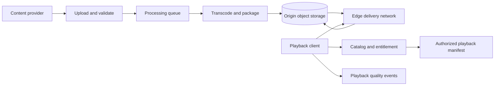
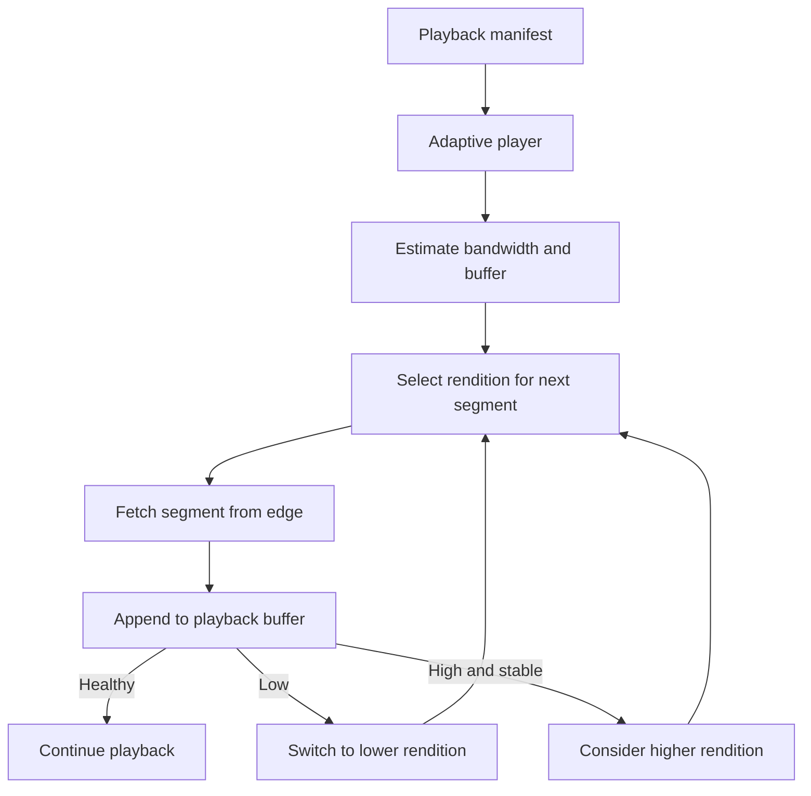
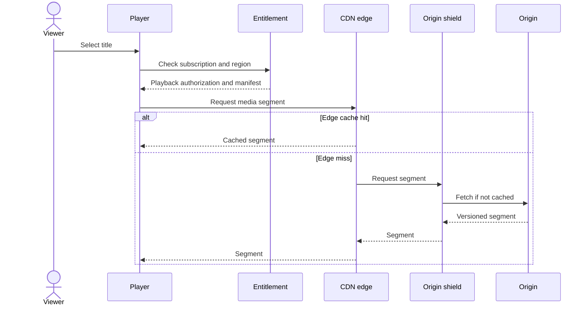
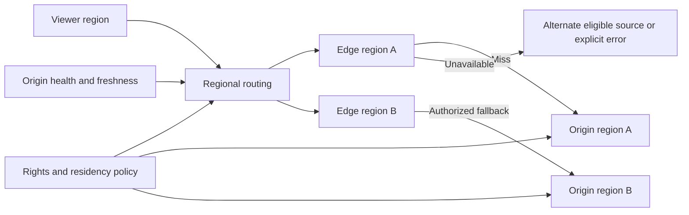
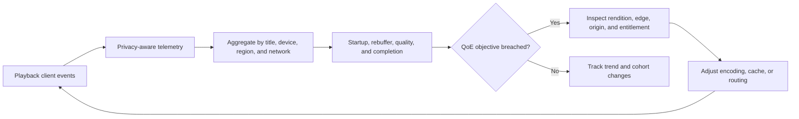

# Video Streaming Platform

Part: [24 — Real-World Architecture Case Studies](PART_OVERVIEW.md)

This case study designs a video platform that ingests content, creates renditions, packages them for playback, distributes them through edge caches, and measures viewing quality. The architecture balances startup time, playback continuity, resolution, rights, and delivery cost. Assumptions: the platform serves on-demand video globally, supports several device classes, and uses a content delivery network (CDN).

## Frame the Ingest-to-Playback Path

Creators upload a source asset and metadata. Ingestion validates the file, rights, and profile; processing creates encoded renditions, manifests, subtitles, and thumbnails. Playback clients request manifests and segments from an origin or edge. Catalog and entitlement services determine what content a user may access; encoding and delivery do not replace those controls.

Processing is asynchronous and should be idempotent by asset version and profile. A failed rendition should not publish an incomplete manifest as ready. Preserve source checksum, rights metadata, processing version, and generated artifact lineage.

## Create an Encoding Ladder and Adaptive Playback

An encoding ladder provides multiple bitrate and resolution choices. The player selects a rendition based on estimated bandwidth, buffer health, device capability, and policy. Higher quality consumes more bandwidth and can increase buffering; lower quality preserves continuity. Segment duration affects startup latency, switching frequency, request overhead, and cache efficiency.

The ladder should match device and network cohorts rather than maximize source fidelity. Validate visual quality, startup time, rebuffering, and bandwidth under representative conditions. A rendition that is rarely selected may add encoding and storage cost without user benefit.

## Serve Through Origin and Edge Caches

The client typically requests a manifest and then many media segments. Immutable, versioned segments are highly cacheable; manifests and entitlement responses may have shorter freshness or user-specific access. Cache keys and token validation must preserve rights boundaries. Origin shielding can reduce repeated cache misses during popular releases.

Keep authorization separate from segment delivery while ensuring access tokens cannot be reused outside their scope and lifetime. Segment caching should not leak one user's entitlement state to another. Part 19 CH02 owns CDN performance trade-offs.

## Protect Regional Availability and Rights

Regional cache or origin failure can affect playback even if the catalog is available. Define origin replication, cache fill, regional routing, and behavior when a content item is unavailable in a jurisdiction. Failover must preserve content rights, encryption, and entitlement constraints; a second region is not automatically an eligible source.

Test origin loss, cache purge, rights expiry, and a title removed during an active session. The platform should prevent new access after revocation within its stated propagation bound while handling in-progress playback according to contract and law.

## Measure Playback Quality of Experience

Quality of Experience (QoE) is a viewer-facing outcome. Measure startup delay, rebuffer frequency and duration, rendition switches, playback errors, completion, and exit behavior by device, region, and network cohort. Correlate events with manifest, encoding, and CDN versions while minimizing personal data.

Do not optimize average bitrate alone. A higher bitrate can worsen rebuffering; a faster startup can still lead to frequent stalls. Treat client telemetry as sampled and potentially biased by device reporting or early exits.

## Worked Case: Live Sports Replay

A major sports event causes a sudden global audience spike. The platform pre-encodes the replay catalog, warms edge caches for likely titles, and scales origin shield capacity. The player starts at a conservative rendition and adapts based on buffer and bandwidth. Entitlement and regional rights remain checked independently of cache warmth.

During a regional origin failure, routing sends requests to an eligible replicated origin. If a title is restricted in that region, the platform returns an explicit unavailable state rather than using an unapproved source. Operations monitors startup time, rebuffering, cache miss rate, origin load, and rights errors by region. Post-event analysis updates encoding ladders and cache-warming policy.

## Review Questions

1. Which artifacts link source media to each playback rendition?
2. How does adaptive playback trade quality against continuity?
3. Which content can be cached broadly and which requires scoped authorization?
4. What rights and freshness checks constrain regional failover?
5. Which QoE indicators reveal a problem that average bitrate misses?

A streaming platform is an end-to-end media pipeline and delivery system. Preserve rights through processing and caching, design the encoding ladder for real networks and devices, and optimize playback outcomes using cohort-specific evidence.
