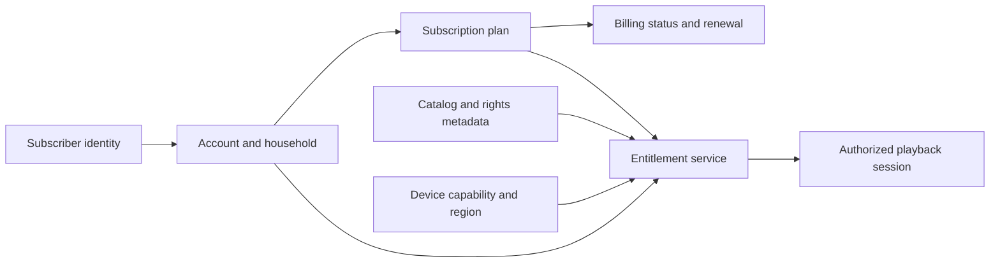
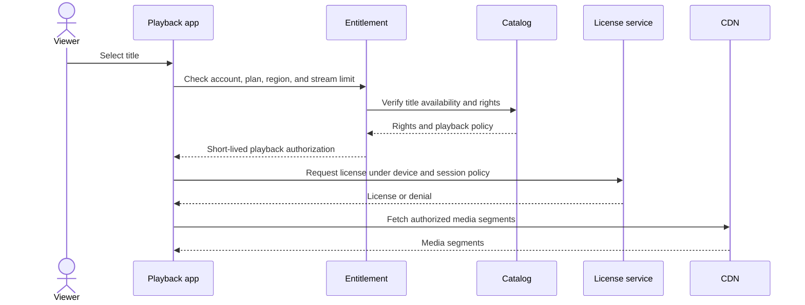
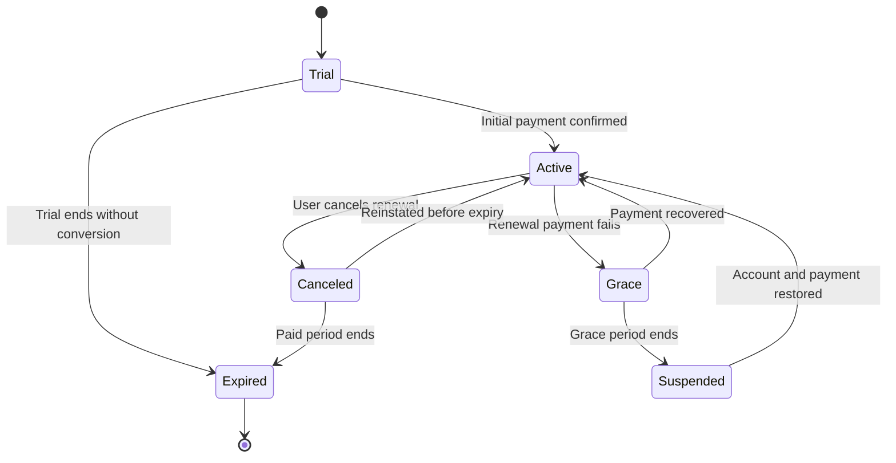
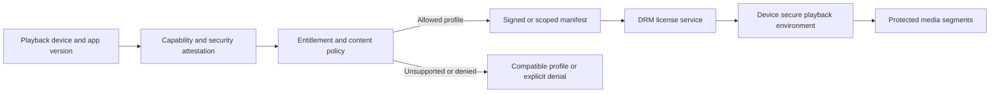
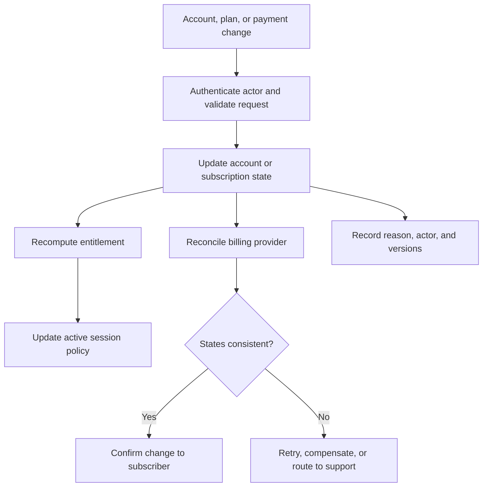

# OTT: Over-the-Top Platform

Part: [24 — Real-World Architecture Case Studies](PART_OVERVIEW.md)

An Over-the-Top (OTT) platform delivers subscription media directly to users across devices and networks. It coordinates identity, plans, entitlement, catalog, playback authorization, content protection, billing, and account lifecycle. Part 24 CH04 owns the general video-ingest and delivery pipeline; this case focuses on subscriber and playback business boundaries.

## Connect Subscriber, Plan, and Entitlement

Identity authenticates a person or household; subscription records plan and billing state; entitlement determines which catalog items a subscriber can access under region, device, and policy constraints. Keep these responsibilities distinct so a billing retry or plan change does not accidentally grant or revoke unrelated identity access.

Entitlement responses should be auditable and short-lived enough to reflect policy changes. Avoid trusting a client-supplied plan, region, or device capability. Define how household sharing, offline downloads, trial expiration, and account recovery affect access.

## Authorize Playback Across Boundaries

Playback authorization checks identity, subscription state, title rights, region, device capability, and concurrent-stream limits. The resulting manifest and key access must remain within those constraints. A valid subscription alone does not authorize every title or device.

Keep playback tokens scoped to title, account, device, and expiry. Separate catalog visibility from playback permission. If an account is suspended or rights are revoked, define how quickly active sessions stop and what evidence is recorded.

## Model Subscription Lifecycle and Billing

Subscription state can include trial, active, grace, suspended, canceled, and expired. Payment failures may initiate retries or a grace period; state transitions should be explicit and driven by verified billing events. Duplicate or delayed callbacks must not create repeated charges or contradictory access.

Reconcile billing-provider status against internal subscription state. Keep payment authorization, capture, refund, and subscription entitlement as related but separate facts. Customer support needs a clear status explanation and a route for disputed charges.

## Respect Device and Content-Protection Boundaries

Devices differ in codecs, screen capability, secure playback support, offline storage, and application version. Digital Rights Management (DRM) license handling and content keys belong in a protected service boundary; keys should not be exposed to application logs or ordinary APIs. Device compatibility selects a playback profile but does not override content rights.

Avoid inferring security from device model alone. Validate supported protocols and attestation where required. Offline playback needs license expiry, renewal, device removal, and account revocation behavior. Retain only device data needed for compatibility and security.

## Reconcile Account and Payment Changes

Account lifecycle includes sign-up, plan changes, household members, device registration, payment updates, cancellation, data access, and account deletion. These workflows cross identity, billing, entitlement, catalog, and playback sessions. Assign one workflow owner and reconcile asynchronous provider and client events.

Define what happens when billing succeeds but entitlement update fails, or when cancellation races with renewal. Use idempotency keys and explicit pending states. Never acknowledge account deletion until retention and legal-hold obligations are evaluated.

## Worked Case: Family Subscription on a New Device

A family subscriber signs in on a new television. Identity verifies the account; the device registers under household policy; the catalog returns available titles; entitlement checks plan, region, stream limit, and title rights. Playback obtains a short-lived authorization and a DRM license before fetching media segments.

The device lacks a preferred codec, so the player selects a compatible rendition without changing access policy. If the account is at its concurrent-stream limit, the service explains the restriction and offers account management rather than silently evicting another user. A later plan downgrade changes entitlement at the next defined billing boundary and is propagated to active sessions under a documented grace rule.

## Review Questions

1. Which service owns subscription state versus playback entitlement?
2. How are catalog availability and authorization distinguished?
3. What happens when billing and internal account state diverge?
4. How do device capability and DRM affect the trust boundary?
5. Which account changes invalidate or constrain active sessions?

An OTT platform is a coordinated subscription and playback system. Keep identity, billing, catalog, and entitlement boundaries explicit; enforce rights at playback and license paths; and reconcile account changes without granting access from stale or client-asserted state.
