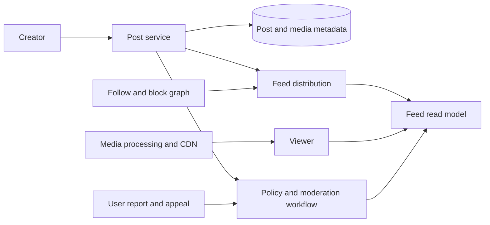
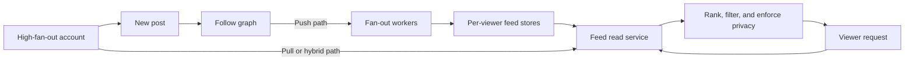
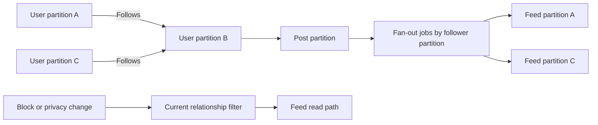
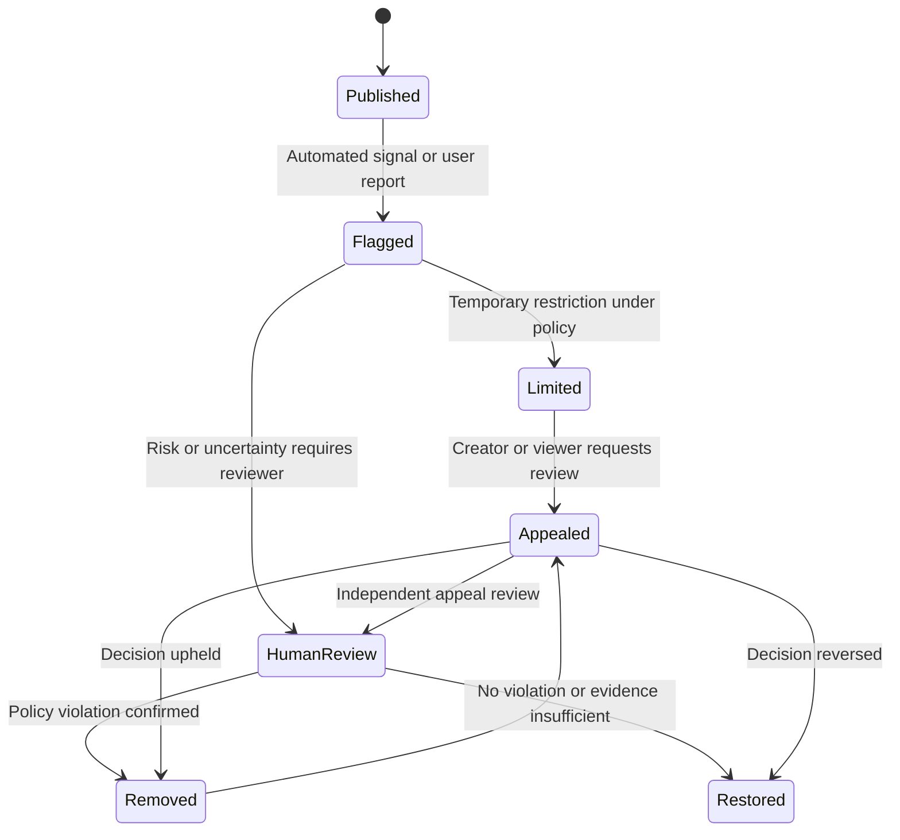
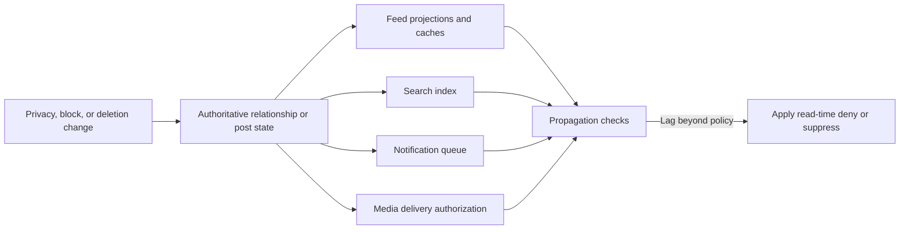

# Social Media Platform

Part: [24 — Real-World Architecture Case Studies](PART_OVERVIEW.md)

This case study designs a social platform for creating posts, following accounts, viewing feeds, moderating content, and controlling privacy. Workloads differ sharply: post writes, graph traversal, feed reads, media delivery, moderation, and notifications have different latency and scale needs. Assumptions: the platform serves public and private accounts, supports text and media, and provides user reporting and appeals.

## Frame Product and Quality Constraints

The architecture should balance feed freshness, relevance, availability, privacy, moderation quality, and operating cost. Define what “fresh” means for a new post, which relationships are authoritative, how private content remains restricted, and how moderation decisions can be appealed. Measures include post publication latency, feed freshness, read latency, report response time, false positive and false negative review outcomes, and privacy incidents.

Separate content storage from feed projection and moderation state. A post may be visible, limited, removed, or under appeal; feed reads must honor current privacy and policy state, not just cached ranking data.

## Choose Push or Pull Feed Generation

Push fan-out writes a new post into follower feed stores at publish time. It gives fast reads but can create enormous write amplification for accounts with many followers. Pull-on-read fetches followed accounts at request time, reducing write work but increasing read fan-out and latency. Hybrid designs apply push to ordinary accounts and pull or defer high-fan-out accounts.

Choose the strategy by follower distribution, freshness target, storage cost, and deletion/privacy requirements. Hybrid systems need a consistent merge of pushed and pulled candidates with deduplication and ranking. A new block or private-account change must invalidate or filter existing feed entries.

## Partition the Social Graph and Content

The graph contains directed relationships such as follows, blocks, and mutes. Partitioning by user can localize profile operations but makes large follower fan-out expensive. Partition by region or shard key while considering hot accounts, high-degree nodes, and cross-partition traversal. Preserve a clear source of truth for relationship changes.

Do not trust stale feed materialization for access control. Apply privacy and block policy at read time or guarantee invalidation within the product's safety requirement. Hot accounts may need special treatment, but avoid making them a shared bottleneck.

## Moderate Content and Support Appeals

Moderation can include automated classifiers, user reports, human review, policy enforcement, and appeal. Separate detection from final enforcement authority where the consequences warrant it. Decisions should be traceable to policy version, evidence, reviewer, and affected content. Provide a recovery path for mistaken removal.

Different content classes need different response deadlines. Track queue age and error rates by policy category and language. A moderation backlog can become a safety and availability issue; define prioritization, escalation, and emergency restriction authority.

## Propagate Privacy and User Controls

Privacy settings affect visibility, search, feeds, notifications, exports, caches, and analytics. A change to a private account, block, or deleted post must reach all derived surfaces. Define propagation targets, time bounds, and behavior while replicas or feeds are stale. Data minimization and retention apply to moderation evidence as well as public content.

Revocation should not depend only on eventual deletion from every cache. Where appropriate, apply a current authorization check at read time while asynchronous cleanup completes. Keep the source of truth and propagation owner explicit.

## Worked Case: New Privacy Setting

A user changes an account from public to private. The relationship service records the change with a version. Feed reads filter against current privacy state while fan-out jobs stop creating public entries. Search, recommendation candidates, and pending notifications are invalidated or suppressed. The UI communicates when the change is effective across the system.

The team tests offline consumers, stale replicas, high-fan-out accounts, and cached media URLs. Metrics include propagation latency, denied stale reads, notification suppression, and support reports. Moderation and legal evidence follow separate retention rules and are not automatically erased with public feed content.

## Review Questions

1. Which traffic patterns favor push, pull, or hybrid feed construction?
2. How do high-degree graph nodes affect partitioning and fan-out?
3. Which control remains authoritative when feed projections are stale?
4. How do moderation decisions and appeals become traceable?
5. Which derived systems must respond to a privacy or deletion change?

Social platform architecture combines graph, feed, media, moderation, and privacy systems. Select feed strategies from workload distribution, enforce current policy across derived views, and make moderation and appeals traceable without turning a single ranking service into the entire design.
