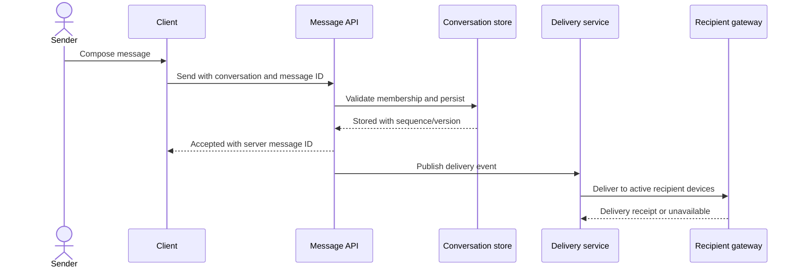
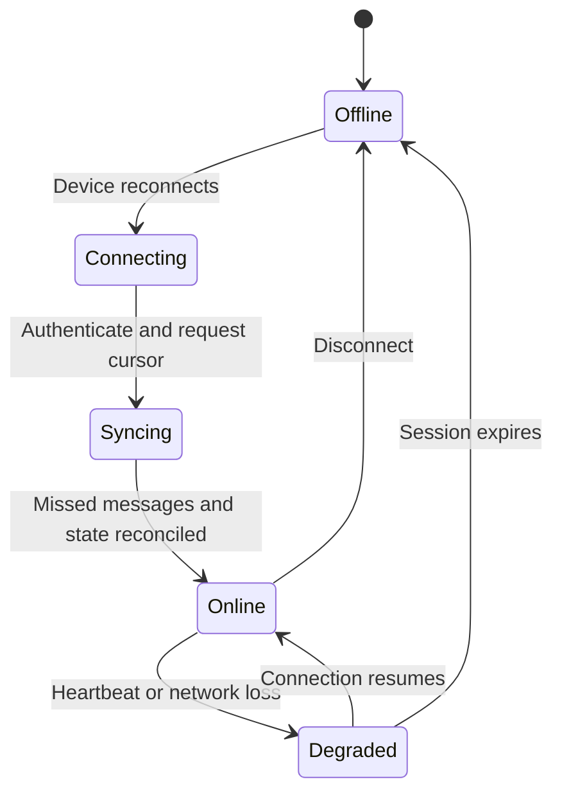
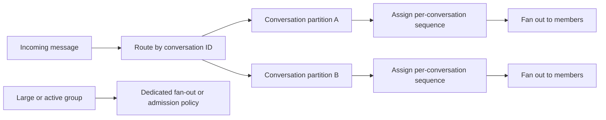
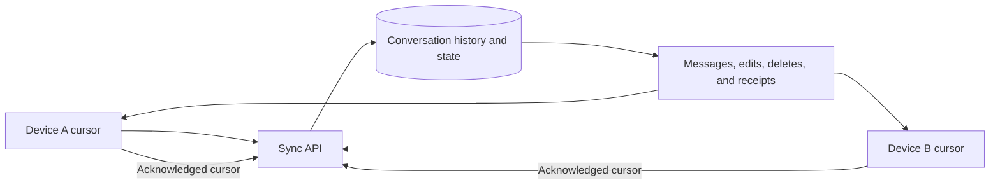
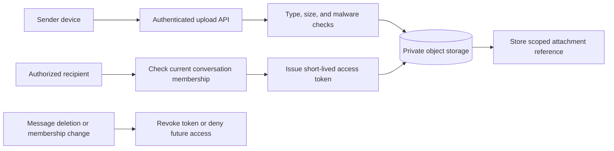

# Chat Application

Part: [24 — Real-World Architecture Case Studies](PART_OVERVIEW.md)

This case study designs a multi-device chat system with durable messages, real-time delivery, presence, read state, and attachments. The architecture must distinguish message persistence from connection delivery and define what ordering, acknowledgement, and offline behavior users can expect. Assumptions: conversations have explicit membership, clients may be disconnected for long periods, and attachments use object storage.

## Separate Message Persistence From Delivery

The sender submits a message with a client-generated idempotency key. The service authenticates membership, persists the message, and then publishes it to recipient connection gateways or offline queues. A server acceptance indicates durable receipt under the service contract; it does not necessarily mean every recipient device has displayed the message.

Persist before fan-out so a gateway outage does not lose accepted messages. Define when a sender sees sent, delivered, and read states, and avoid conflating them. Eventual delivery should be visible in product behavior.

## Model Online and Offline Delivery

Connection gateways maintain active device sessions, while durable storage remains the source of truth. A disconnected device can fetch missed messages on reconnect using a cursor or sequence. Presence is an expiring observation, not proof that a user is reading. Reconcile device state after reconnect and handle duplicate delivery idempotently.

Set limits on offline queue retention and device synchronization. If history is truncated, communicate that explicitly. Device removal or account revocation should invalidate sessions and attachment access according to security policy.

## Partition Conversations and Preserve Required Order

Partitioning by conversation can preserve an ordering domain while allowing separate conversations to scale. A global sequence across all conversations is usually unnecessary. Hot group conversations, large fan-out, and message edits or deletes create different load patterns. Define whether order is strict, per conversation, or best-effort across devices.

Conversation membership and authorization must be checked at send and read time. A stable partition key can create hot spots; monitor per-conversation load and choose a safe strategy for exceptional groups rather than weakening ordering for every conversation.

## Synchronize Multiple Devices

Each device maintains a cursor for messages and conversation state. The service returns changes after that cursor and advances it only after the client safely applies them. Read receipts and edits are separate state changes that may arrive out of order. Define conflict rules for offline drafts and concurrent edits.

Avoid treating device-local state as authoritative. When a client falls too far behind, use a bounded resynchronization path. Preserve edit/delete semantics across devices and ensure a revoked user cannot fetch older messages through a stale cursor or cache.

## Protect Attachment Access

Attachments are large, separate objects with their own scanning, retention, authorization, and delivery path. Store metadata and a scoped reference with the message, then issue time-bounded access only to authorized conversation members. Do not expose a public object URL that bypasses membership or deletion policy.

Define encryption, key management, content scanning limits, and deletion behavior. End-to-end encryption can constrain server-side scanning and recovery; if required, model the trade-off explicitly rather than claiming both incompatible guarantees.

## Worked Case: Group Conversation on a New Device

A user signs in on a new phone and opens a group conversation. The service verifies membership, syncs messages after the device cursor, and returns attachments through short-lived scoped tokens. A large group uses asynchronous fan-out; the sender receives a durable-acceptance response while per-device delivery updates separately.

If the user is removed while offline, the service denies subsequent sync and attachment requests despite the stale local conversation. A message retry with the same client ID returns the original server message rather than creating a duplicate. The product exposes sent, delivered, and read as distinct states and communicates history limits on a newly registered device.

## Review Questions

1. What does the server's acceptance acknowledgement guarantee?
2. Which state is durable, and which is an expiring connection observation?
3. What ordering domain does a conversation require?
4. How do devices resume after being offline or revoked?
5. How are attachments authorized and deleted independently of message metadata?

Chat architecture must preserve durable message state while handling transient connections and devices. Keep delivery acknowledgements distinct, scope ordering by conversation, synchronize through explicit cursors, and enforce membership on both messages and attachments.
