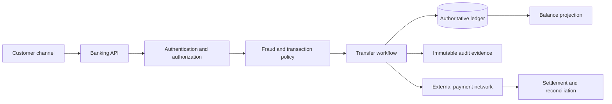
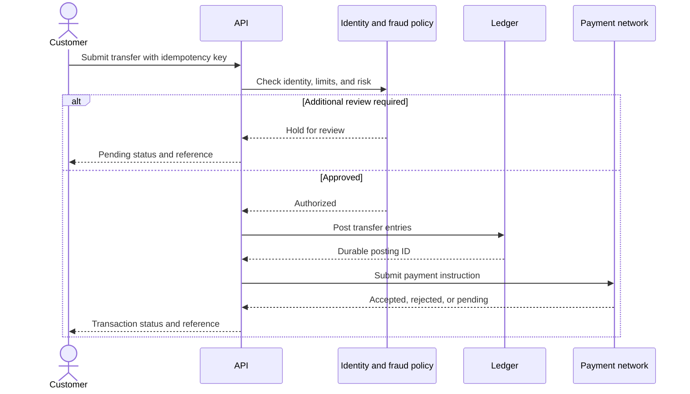
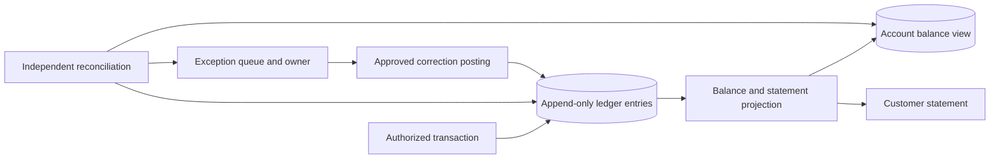
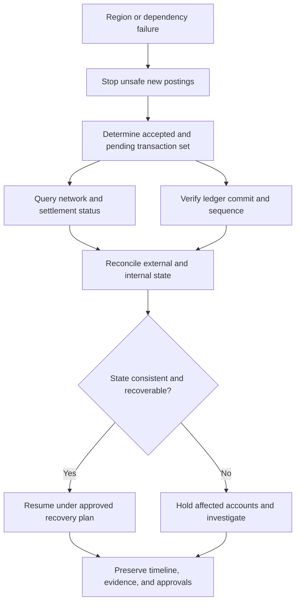
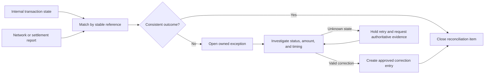

# Banking System

Part: [24 — Real-World Architecture Case Studies](PART_OVERVIEW.md)

This case study designs a banking transaction path spanning customer channels, identity, authorization, ledger posting, balance views, fraud controls, reconciliation, and legacy integration. Correctness, auditability, availability, privacy, and regulatory obligations shape the architecture. Assumptions: the bank serves retail accounts, processes domestic transfers, and operates a legacy core with defined maintenance windows.

## Frame the Transaction and Invariants

Separate customer intent from an accepted transaction. The system authenticates the caller, validates account and transfer rules, applies fraud and risk policy, posts ledger entries, and returns a durable transaction identifier. The ledger is authoritative; balance views and statements may be derived but need reconciliation and freshness contracts.

Define invariants before selecting components: no unauthorized debit, balanced postings, idempotent request handling, a durable outcome for accepted transfers, and an auditable path for corrections. A response timeout does not mean the transaction failed; expose pending or unknown status and allow safe reconciliation.

## Post Transactions and Handle Risk

Authorization, fraud review, and ledger posting have different responsibilities. A high-risk transfer may require a hold or manual review; an approved transaction posts to the ledger under a transaction identifier and records policy decisions. Do not allow a fraud model or external provider response to modify ledger state without the authoritative workflow.

Define whether ledger posting precedes or follows external network acceptance and how compensation works. Reversals should be new auditable entries, not edits to historical postings. Protect idempotency keys and bind them to the authenticated customer and transfer parameters.

## Derive Balances and Statements From Ledger Evidence

Balance projections can improve read performance but may lag. Statements and operational views should identify their source version and reconcile to the ledger. A mismatch needs a controlled exception path; silently replacing ledger truth with a cache or projection undermines financial control.

Reconciliation should compare expected and observed totals across time windows and external settlement reports. An exception queue needs severity, age, owner, evidence, and resolution authority. Corrections preserve original entries and link to the reason and approver.

## Preserve Audit and Recovery Continuity

Audit evidence must survive application failure and support investigation without exposing unnecessary data. Link customer identity, authorization, policy version, request ID, ledger posting, external reference, and operator action. Recovery procedures must reconcile uncertain external outcomes before retrying and maintain ordering for account-sensitive operations.

Recovery must prioritize correctness over rapid but uncertain replay. Define who can resume posting, what conditions block a region, and how customers are informed. Test restore and reconciliation procedures with realistic transaction volume and controls.

## Reconcile and Handle Exceptions

Settlement, reversals, chargebacks, and network timeouts are distinct flows. A transfer may be accepted internally but rejected externally, or accepted externally while the response is lost. Reconcile using stable transaction identifiers and retain evidence from both systems. Do not infer failure from a timeout alone.

Establish a service-level target for exception resolution and escalation. Corrections require dual control or other approval when policy dictates. Reconciliation evidence should be retained according to regulatory and privacy requirements.

## Worked Case: Delayed Interbank Transfer

A customer submits a transfer. The bank authenticates the request, checks limits and fraud signals, posts the debit/credit entries, and submits an instruction to the payment network. The network response times out. The API returns a pending status with a transaction reference rather than asking the customer to resubmit.

An asynchronous reconciliation queries the network and settlement report. A successful transfer advances the internal status. The balance projection then updates. If the transfer failed before acceptance, an approved reversal entry restores the balance. If status remains unknown, the transaction stays held for operations rather than being duplicated. Every step is traceable to the original request, policy decision, ledger posting, and network reference.

## Review Questions

1. Which system is authoritative for financial state?
2. What does a client timeout mean when an external payment result is unknown?
3. How are balance projections reconciled to ledger entries?
4. Which actions require explicit approval or dual control?
5. What evidence allows safe recovery without duplicate posting?

Banking architecture protects transaction correctness across internal and external boundaries. Keep the ledger authoritative, separate policy from posting, make uncertain outcomes explicit, and preserve audit and reconciliation evidence through failure recovery.
