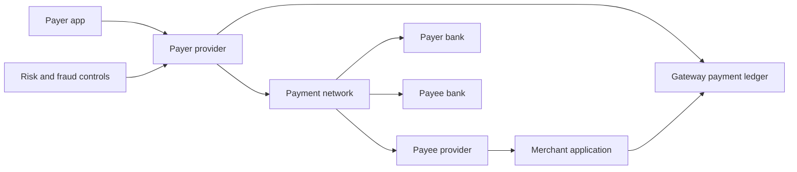
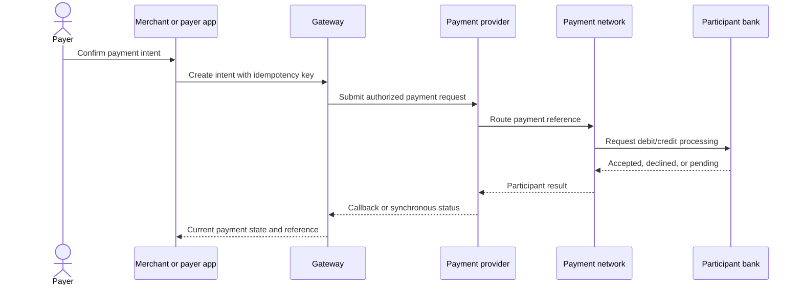
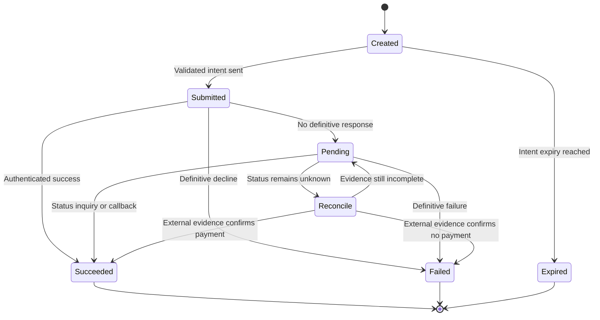
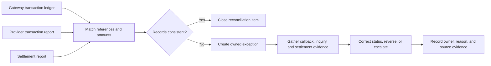
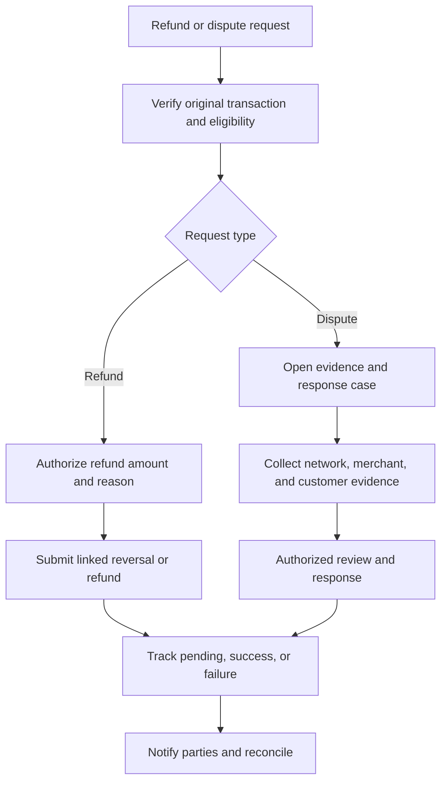

# UPI Payment Gateway

Part: [24 — Real-World Architecture Case Studies](PART_OVERVIEW.md)

Unified Payments Interface (UPI) enables real-time account-to-account payments through participating payment applications, providers, banks, and network infrastructure. A gateway or application provider coordinates payment intent, authentication, routing, callbacks, status inquiry, and reconciliation without treating a timeout as a definitive failure. This case is an architecture model; participant obligations and current network rules must be verified against applicable specifications and contracts.

## Define Participants and Trust Boundaries

Participants may include payer and payee applications, a provider or payment service provider (PSP), a payment network, payer and beneficiary banks, and merchant systems. Each boundary has distinct credentials, data, availability, and support responsibility. Do not store a user's authentication secret or assume that an application callback proves bank settlement.

The gateway records its own payment state and references to external participants. It does not become the financial system of record for bank balances. Minimize personal data and protect identifiers, device information, and callback secrets under the applicable policy.

## Initiate and Route a Payment

A payment intent should include a stable client and gateway reference, amount, currency, payer/payee handles, expiry, and purpose. The payer authenticates through the authorized payment flow; the gateway routes a signed or otherwise authenticated request through its participant boundary. A response may be immediate, pending, or unknown.

Authentication and authorization boundaries must be explicit. The gateway should validate amount and merchant state, prevent client tampering, and avoid recording sensitive authentication material. A successful callback should be authenticated, correlated to the intent, and idempotently applied.

## Model Timeout, Retry, and Idempotency

Payment states should distinguish created, submitted, pending, succeeded, failed, expired, and under-reconciliation. A network timeout can mean the request never arrived or that processing completed without a response. Reconcile by stable reference before retrying; blindly resubmitting can duplicate a debit.

Use idempotency keys at the gateway and preserve the external transaction reference. Separate user retry from backend retry; retries must honor deadlines and network rules. Late callbacks can arrive after the user sees pending or closes the app, so state transitions must be monotonic and auditable.

## Reconcile Settlement and Exceptions

The gateway compares its transaction records with provider and bank settlement reports. Differences can arise from delayed callbacks, reversals, duplicate submissions, settlement timing, or fees. Reconciliation should match stable references and amount, detect missing or duplicate entries, and route exceptions to an owner.

Settlement timing is distinct from real-time authorization status. Define financial close boundaries and escalation targets. Corrections should preserve the original transaction and add a linked adjustment rather than silently overwrite history.

## Handle Refunds and Disputes

Refunds and disputes are separate workflows with their own eligibility, amount, authority, and timelines. A refund request should reference the original payment and remain idempotent. A dispute needs evidence, communication, ownership, and a clear state visible to support and finance teams.

Separate the person requesting a refund from the authority approving it. Preserve evidence with access controls and retention. If a refund times out, reconcile before resubmitting; do not infer failure from missing UI confirmation.

## Worked Case: Merchant Checkout Timeout

A customer confirms a merchant checkout. The gateway creates an intent and submits it, but the response times out. The merchant app shows “processing” and does not create a second intent. A status inquiry finds that the payment succeeded; the gateway updates the original reference and notifies the merchant. If no definitive result is available within the product's support window, the transaction enters reconciliation rather than an automatic duplicate retry.

The merchant later requests a partial refund. The gateway validates the original transaction, records the reason and actor, and submits a linked refund. A settlement mismatch creates an owned finance exception with provider references and a status deadline. The customer receives clear pending and final states.

## Review Questions

1. Which participants own authentication, routing, and financial records?
2. What does a timeout mean when external payment status is unknown?
3. How do idempotency and status inquiry prevent duplicate payments?
4. Which reconciliation sources confirm settlement?
5. How do refund and dispute workflows preserve authority and evidence?

UPI gateway architecture must represent multiple authorities and uncertain outcomes. Separate intent, processing, settlement, refunds, and disputes; preserve stable references; and reconcile before retrying any operation that could move money.
