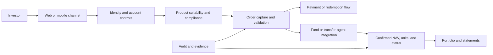
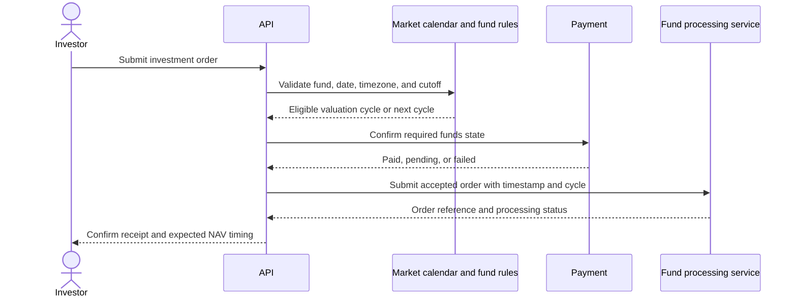
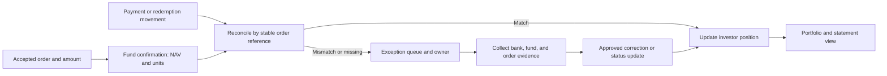
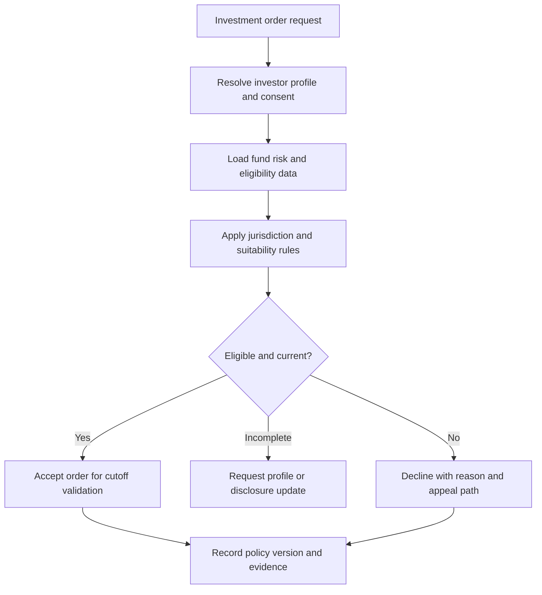
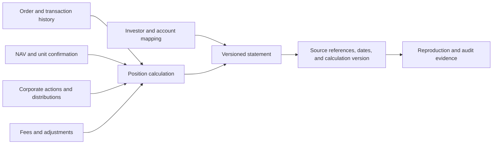

# Mutual Fund Platform

Part: [24 — Real-World Architecture Case Studies](PART_OVERVIEW.md)

This case study designs an investment platform for mutual-fund orders, valuation, payments, portfolio views, and statements. The architecture must respect market cutoffs, suitability rules, fund-specific valuation timing, money movement, and audit requirements. Assumptions: investors can place purchase, redemption, and switch orders through digital channels, while an external transfer agent or fund service provides confirmed processing outcomes.

## Frame Investor and Order Lifecycle

An investment order is not complete when a client clicks submit. The system authenticates the investor, validates account and product suitability, captures payment or redemption instructions, submits the order before the applicable cutoff, and tracks confirmation, units, and settlement. Statuses should make pending external processing visible.

Keep order acceptance, fund acceptance, NAV assignment, and settlement as distinct milestones. A payment success does not prove an investment order was accepted. Provide a durable order reference and explain which external confirmation is pending.

## Apply Cutoff and NAV Timing

Orders received before or after a cutoff may receive different valuation dates depending on product and jurisdiction. The system should use an authoritative market calendar, timezone, fund rules, payment status, and validated receipt timestamp. Do not infer cutoff eligibility from client device time.

Define behavior when payment confirmation arrives near a cutoff, the calendar is unavailable, or an order is corrected. Preserve the source timestamp, applicable rule version, and reason for the assigned valuation cycle.

## Reconcile Units, Cash, and Confirmations

The platform receives external confirmations for NAV, units, fees, and settlement. Internal estimates should not overwrite confirmed outcomes. Reconcile order references and amounts across payment, fund processing, cash movement, and portfolio records; route mismatches to an owned exception queue.

Corrections should preserve original records and link the adjustment to its evidence and approver. Reconciliation targets should account for fund calendars and external partner delays. A user-facing portfolio should distinguish estimated, pending, and confirmed values.

## Enforce Suitability and Compliance Controls

Suitability decisions depend on investor profile, product rules, risk disclosures, and jurisdiction. Version the inputs and policy used at order time. Keep suitability separate from product ranking or marketing. A failed or expired profile should block, defer, or request updated information according to policy.

Only authorized roles should override a control, and the override needs rationale and audit. Data retention should distinguish order evidence, investor profile, financial records, and optional analytics.

## Preserve Statement Lineage

Portfolio statements combine orders, confirmations, corporate actions, fees, prices, and account identity. Track source, effective date, transformation, and version for each displayed value. A statement should be reproducible enough to explain a prior position without silently applying today's fund rules to historical transactions.

Maintain lineage for both current and corrected statements. If a source confirmation changes, identify affected accounts and statements, notify owners, and produce a corrected version rather than overwriting historical evidence.

## Worked Case: SIP Purchase Near a Cutoff

An investor schedules a recurring purchase whose payment confirmation arrives near the fund cutoff. The platform records the scheduled instruction, applies current suitability, and submits only after payment status and market calendar rules are confirmed. If confirmation misses the cutoff, the order receives the next eligible valuation cycle and the investor sees a pending state.

The external fund service later confirms NAV and units. Reconciliation matches the payment, accepted order, and confirmation by stable reference. A mismatch enters an exception queue rather than changing the displayed balance silently. The statement records the valuation date, units, fees, and source version.

## Review Questions

1. Which timestamps and rules determine valuation-cycle assignment?
2. How do payment confirmation and fund acceptance differ?
3. What stable references link order, cash, units, and statement records?
4. Which suitability data and policy version support the order decision?
5. How are corrected statements and historical evidence handled?

A mutual-fund platform must distinguish intent, payment, fund acceptance, valuation, units, and settlement. Preserve cutoff and suitability evidence, reconcile every external confirmation, and maintain lineage for statements and corrections.
