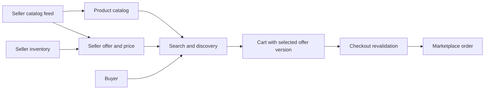
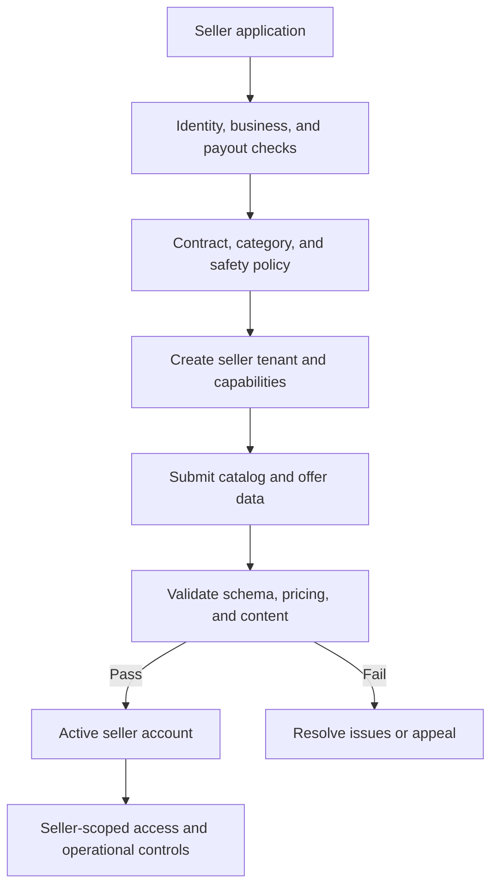
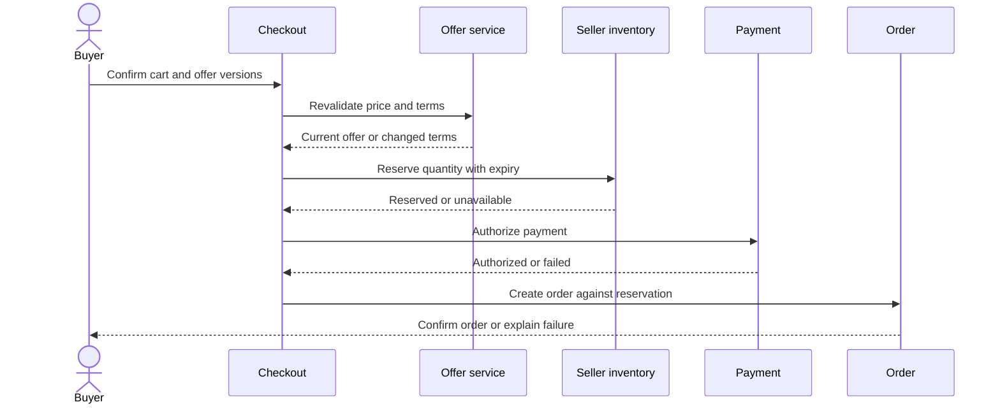
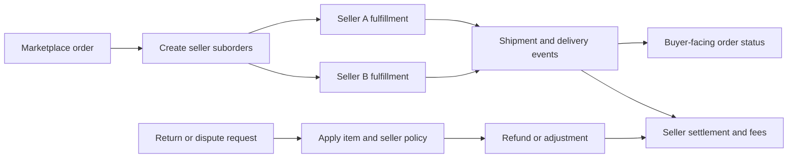
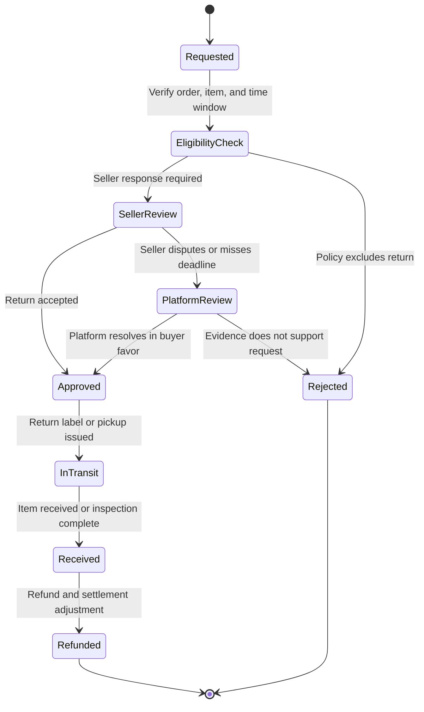

# E-commerce Marketplace

Part: [24 — Real-World Architecture Case Studies](PART_OVERVIEW.md)

This case study designs a marketplace where multiple sellers list offers to buyers and fulfill orders under shared platform policies. The architecture coordinates catalog discovery, seller-specific price and availability, checkout, payment, fulfillment, settlement, returns, and seller isolation. A marketplace differs from a single-retailer store because the platform must govern independent seller data and responsibilities.

## Trace the Browse-to-Purchase Journey

Catalog data, seller offers, inventory, pricing, and policy are related but separately owned. Search can return a product with several seller offers; checkout must bind the buyer to one offer version and revalidate price and availability before creating the order.

Keep global product identity distinct from seller-specific offers. A product may have many offers with different condition, price, delivery promise, and return terms. Store version references so a later dispute can reconstruct what the buyer saw at checkout.

## Model Seller Onboarding and Isolation

Seller onboarding establishes identity, catalog permissions, fulfillment model, payout details, and policy obligations. Tenant isolation applies to data, operational tools, and analytics. The platform should prevent one seller from reading another seller's customer or inventory data while still providing cross-seller marketplace discovery under controlled rules.

Seller status changes should affect offers, active listings, payouts, and support cases consistently. A suspended seller may require new purchases to be blocked while existing orders continue under a defined customer-protection policy.

## Reserve Inventory and Revalidate Checkout

Inventory reservation prevents oversell when several buyers purchase the same offer concurrently. The reservation must be bounded by a timeout and tied to an offer version. If price or fulfillment terms change, show the buyer the updated terms before confirmation.

If payment fails, release the reservation. An uncertain order result needs reconciliation by checkout and reservation identifiers before any retry. Do not hold inventory indefinitely while awaiting a client response.

## Coordinate Order Fulfillment and Settlement

Multi-seller orders require split fulfillment and payment allocation. The platform tracks a customer-facing order while seller suborders progress independently. Cancellation, partial shipment, return, refund, and seller payout must reconcile to both the buyer and seller view.

Maintain a clear relationship between parent order and suborders. A seller failure should not erase completed items from another seller. Define how platform fees, refunds, chargebacks, and settlement holds work for partial completion.

## Handle Returns and Policy Disputes

Returns can differ by product category, seller, condition, and delivery status. The platform needs a policy decision, evidence, seller response, customer communication, and financial adjustment. A seller disagreement should route to an accountable marketplace operator; policy must not be inferred from free-form seller text at decision time.

Retain only necessary evidence and define appeal and retention periods. Status should distinguish approval from refund completion. Audit decisions and policy versions for later dispute resolution.

## Worked Case: Multi-Seller Checkout

A buyer selects two items from different sellers. Checkout locks the offer versions, revalidates delivery promises, and reserves each seller's stock independently. Payment is authorized once under the platform's payment policy; the order service creates seller suborders and tracks shipment events separately. If one seller cannot fulfill, the buyer retains the other item and receives a policy-governed adjustment for the failed portion.

The architecture records seller ownership, offer version, inventory reservation, payment reference, and settlement split. A seller suspension blocks new offers but does not silently cancel an in-flight shipment. Operations can investigate each suborder and reconcile the parent order's customer status.

## Review Questions

1. How do product identity and seller offers differ?
2. Which data and actions require seller isolation?
3. How does checkout prevent stale price or oversold inventory?
4. Which states belong to a parent order versus seller suborders?
5. How are returns, refunds, and seller settlement reconciled?

A marketplace architecture must coordinate independent sellers without obscuring who owns each offer, inventory record, fulfillment, and payout. Bind checkout to validated offer versions, reserve stock safely, and model partial completion and disputes as explicit workflows.
