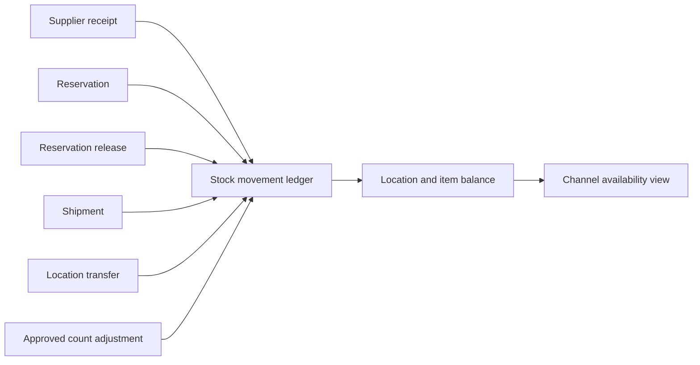
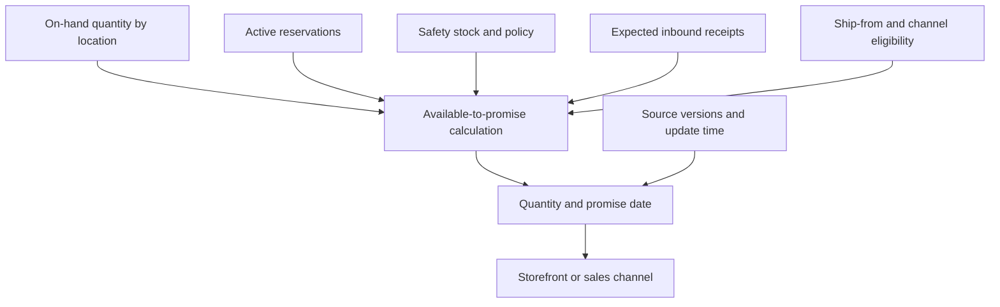
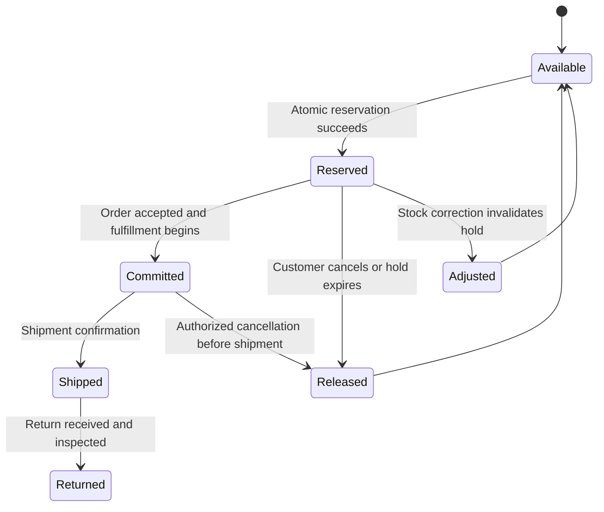
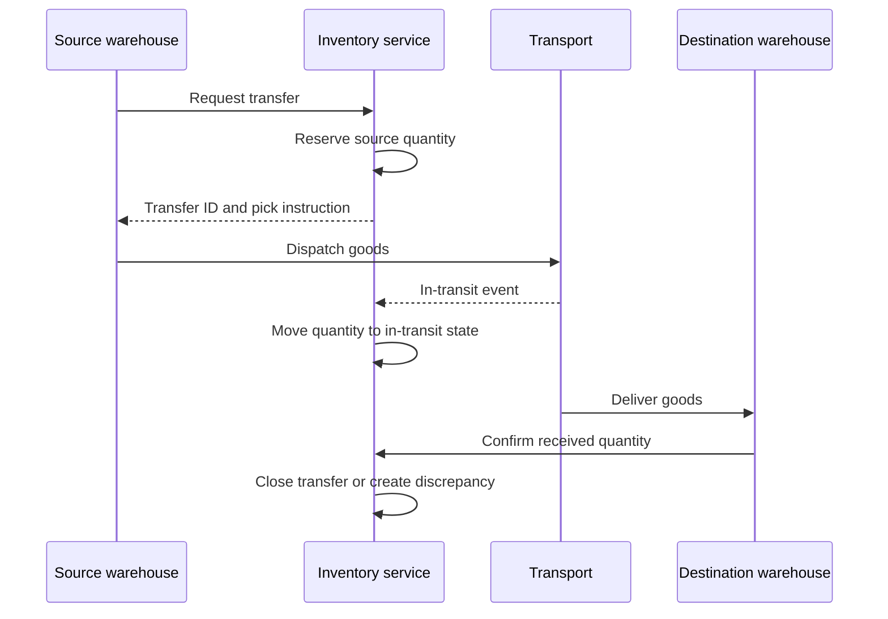
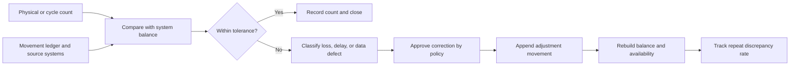

# Inventory Management

Part: [24 — Real-World Architecture Case Studies](PART_OVERVIEW.md)

This case study designs inventory management across warehouses, stores, and sales channels. The architecture tracks physical stock, reservations, movements, adjustments, and an availability view. The challenge is preventing oversell while keeping channel availability fresh and recovery traceable. Part 06 owns database and storage mechanics; Part 19 owns performance methods.

## Model Stock as Movements and State

Represent inventory changes as attributable movements: receipt, reservation, release, shipment, transfer, count adjustment, and return. A current balance is a derived view of those movements and may be reconciled against physical counts. Preserve location, product, quantity, reason, source, and transaction reference.

The ledger and balance view have distinct purposes. The ledger records evidence and correction history; the balance supports operational queries. Define which service may create each movement and how duplicate events are detected. Do not let storefronts directly decrement stock without an authoritative reservation contract.

## Calculate Available-to-Promise

Available-to-promise (ATP) is not simply on-hand quantity. It may account for reservations, safety stock, expected receipts, location eligibility, channel policy, and freshness. The formula is domain-specific; show the inputs and authority that produce the promise.

Display freshness or uncertainty when data is delayed. A stale positive availability can create an oversell; a stale zero can suppress valid sales. The channel contract should define when it can show an estimate and when it must confirm with the authoritative reservation service.

## Reserve Inventory Safely

Reservation prevents concurrent checkouts from claiming the same units. It should have an owner, expiry, quantity, location, order reference, and idempotency key. Expiry releases abandoned holds; the checkout must revalidate before committing shipment. The inventory service should return an explicit conflict or alternative location when stock is unavailable.

Avoid a gap between successful payment and failed reservation by defining ordering and compensation. If payment is authorized first, handle reservation failure through a defined release or refund path. If inventory is reserved first, expiry and abandoned checkout behavior must be correct. Repeated requests should reuse the same reservation result.

## Coordinate Transfers Between Locations

A transfer has source, destination, quantity, carrier or movement reference, and intermediate state. Stock should not appear in both locations during transit. Define in-transit ownership, receipt confirmation, partial delivery, loss, and cancellation. Cross-location availability may be estimated, but a transfer is not complete until receiving inventory confirms it.

Use stable transfer IDs and separate dispatched from received quantities. A missed arrival event should trigger reconciliation rather than duplicate movement. Regional or store systems may work offline; provide a controlled sync and conflict-resolution path.

## Detect and Correct Discrepancies

Cycle counts, returns, damaged goods, and integration failures create differences between system and physical stock. Reconcile by item and location, classify cause, require approval for material adjustments, and preserve both original and corrected evidence. Repeated discrepancy patterns can reveal process or integration failures.

Do not overwrite the balance without recording a reason and source. Corrections should propagate to channel availability and open reservations under defined rules. Alert on unexpected high adjustment volume or unresolved age.

## Worked Case: Marketplace Flash Sale

A limited-release product is sold through the web, mobile app, and marketplace partners. All channels query a shared availability view but must reserve through the same authority. The platform partitions stock by location and uses atomic reservations with short expiry. A channel may display an estimate, then confirm the reservation during checkout.

During the sale, two channels race for the final units. One reservation succeeds; the other receives an explicit unavailable response and may offer another location. A delayed partner callback is deduplicated by request ID. After shipment, cycle count reveals one missing unit; an approved adjustment updates the ledger and identifies a warehouse process gap. The team measures reservation conflicts, stale availability, adjustment rate, and checkout latency.

## Review Questions

1. Which movements change authoritative stock and who can create them?
2. What inputs define ATP and how fresh are they?
3. How do reservations expire and remain idempotent?
4. Which states prevent double-counting stock during transfer?
5. How are discrepancies corrected and investigated?

Inventory architecture makes stock ownership, reservation, movement, and correction explicit. Separate source movements from derived availability, make reservations authoritative across channels, and reconcile physical and digital state without erasing history.
