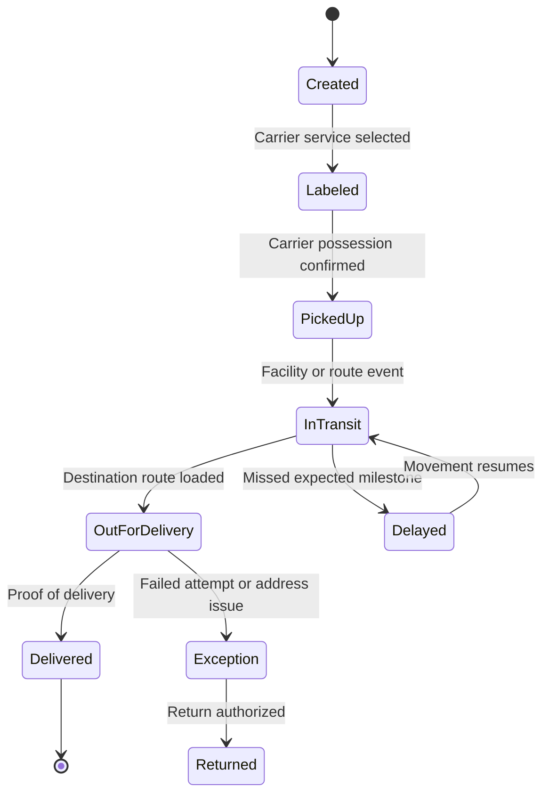
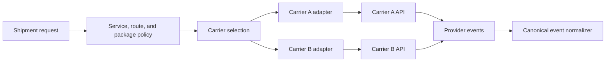
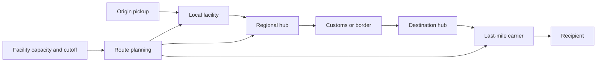
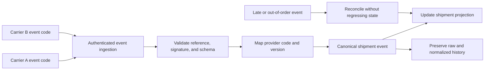
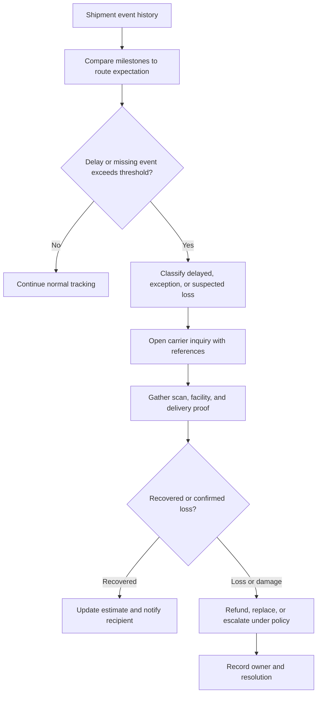

# Logistics Platform

Part: [24 — Real-World Architecture Case Studies](PART_OVERVIEW.md)

This case study designs a logistics platform that creates shipments, selects carriers, coordinates facilities and routes, ingests tracking events, and resolves exceptions. It must present a coherent shipment state while carriers report different vocabularies, frequencies, and reliability. Assumptions: the platform supports multiple carriers, domestic and cross-border paths, and customer-visible delivery estimates.

## Model the Shipment Lifecycle

A shipment passes through creation, label purchase, pickup, facility processing, line-haul, delivery attempt, proof of delivery, and possible exception or return. Carrier events are evidence about shipment state, not necessarily the complete source of truth. Keep the platform's normalized shipment status linked to raw carrier events and source timestamps.

Define which transitions are inferred from carrier scans, customer actions, or internal timers. A missing event may mean delayed ingestion, not a stationary shipment. The customer-facing estimate should communicate uncertainty when tracking evidence is stale.

## Integrate Multiple Carriers Through Adapters

Carrier adapters translate platform requests and provider-specific responses. Rate, label, pickup, tracking, cancellation, and proof-of-delivery capabilities may differ. Maintain a capability map so routing does not choose a carrier that cannot satisfy a shipment's customs, delivery window, or service requirement.

Keep provider credentials and payloads isolated. Store the provider's transaction reference and request ID for support. An adapter should not erase distinctions that matter to delivery promises or billing; represent unsupported capabilities explicitly.

## Plan Routes and Facility Handoffs

Routes connect origin, sorting facilities, hubs, customs, and destination. A facility handoff can introduce delay, scan gaps, or ownership ambiguity. Model expected milestones, cutoff times, capacity, and alternate routes at the level needed for service planning. Part 19 owns network and performance optimization; this case focuses on logistics state and coordination.

Expected transit time is a forecast, not a guarantee. Use historical lane and facility performance, carrier commitments, customs uncertainty, and current events. If a route changes, retain the reason and update the customer estimate without rewriting prior tracking history.

## Normalize Events and Preserve Provenance

Carriers send different codes and may report late, duplicate, or out-of-order events. Normalize to a canonical state while retaining raw event, provider, event time, received time, location, mapping version, and confidence. Resolve ordering from provider sequence or event time only when the semantics are reliable.

Do not blindly apply a late “in transit” event after delivery. Define monotonic state rules and an exception path when events contradict. Preserve the raw event for audit and support while limiting personal data exposure.

## Escalate Delayed, Lost, or Damaged Shipments

Exception handling needs a trigger, evidence package, owner, action, and customer communication. A stale tracking signal should not automatically label a package lost. Apply thresholds by route and service level, then open a carrier inquiry, request proof, or offer a remediation under policy.

Separate carrier service-level breach from customer compensation policy. Keep a human path for ambiguous delivery evidence or high-value goods. Measure exception age, resolution time, carrier response, and customer impact.

## Worked Case: Cross-Border Electronics Shipment

A marketplace seller ships a high-value device internationally. The platform selects a carrier with customs capability and signature-required delivery. Carrier events are normalized across export, customs, destination hub, and last-mile stages. Customs delays update the delivery estimate and trigger a customer notice; missing scans beyond the lane threshold open a carrier inquiry.

The shipment reaches the recipient, but the carrier's delivery scan arrives late. The platform retains the original event time and received time, avoids regressing the displayed state, and attaches proof-of-delivery evidence to the support case. If the package is confirmed lost, a policy owner determines replacement or refund while finance reconciles carrier claims.

## Review Questions

1. Which carrier events are authoritative and which are inferred?
2. How are provider-specific codes normalized without losing provenance?
3. What prevents late events from regressing shipment state?
4. Which thresholds trigger inquiry versus suspected loss?
5. Who owns customer remediation and carrier-claim evidence?

Logistics architecture coordinates heterogeneous carriers and facilities through explicit shipment state, normalized but traceable events, and owned exception handling. Keep estimates distinct from confirmed scans, preserve provenance, and make customer and financial remedies part of the workflow.
