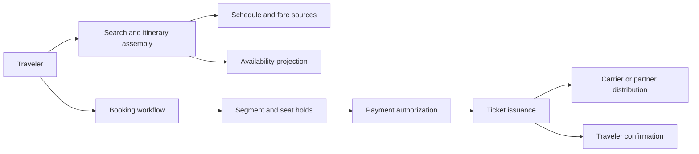
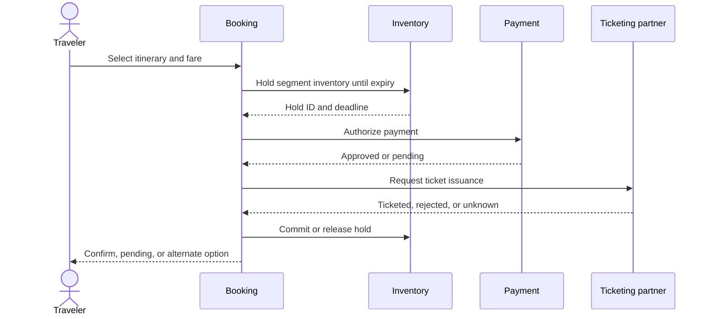
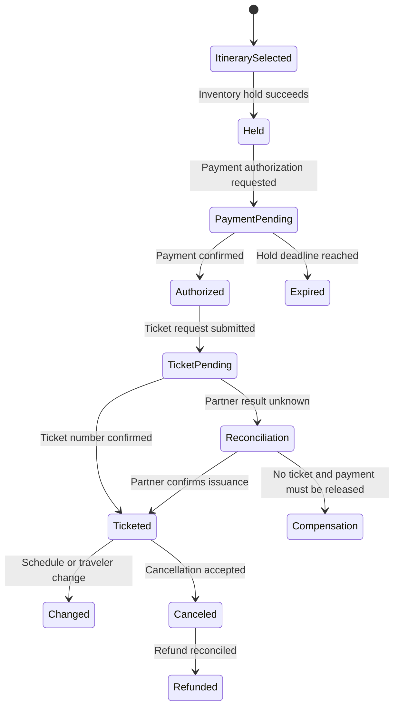
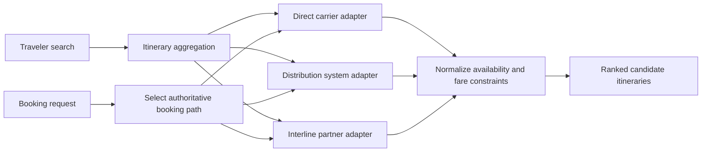
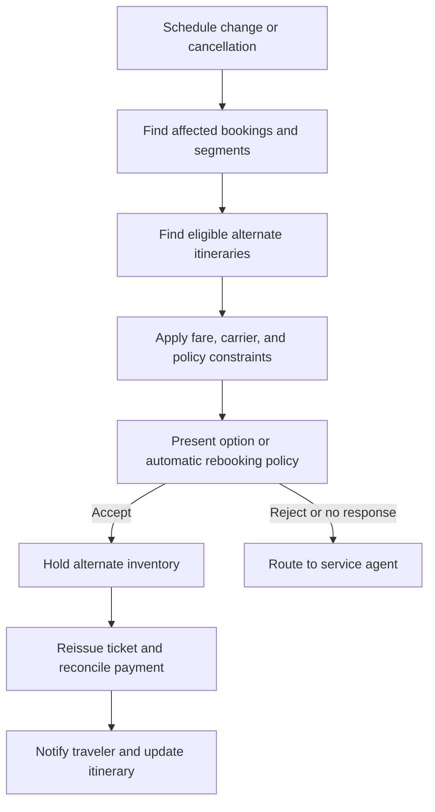

# Airline Reservation System

Part: [24 — Real-World Architecture Case Studies](PART_OVERVIEW.md)

This case study designs search, pricing, seat inventory, booking, payment, ticketing, partner distribution, and disruption handling for airline reservations. The system must prevent oversell while presenting fast search results that may change before booking. Assumptions: itineraries can include multiple segments and carriers, fare rules vary, and external partners may respond asynchronously.

## Separate Search, Availability, Booking, and Ticketing

Search returns candidate itineraries and indicative availability. Booking places a time-bounded hold on inventory and validates fare rules. Ticketing occurs only after required payment and partner confirmation. These steps have different freshness and authority; a search result is not a reservation.

Show search freshness and revalidate price and availability before commitment. A booking can fail after a successful search due to inventory contention, fare expiration, or partner timeout. Provide a clear retry or alternate-itinerary path.

## Hold Seat Inventory With Expiry

Seat and fare inventory are scarce, concurrently requested resources. A hold reserves a defined inventory unit until expiry and is tied to a booking reference. Expiry releases capacity, but delayed payment or partner callbacks can race with release. Use an authoritative version and reconcile ambiguous outcomes before reallocating.

Hold duration balances conversion time against inventory utilization. If ticket issuance status is unknown, do not release and sell the same seat blindly. Query the partner by idempotency or booking reference and keep the traveler in an explicit pending state.

## Model Booking and Ticket State

Booking and ticket are related but distinct records. A booking may include several passengers and segments; some segments can ticket while others fail. State should reflect holds, payment, partner confirmation, ticket issuance, cancellation, and refund separately.

Use stable booking, passenger, segment, and ticket identifiers. Define partial success and compensation across multi-segment itineraries. Keep the audit history for fare rules, passenger changes, and ticket actions.

## Integrate Distribution Partners

Airline inventory and booking may pass through global distribution systems, carrier APIs, or interline partners. Each interface can differ in fare rules, response timing, cancellation semantics, and ticketing authority. Adapters normalize contracts while preserving partner-specific limitations and references.

Search aggregation may return stale or inconsistent availability. Revalidate through the selected booking authority and retain source provenance. Partner rate limits, service windows, and failure modes should influence search fan-out and timeout strategy.

## Handle Disruption and Re-Accommodation

Schedule changes, cancellations, weather, and missed connections require re-accommodation options, traveler communication, and possibly refunds. The system should identify affected bookings from flight and segment references, prioritize by departure time and impact, and preserve human authority for exceptional cases.

Disruption workflows are long-running. Track deadlines, holds, communications, and unresolved cases. A replacement itinerary must preserve passenger, segment, and ticket lineage. When no alternate inventory exists, the system returns a clear support or refund path.

## Worked Case: Connecting Flight Delay

A delayed inbound flight makes a passenger's connection infeasible. The platform consumes the schedule event, identifies affected bookings, and queries eligible alternatives from the relevant carriers. It applies ticket rules and inventory holds, then offers a replacement itinerary. If accepted, ticketing reissues the affected segments and reconciles any fare difference; the original ticket remains linked for audit.

The system avoids rebooking from stale availability and does not release the original itinerary until the replacement is confirmed or policy determines the next action. If partner status is unknown, it routes the case to a human queue with current evidence. The review measures recovery time, passenger contact rate, duplicate ticket events, and unresolved booking age.

## Review Questions

1. Which systems own search, availability, booking, payment, and ticketing truth?
2. What happens when a hold expires while a partner response is delayed?
3. How are partial ticketing outcomes reconciled across segments?
4. How does partner provenance affect booking revalidation?
5. What state and communication track disruption recovery?

Airline reservation architecture separates indicative search from authoritative booking and ticketing. Use bounded holds, partner-specific adapters, explicit unknown states, and traceable disruption workflows to protect inventory and traveler outcomes.
