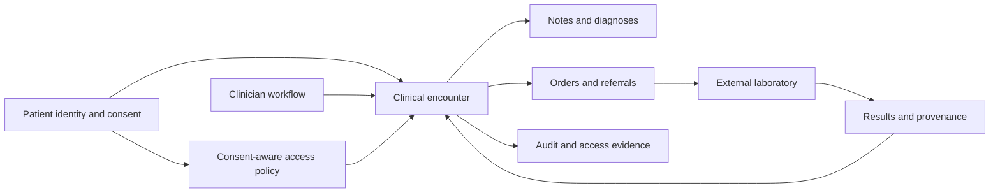
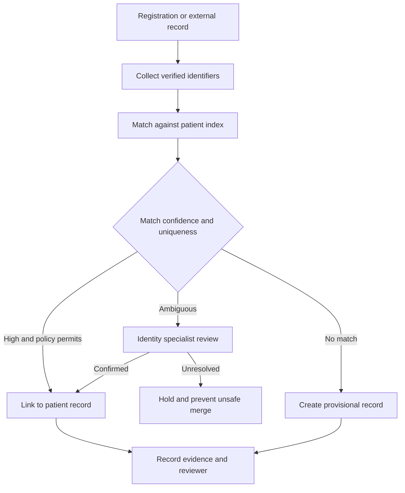
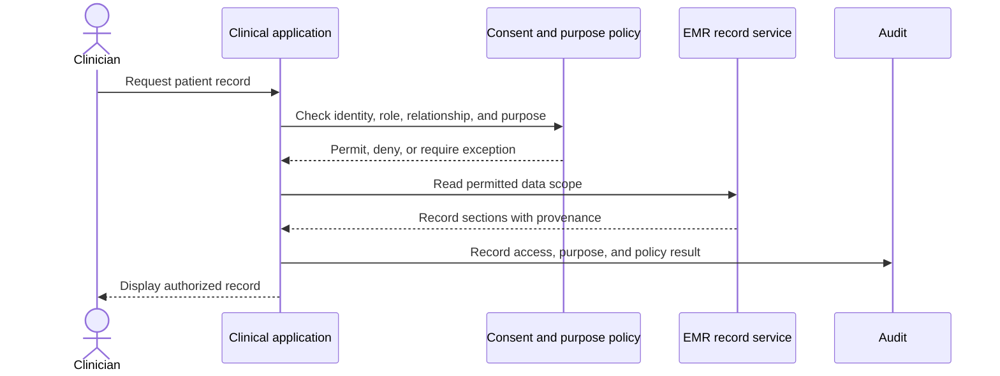
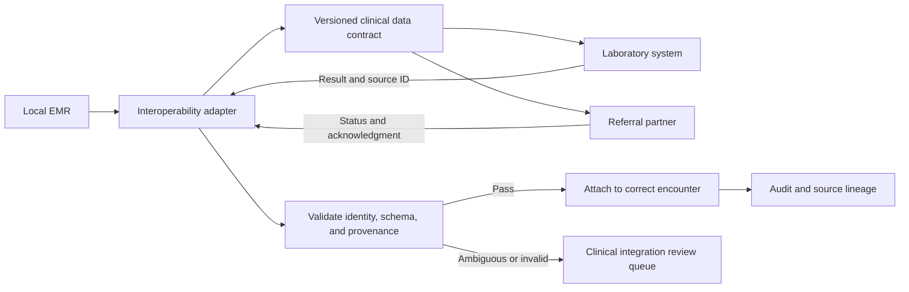
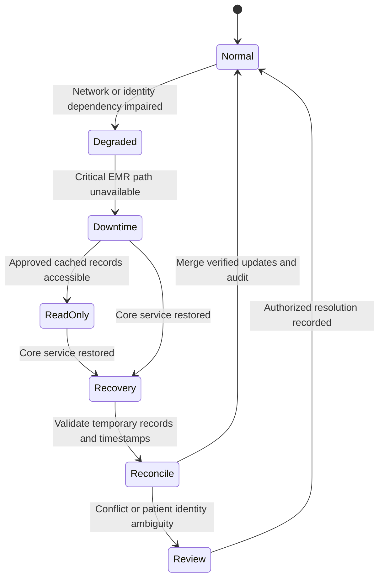

# Healthcare Electronic Medical Record System

Part: [24 — Real-World Architecture Case Studies](PART_OVERVIEW.md)

This case study designs an Electronic Medical Record (EMR) system that supports patient identity, encounters, clinical documentation, orders, results, consent, audit, interoperability, and downtime operations. The architecture must protect confidentiality while preserving safe access to current clinical information. Assumptions: the system serves multiple care locations and integrates with external laboratories and referral services; applicable regulations and clinical policies are verified with local owners.

## Frame Clinical Workflows and Safety Goals

Clinical data is authored by different roles and changes over time. An encounter may include notes, diagnoses, medications, orders, results, and amendments. Distinguish draft, signed, corrected, and imported information. Define which workflows require human attestation and which views may display delayed or incomplete data.

The architecture should make data provenance, author, timestamp, source, and correction history visible. Clinical users need to distinguish verified from imported or patient-reported content. A fast interface must not imply that data is complete when an integration is delayed.

## Resolve Patient Identity Safely

Patient matching combines stable identifiers, demographic attributes, and context. False merges can expose or alter another person's record; false splits can hide critical history. Use confidence thresholds and human review for ambiguous matches. Do not treat a probabilistic match as authorization to merge records automatically.

Define correction and merge procedures, including downstream systems, audit, and patient notification where required. Identity errors must be reversible through controlled correction, not hidden by overwriting identifiers.

## Enforce Consent and Purpose at Access

Access depends on authenticated user, clinical relationship, role, purpose, location, emergency context, and consent policy. Consent may differ by data type and care relationship. Emergency access (“break glass”) should be time-bounded, justified, visible to auditors, and reviewed after use.

Do not rely solely on UI visibility to enforce access. Apply policy at service boundaries and propagate the permitted scope to downstream queries and caches. Audit access without copying unnecessary clinical content into logs.

## Interoperate With External Care Systems

Interoperability exchanges patient identity, encounters, orders, results, and referrals with external organizations. Contracts must define identifiers, provenance, time semantics, acknowledgements, corrections, and error handling. Imported data remains attributable to its source; it should not silently become locally verified clinical advice.

External availability and formats vary. Queue retries safely, deduplicate by source identifiers, and route clinical ambiguity to an accountable role. Reconciliation should identify missing or duplicate results before clinicians rely on the record.

## Design Downtime Access and Recovery

Care may continue during network, identity, or application outages. Define which read-only information can be accessed locally, how freshness is labeled, which actions are unavailable, and how offline changes are reconciled. Downtime procedures need controlled access, audit continuity, and a process for reconciling handwritten or temporary records.

Define data age limits for offline views and which clinical actions require real-time verification. Do not make stale cached information appear current. Test downtime access, recovery, duplicate documentation prevention, and identity conflict resolution with clinical and operational teams.

## Worked Case: Emergency Department Result Review

A clinician orders a laboratory test during an emergency visit. The EMR verifies patient identity and clinician authority, records the order, and sends it to the lab. The lab returns a result with a source identifier and timestamp. The EMR validates the patient and encounter mapping, attaches the result with provenance, and notifies the clinician. If the network is unavailable, the workflow marks the order pending and uses the approved downtime process.

A delayed result arrives after the encounter is closed. The system links it to the original encounter and alerts the responsible clinical role rather than creating a duplicate visit. Consent and audit policies govern access and disclosure. During reconciliation, an identity mismatch routes to a specialist for review; the result is not merged into a likely patient record automatically.

## Review Questions

1. How are authored, imported, draft, and corrected clinical records distinguished?
2. What evidence is sufficient for an automatic patient match?
3. Which identity, purpose, and consent attributes constrain access?
4. How are delayed or duplicate external results reconciled?
5. What can clinicians access and document during downtime?

EMR architecture must preserve clinical context, patient identity, consent, and provenance across normal and degraded operation. Keep access policy authoritative, route ambiguous matching to human review, and exercise downtime and reconciliation with the people who deliver care.
