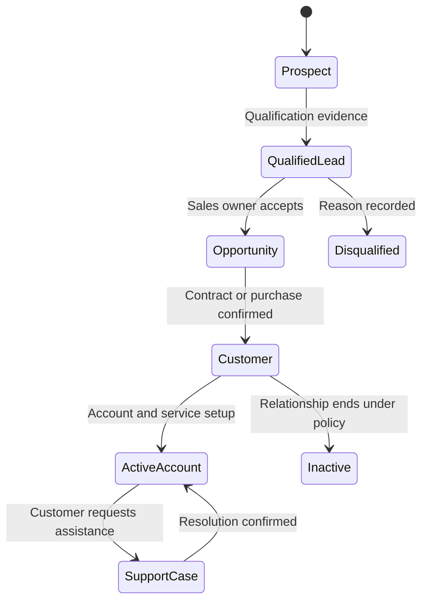
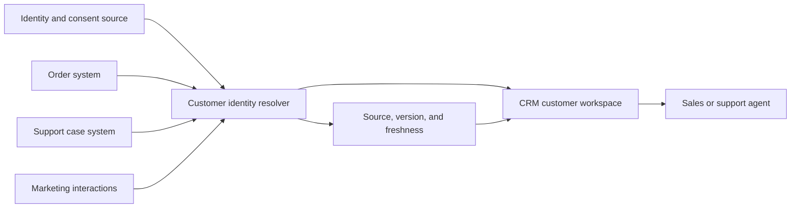
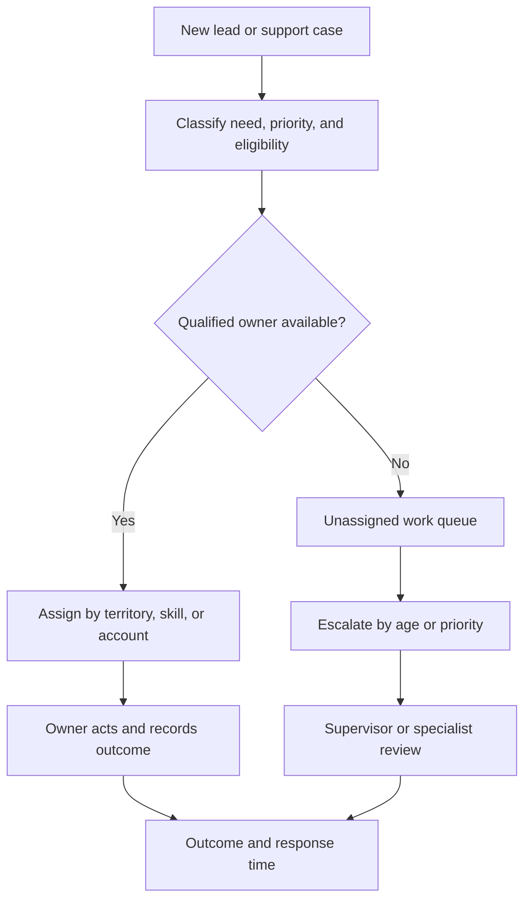
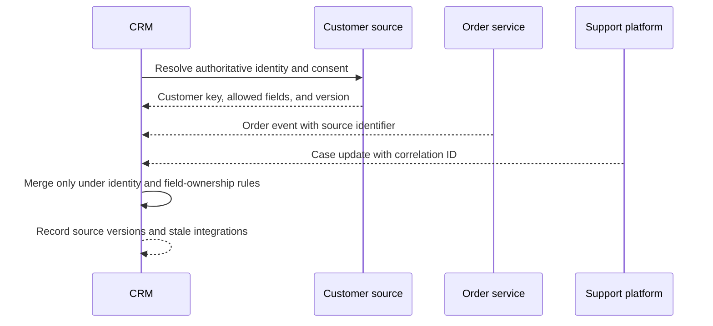
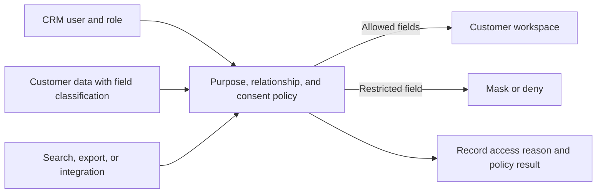

# CRM: Customer Relationship Management Platform

Part: [24 — Real-World Architecture Case Studies](PART_OVERVIEW.md)

This case study designs a Customer Relationship Management (CRM) platform that supports customer identity, interaction history, sales and service workflows, assignment, integrations, and governed access. The system must give users useful context without creating an unowned “customer 360” copy that conflicts with authoritative source systems.

## Model the Lead-to-Customer Lifecycle

Prospect, lead, account, contact, opportunity, and service case records have distinct meanings and ownership. Lifecycle transitions should capture actor, evidence, and reason. Conversion or merge operations must preserve lineage and prevent duplicate customer records from fragmenting service history.

Define who can advance or merge records and how external source identifiers map to the CRM identity. Do not treat a lifecycle label as proof of consent, contract status, or revenue recognition.

## Compose a Customer View With Provenance

A customer view can combine profile, consent, orders, support cases, and interactions from multiple systems. Identify the system of record for each attribute and show freshness and source. The view should be optimized for a user task while preserving authority and data-quality indicators.

Do not silently overwrite one source with another. Define conflict resolution, data owner, and a correction route. Caching or replication should honor field-level sensitivity, retention, and consent constraints.

## Assign Work and Escalate Cases

Assignment may depend on skill, region, account ownership, language, workload, priority, or service-level commitments. Keep assignment policy visible and provide an exception queue when no eligible owner exists. Escalation should preserve context and history rather than forcing users to repeat information.

Measure unassigned age, reassignment rate, duplicate contact, and resolution outcome. Avoid routing rules that maximize short-term utilization while breaking continuity or violating customer preferences.

## Integrate Systems With Clear Ownership

CRM integrates with identity, order, billing, support, marketing, and communication systems. Use contracts for events and APIs, with idempotency, correlation IDs, versioning, and reconciliation. A synchronization failure should create a visible stale or pending state, not a false success.

Do not make the CRM a write authority for data owned elsewhere unless governance assigns that role. Define conflict handling, retry, dead-letter ownership, and how operators repair mismatches.

## Enforce Consent and Field-Level Access

Access can depend on user role, purpose, region, customer relationship, and consent. Apply controls at the service boundary and in search, export, reporting, and integration paths. A hidden UI field is not an authorization control. Record policy version and access outcome without retaining unnecessary sensitive content.

Consent changes should propagate to marketing, support, exports, and derived views within a defined period. Define emergency access, expiry, and audit review. Retention and deletion policies apply to interaction history and analytics as well as profile records.

## Worked Case: Duplicate Customer Records

A support agent sees two records that may belong to the same customer. The CRM uses source identifiers and matching evidence to suggest a merge, but it does not automatically combine records when confidence is low. The agent verifies permitted attributes and submits a merge request; a data owner reviews conflicts in consent and service history.

After approval, the identity resolver records the canonical key and source lineage. Updates propagate to support and marketing under their access rules. If a downstream system fails to acknowledge the merge, the CRM marks the view as pending and assigns an integration exception rather than showing a falsely unified profile.

## Review Questions

1. Which system owns each customer attribute?
2. How are duplicate identities merged and reversed safely?
3. What assignment factors preserve customer continuity and fairness?
4. How does integration failure appear to users and operators?
5. Which access paths enforce consent beyond the visible form?

A CRM platform is a coordinated workflow and data-composition system. Preserve source ownership and provenance, make assignment and integration failures visible, and enforce consent across every read, export, and downstream use.
