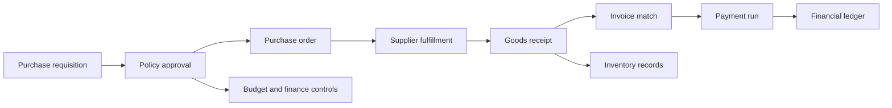
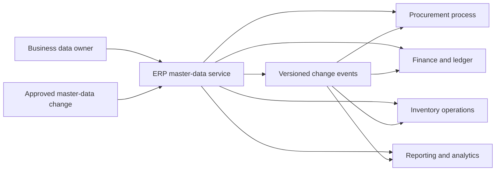
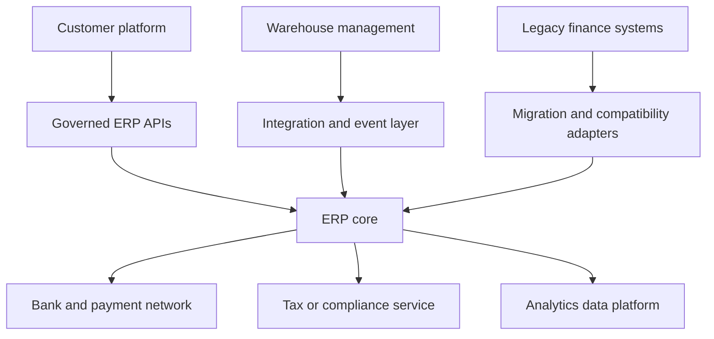
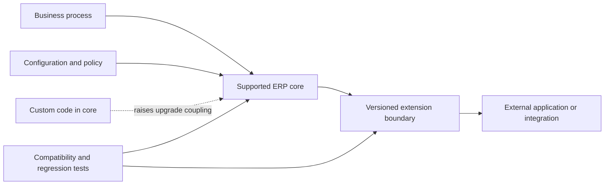
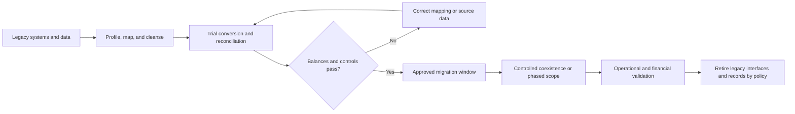

# ERP: Enterprise Resource Planning System

Part: [24 — Real-World Architecture Case Studies](PART_OVERVIEW.md)

This case study examines an Enterprise Resource Planning (ERP) system coordinating finance, procurement, orders, inventory, production, and reporting. The architecture must balance shared records and standardized workflows with local regulatory or business variants. Integration and data ownership matter as much as the ERP package itself.

## Trace a Cross-Functional Transaction

A purchase-to-pay transaction crosses requisition, approval, purchase order, receipt, invoice matching, and payment. The ERP may orchestrate or record the workflow while external systems provide identity, supplier data, warehouse activity, or banking. Define authoritative state and reconciliation points for each boundary.

The architecture should make exceptions visible: partial receipt, price mismatch, duplicate invoice, approval timeout, and period close. Do not model a successful happy path as if cross-system records are atomically updated.

## Govern Shared Master Data

ERP systems commonly host or consume master data such as supplier, legal entity, chart of accounts, product, and location. Define which system owns each domain, who approves changes, and how consumers receive updates. Shared master data reduces duplication but creates a central change and availability dependency.

Consumers need version, effective date, and correction behavior. A master-data update can alter downstream reporting and historical interpretation; retain lineage and define whether prior transactions preserve the values effective at the time.

## Define the Integration Landscape

An ERP is rarely the only enterprise system. It connects to customer platforms, warehouses, banks, tax services, analytics, and legacy systems. Select integration styles from volume, latency, change coupling, and recovery needs. Avoid tightly coupling every consumer to the ERP's internal tables or release schedule.

Document ownership, contracts, update frequency, error handling, and support for each integration. Batch interfaces can be appropriate for close or settlement; real-time interfaces may be needed for authorization or inventory checks. Reconcile critical financial flows to the system of record.

## Govern Extensions Around the Core

ERP customization can satisfy unique needs but complicates upgrades, support, and testing. Prefer configuration or supported extensions when they preserve the vendor-supported core. Document where custom logic runs, who owns it, what APIs it depends on, and what upgrade evidence is required.

Avoid modifying core code without a lifecycle plan. A custom feature should include a business owner, upgrade path, test coverage, support model, and retirement trigger. Extensive customization can indicate a poor process or product fit. Reassess both before building more extensions.

## Migrate in Phases and Reconcile

ERP migration involves data conversion, process redesign, integration change, user readiness, and financial controls. Use phased deployment or a controlled cutover based on transaction criticality and dependency structure. Maintain a reconciliation plan that proves opening balances, inventory, open orders, and master data are consistent.

Define rollback limits before cutover. Once transactions are posted in both systems, rollback may require reconciliation and compensating entries rather than restoring a snapshot. Include user support, audit evidence, and finance sign-off in readiness.

## Worked Case: Regional ERP Consolidation

A manufacturer consolidates three regional ERP instances. The target standardizes procurement and finance while retaining local tax and language variants. A capability map identifies shared processes; master-data owners define supplier and product identities; integration adapters preserve warehouse and bank connections during transition.

The migration begins with one lower-risk region and a trial conversion. Reconciliation compares opening balances, inventory quantities, open purchase orders, and audit trails. A discrepancy blocks cutover. The program uses a phased deployment and retires each legacy instance only after financial close, operational support, and retention obligations are verified.

## Review Questions

1. Which processes and records are authoritative in the ERP?
2. Who owns shared master data and downstream corrections?
3. Which integrations need real-time behavior versus batch reconciliation?
4. How are custom extensions protected from upgrade breakage?
5. What reconciliation evidence permits cutover and legacy retirement?

ERP architecture coordinates shared records and cross-functional workflows. Define system authority and integration contracts, constrain customization, and treat migration reconciliation as a release gate rather than a post-cutover cleanup activity.
