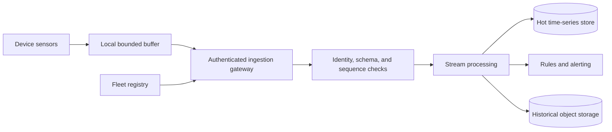
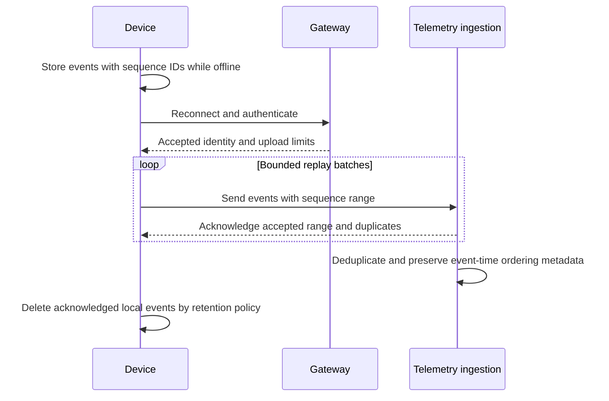
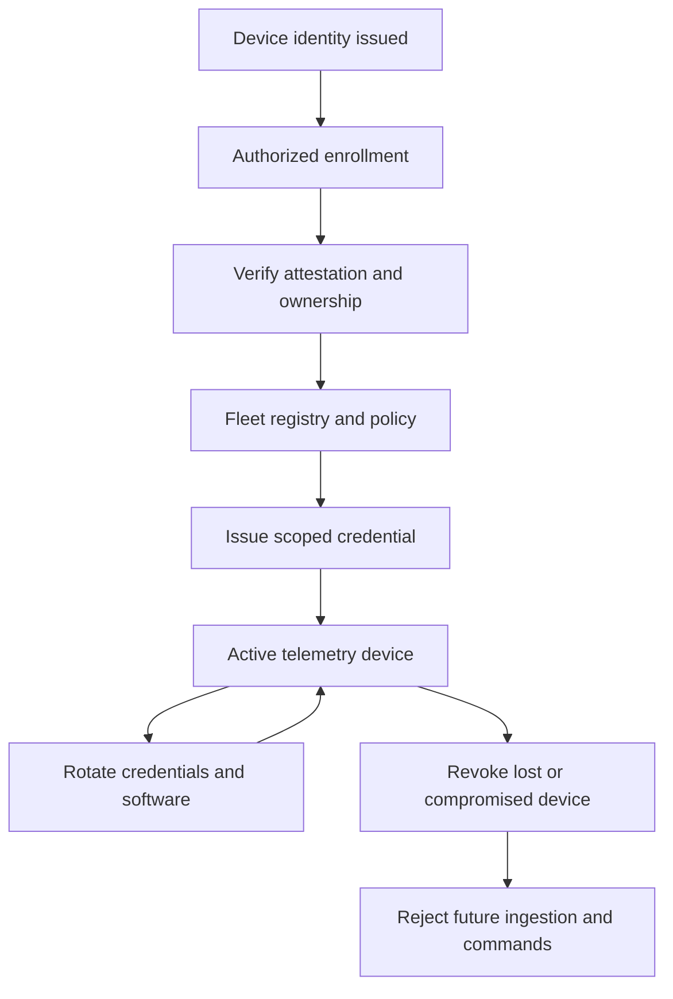
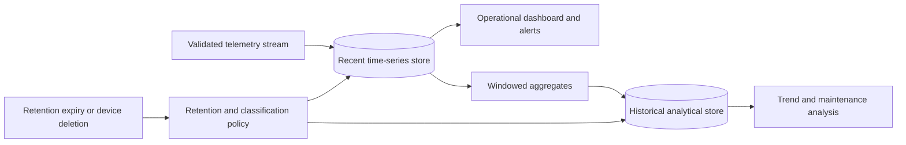
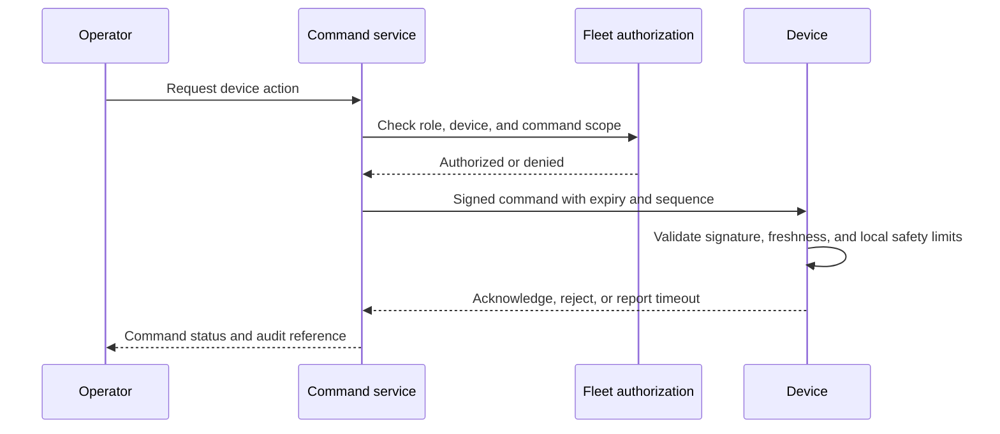

# IoT Telemetry Platform

Part: [24 — Real-World Architecture Case Studies](PART_OVERVIEW.md)

This case study designs an Internet of Things (IoT) telemetry platform for device provisioning, authenticated ingestion, stream processing, time-series storage, fleet operations, and commands. Devices may be intermittently connected, resource-constrained, or physically exposed. The architecture must preserve identity, ordering assumptions, replay safety, and data retention across unreliable links.

## Trace Device-to-Cloud Telemetry

Devices collect measurements and send batches or streams through an authenticated gateway. The ingestion layer validates device identity, schema, timestamp, sequence, and size before accepting data. Stream processing enriches or aggregates events and writes to a serving store or historical tier.

Device timestamps may drift, and events may be duplicated or arrive late. Preserve event time and ingestion time separately. Define whether the platform rejects, quarantines, or accepts out-of-range measurements and how consumers interpret the result.

## Buffer Offline Data and Replay Safely

An offline device can persist a bounded queue and replay on reconnect. Buffer policy needs capacity, expiration, prioritization, ordering, and duplicate handling. Critical alarms may need a different delivery path than routine telemetry. Replay should not create duplicate side effects or overwhelm ingestion after a network outage.

A device should delete buffered data only after durable acknowledgment under the defined contract. Reconnect limits protect the gateway from replay storms; backpressure and jitter spread recovery load. If buffer capacity is exhausted, define which data is dropped and expose a loss counter.

## Provision Identity and Operate the Fleet

Each device needs a unique identity, credential lifecycle, ownership, software version, hardware profile, and operational status. Provisioning should verify device authenticity and bind it to an owner or site. Credential rotation and revocation must work for devices that reconnect infrequently.

The fleet registry is control-plane state; it should not be inferred from arbitrary telemetry. Track last-seen time, firmware, credential status, and ownership changes. A revoked device should be unable to send commands or data even if it holds a previously valid local credential.

## Tier Storage by Query and Retention Needs

Hot storage serves recent operational queries and alerts; historical storage supports analytics, audit, and model training. Retention and aggregation should reflect purpose and sensitivity. Moving data between tiers must preserve timestamps, device identity, schema version, and lineage. Part 06 owns storage mechanics.

Define query freshness, compression or aggregation loss, retention windows, deletion behavior, and access controls. A downsampled aggregate cannot replace raw telemetry when the use case requires forensic reconstruction; preserve the needed level for a governed duration.

## Secure the Command Channel

Telemetry is primarily device-to-platform, while commands travel platform-to-device and can change physical or operational state. Authenticate command origin, authorize device scope, include expiry and sequence, and require acknowledgment or safe timeout behavior. Separate telemetry permissions from command permissions.

The device should reject replayed or expired commands and enforce local safety limits even if the cloud authorizes an action. Loss of connectivity must not leave a hazardous command in an unbounded queue. Audit who initiated the command, its target, result, and relevant policy version.

## Worked Case: Industrial Pump Monitoring

Remote pumps report vibration, temperature, and operating state every minute. Each device buffers a bounded window during connectivity loss and replays with sequence IDs. The platform validates firmware version and sensor range, stores recent data for alarms, and aggregates older measurements for maintenance analysis.

An operator can request a diagnostic mode, but a physical safety controller remains authoritative for shutdown. Commands are scoped, signed, and expire quickly. When a device is compromised, fleet operations revoke its credential, reject future messages, and alert the site owner. During replay after an outage, the gateway rate-limits uploads so current alarms remain responsive.

## Review Questions

1. Which device identity and data fields are validated at ingestion?
2. How are offline buffers bounded, acknowledged, and replayed?
3. What protects fleet provisioning and credential revocation?
4. Which data is hot, aggregated, archived, or deleted?
5. How do commands remain safe during replay, delay, or disconnection?

An IoT telemetry platform must handle unreliable devices and links without weakening identity or command safety. Separate data and control paths, preserve replay metadata, govern retention, and test offline recovery and revocation as first-class scenarios.
