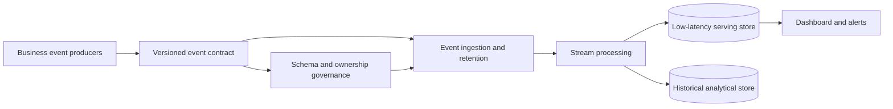
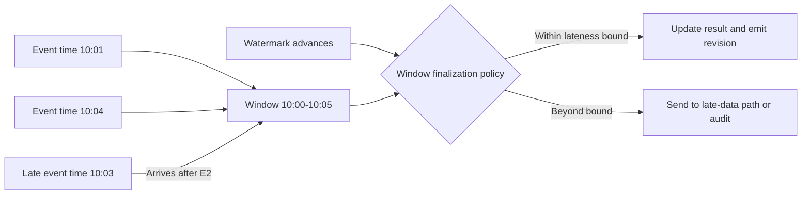
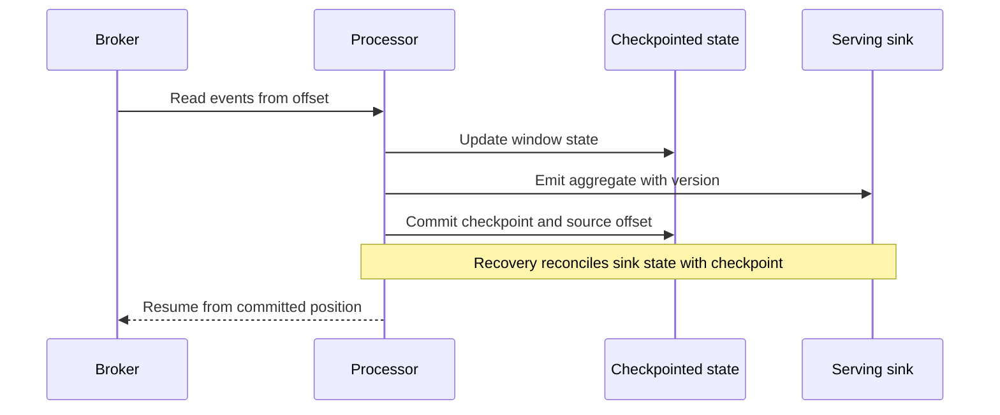
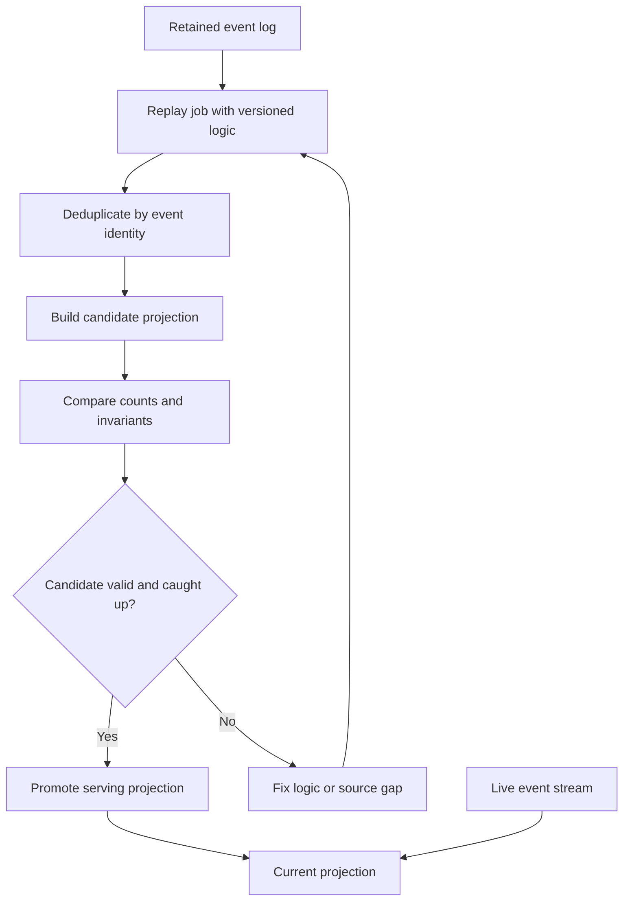
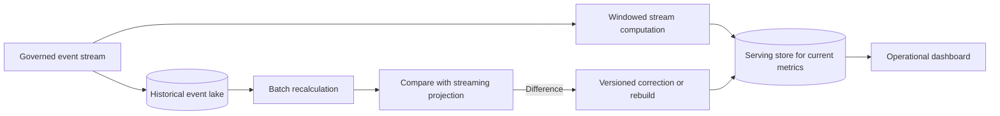

# Real-Time Analytics Platform

Part: [24 — Real-World Architecture Case Studies](PART_OVERVIEW.md)

This case study designs a real-time analytics platform that ingests events, computes rolling results, serves dashboards and alerts, and retains history for deeper analysis. The key architecture choices are freshness, event-time correctness, state recovery, replay, and the boundary between serving and historical stores. Part 07 owns stream-processing semantics; Part 06 owns storage mechanics; Part 14 owns observability platforms.

## Define Event Contracts and Latency Goals

Each event should have a schema, producer owner, event identity, event time, ingestion time, and semantic meaning. Define expected volume, burst rate, allowed lateness, ordering scope, and freshness objective. A dashboard that updates “in real time” needs a measurable end-to-end bound and a clear response when the stream falls behind.

Separate event-time from processing-time. Producers may send late or out-of-order events due to offline devices, retries, or network delay. Define whether results update, retract, or preserve prior values when late data arrives.

## Process Windows and Late Events

Windowing groups events over time ranges. Fixed windows are simple and align to reporting periods; sliding windows overlap; session windows follow inactivity gaps. Watermarks estimate event-time progress and determine how long the system waits for late events. Larger lateness tolerance improves completeness but delays finalization and consumes state.

The application contract must define whether a dashboard value is provisional or final. A late event can change a previously emitted aggregate. Downstream consumers need a revision or correction signal. Do not silently mutate historical values without lineage.

## Persist State and Recover

Stream processors maintain state such as counts, balances, or per-key windows. Checkpoints capture progress and state so a worker can recover after failure. Claims of exactly once processing depend on source, processing, and sink semantics; the architecture should state the actual guarantee and how duplicates or partial commits are handled.

Checkpoint frequency trades recovery point and overhead. A checkpoint is useful only if state, offsets, and sink writes recover coherently. Test worker loss during emission, sink outage, and checkpoint corruption before trusting a recovery objective.

## Replay and Deduplicate Safely

Replay supports backfills, bug fixes, and projection rebuilds. It can overload sources and sinks or duplicate external side effects. Use stable event IDs, versioned logic, isolated replay targets, bounded rate, and a promotion gate. Keep replay separate from live processing where possible, or define how both streams reconcile.

Replay must respect retention and privacy requirements. If upstream events have expired, identify that limitation rather than claiming complete reconstruction. Record code, schema, offsets, and result version for every replay.

## Separate Serving and Historical Boundaries

A low-latency serving store supports current dashboards and alerts; a historical store supports long-range analysis and expensive queries. Define which is authoritative for each metric, how late corrections propagate, and how retention differs. Batch and stream paths can coexist if they share event definitions and reconciliation rules.

Do not let a dashboard query the event lake directly if its latency and cost contract require the serving store. Conversely, do not use a lossy aggregate as the only history when audit or recalculation requires source events. Document metric definitions and update delay.

## Worked Case: Delivery Operations Dashboard

A delivery platform computes active shipments, late deliveries, and facility backlog from status events. The dashboard needs updates within two minutes; source events include event time and facility ID. The stream processor updates rolling windows, while late carrier scans revise the metric and emit a correction. A historical store retains normalized events under the data-retention policy.

When a processor fails during sink emission, checkpoint recovery replays recent events with stable IDs. A daily batch calculation compares totals against the streaming projection. The platform exposes data freshness and correction status so operators do not treat a temporarily incomplete metric as final. Alerting distinguishes service lag from actual delivery backlog.

## Review Questions

1. What freshness and completeness contract does each dashboard metric require?
2. How are event-time and processing-time distinguished?
3. What happens to results when events arrive after a window closes?
4. How do checkpoint and sink guarantees interact during recovery?
5. How are replay, retention, and privacy handled together?

Real-time analytics is an event-time, state-recovery, and serving-contract problem. Define freshness and lateness, make checkpoints and replay observable, and reconcile stream results with historical evidence without claiming stronger guarantees than the system provides.
