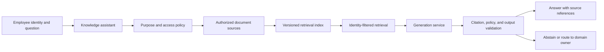
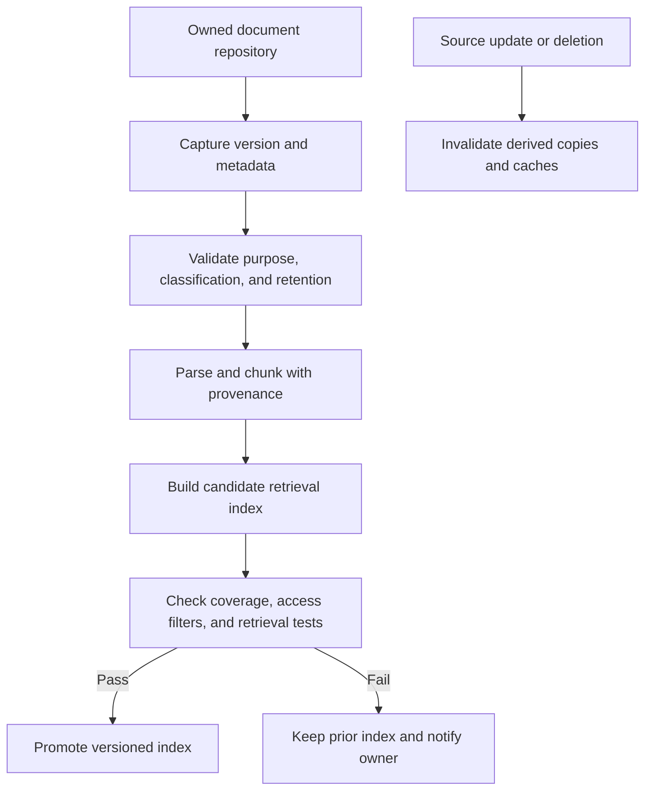
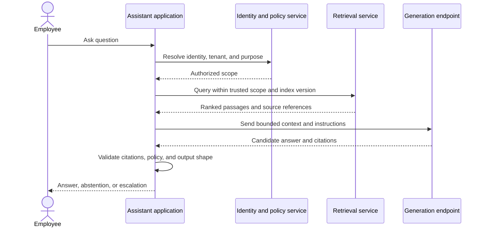
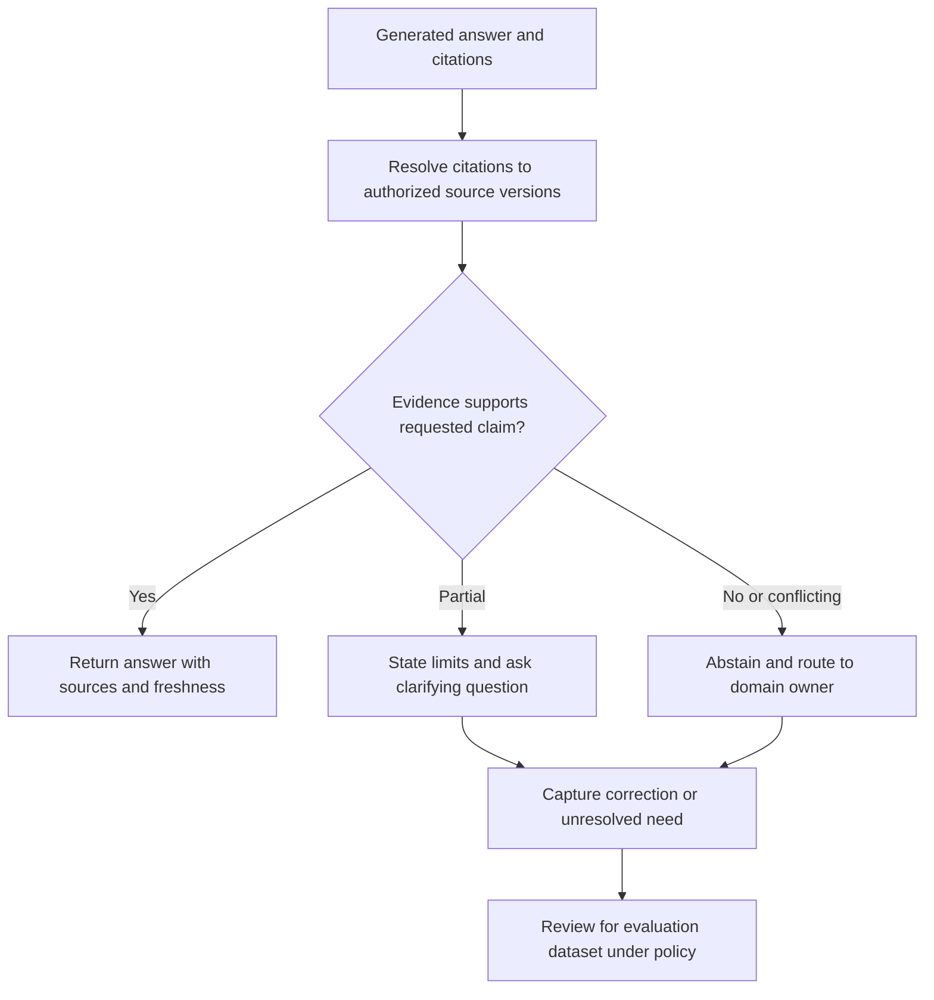
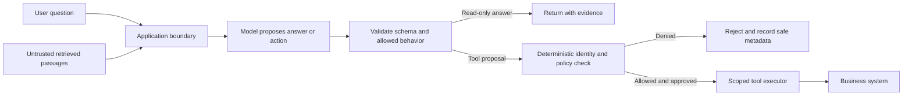

# AI-Powered Enterprise Knowledge Assistant

Part: [24 — Real-World Case Studies](PART_OVERVIEW.md)

This case study designs an enterprise assistant that answers employee questions from internal policies, procedures, and technical documentation. It must ground answers in authorized sources, preserve citations, abstain when evidence is weak, and avoid turning retrieved text into tool authority. Part 16 owns retrieval and evaluation techniques; Part 17 owns AI system architecture. This chapter applies those designs to a bounded enterprise workload.

## Frame Users, Sources, and Decision Scope

Assume employees ask questions across business units, documents have owners and access restrictions, and policies change on different schedules. The assistant can summarize and locate evidence; it cannot approve exceptions, change employee records, or replace accountable domain owners. Define success through resolved-question rate, citation validity, time to answer, escalation quality, cost, and unauthorized-access tests.

Treat the answer as decision support rather than authoritative policy. Every content domain should have an owner, source of truth, update frequency, and escalation route. Exclude unsupported sources rather than indexing everything by default.

## Ingest and Govern the Knowledge Base

Ingestion extracts content, preserves source identity and version, attaches access and classification metadata, and publishes an index only after quality checks. Deletions and permission changes must propagate to chunks, embeddings, caches, and derived results. The index is a derived artifact; document repositories remain authoritative.

Prioritize source freshness and authorization correctness over index coverage. A broad index with missing access metadata is unsafe. Record the source version and indexing pipeline so an answer can be traced to the exact content that informed it.

## Execute an Identity-Filtered Question Path

The runtime resolves identity and purpose before retrieval. It applies access filters using trusted context, retrieves candidate passages, assembles bounded context, and generates an answer with references. The application validates that references resolve to authorized passages and that output policy is satisfied before returning it.

If identity or policy cannot be resolved, fail closed rather than searching without filters. Avoid raw prompt logging unless explicitly justified and governed. Record model, prompt, index, policy, and response identifiers for diagnosis while minimizing sensitive content.

## Ground Answers, Escalate Uncertainty

Retrieved passages provide evidence but do not guarantee that generated claims are supported. Validate citation references and present source freshness. If evidence is empty, conflicting, stale, or outside the user's authority, ask for clarification or route to a domain owner instead of filling gaps from model memory.

Do not automatically turn user corrections into training data. Review privacy, source validity, representativeness, and cause. Track abstention and escalation as quality outcomes; a safe non-answer can be preferable to an unsupported answer.

## Protect Against Prompt Injection and Tool Abuse

Retrieved documents and user input are untrusted content. Prompt instructions can help, but authorization and tool scope must be enforced by application code. This assistant has no write tools in its initial release. If later tools are added, require narrow schemas, identity-bound authorization, explicit confirmation for consequential actions, and auditable execution.

Never place credentials or privileged API access in model context. Test direct and indirect prompt injection, cross-tenant document retrieval, malicious documents, and attempts to reveal hidden instructions. The security boundary is the executor and policy service, not the model's claimed refusal.

## Worked Case: Employee Travel Policy Question

An employee asks whether a meal expense is reimbursable. The assistant authenticates the employee, retrieves current policy for the correct region and role, and drafts an answer with the source section and effective date. It does not submit an expense or approve an exception. If policies conflict or the source is stale, it routes to the finance policy owner.

The release gate checks citation resolution, cross-role access, stale-index behavior, malicious content, abstention quality, latency, and operating cost. A document owner updates the policy; the index refreshes and passes validation before promotion. The trace stores versions and source references under retention policy. Analysts review corrections before adding any case to the evaluation set.

## Review Questions

1. Which content sources are authoritative and who owns freshness?
2. Where is identity checked before retrieval?
3. What qualifies as sufficient evidence for an answer?
4. How does the assistant behave on conflicting, stale, or unauthorized sources?
5. Which deterministic controls constrain tools and protect against injection?

An enterprise knowledge assistant is a governed retrieval and response workflow, not simply a model connected to documents. Enforce access before retrieval, preserve source-version provenance, validate citations, abstain safely, and treat all model and retrieved content as untrusted input.
