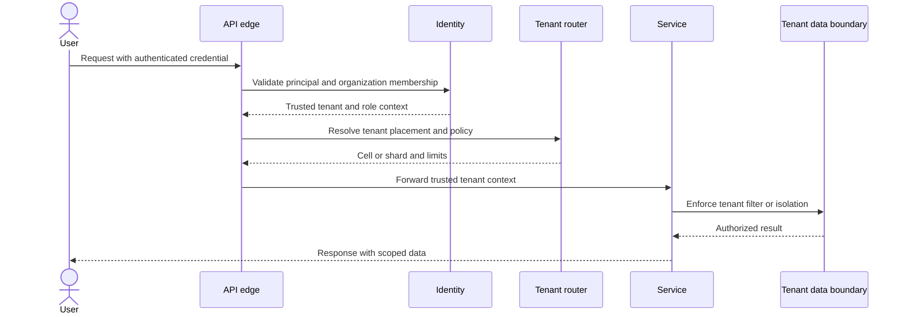
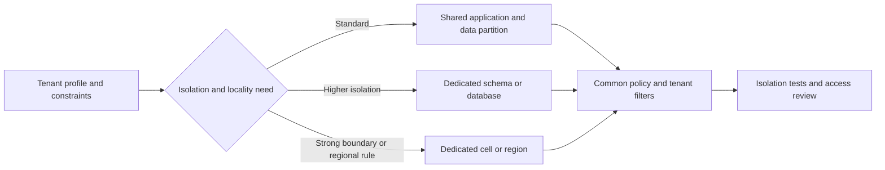
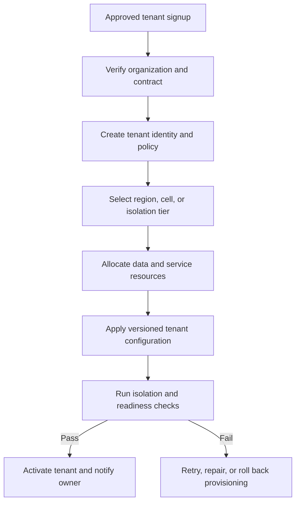
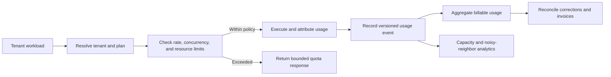
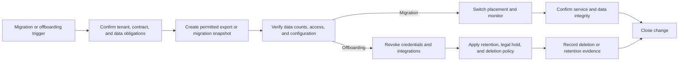

# Multi-Tenant SaaS Platform

Part: [24 — Real-World Architecture Case Studies](PART_OVERVIEW.md)

This case study designs a Software as a Service (SaaS) platform serving multiple customer organizations from a managed product. The architecture must isolate tenant data and operations, provision configuration, meter usage, manage quotas, and support tenant lifecycle changes. Assumptions: most tenants share application code, while a small subset may require stronger isolation or regional placement.

## Route Requests With Trusted Tenant Context

Resolve tenant identity from authenticated credentials and server-side policy, not a client-provided tenant header alone. Propagate the tenant context through authorization, data access, caches, logs, queues, and outbound calls. A missing or ambiguous tenant should fail closed.

Tenant identity is an authorization input and a partition key, not a substitute for object-level authorization. Validate tenant scope at service boundaries and ensure background jobs retain the same context.

## Choose an Isolation Model

Shared tables reduce operational overhead but require strong tenant scoping and query discipline. Schema-per-tenant or database-per-tenant can improve isolation and customization at higher provisioning, migration, and cost complexity. A hybrid model can place most tenants in shared cells and move regulated or high-volume tenants into isolated deployments.

Isolation should be tested, not inferred from architecture labels. Include cross-tenant access tests, noisy-neighbor load, backup restore, and administrative support paths. Stronger isolation does not remove the need for identity, encryption, or tenant-aware authorization.

## Provision and Configure Tenants

Provisioning creates tenant identity, plans, roles, configuration, resource placement, and initial data. It should be repeatable, idempotent, and observable. It should compensate for partial failure. Configuration should be versioned and distinguish tenant-specific settings from global product policy.

Provisioning includes support and audit readiness, not only resource creation. Record tenant owner, plan, region, isolation model, configuration version, and data-retention policy. Avoid manual one-off setup that cannot be reproduced or migrated.

## Meter Usage and Enforce Fair Quotas

Metering supports billing, capacity planning, and abuse detection. Define the measured unit, aggregation interval, correction process, and authoritative source. Quotas should protect shared capacity while providing clear client feedback and an upgrade or appeal path. Apply limits consistently across synchronous requests, background jobs, storage, and egress.

Quotas are part of the service contract and must not silently drop work. Define burst behavior, fairness, and priority for critical operations. Usage records need idempotency and provenance so duplicate telemetry does not create duplicate billing.

## Migrate and Offboard Tenants Safely

Tenant migration may change region, isolation tier, schema, or product plan. Use staged data copy, version checks, validation, routing switch, and rollback criteria. Offboarding requires access revocation, contract and billing closure, export, retention, legal hold, deletion, and evidence of completion.

Migration should preserve tenant isolation throughout copying and cutover. Offboarding is not complete when a tenant row is marked inactive; caches, backups, analytics, support tools, and delegated credentials may retain data or access.

## Worked Case: Regional Tenant Migration

A customer requires data to remain in a new region and requests migration from a shared database to a dedicated tenant cell. The platform validates contractual scope, exports a consistent snapshot, replays changes, verifies data counts and permissions, and switches tenant routing. During migration, only one placement accepts writes; requests carry a migration version to avoid split-brain state.

The migration has a rollback window before old-region writes are retired. After validation and owner approval, old credentials are revoked and data is deleted according to retention policy. Support teams receive the new placement and escalation details. Metering and billing continue with an auditable transfer of usage records.

## Review Questions

1. How is tenant context authenticated and propagated to every data path?
2. Which tenant profiles require stronger isolation or regional placement?
3. How are provisioning steps recovered after partial failure?
4. What usage is metered and how are duplicate records prevented?
5. Which stores, caches, backups, and credentials are addressed during offboarding?

Multi-tenant SaaS architecture combines shared efficiency with tenant-specific trust, capacity, and lifecycle obligations. Make tenant context authoritative, test isolation, meter usage consistently, and treat migration and offboarding as controlled workflows.
