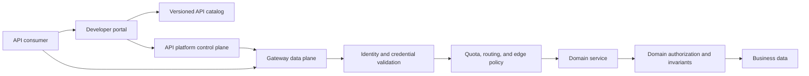
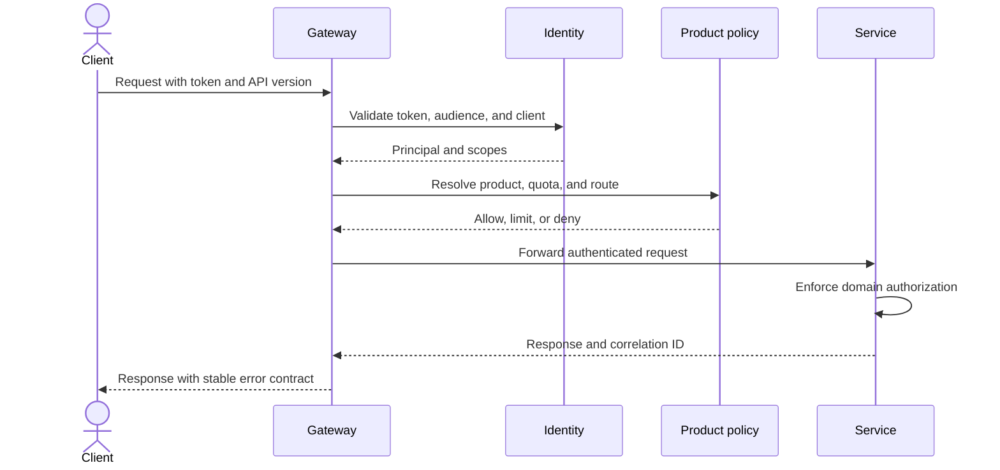
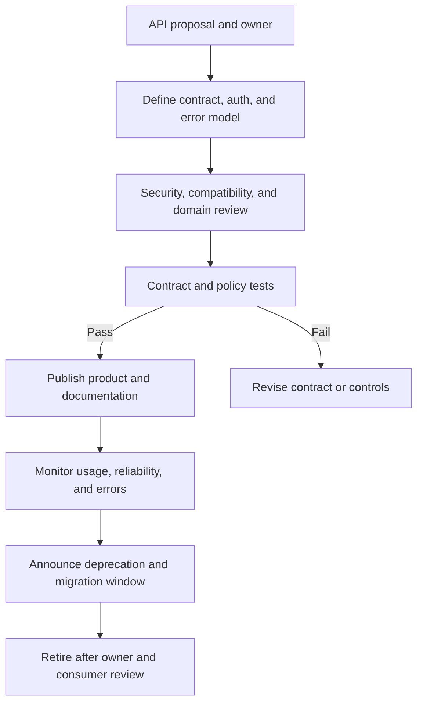
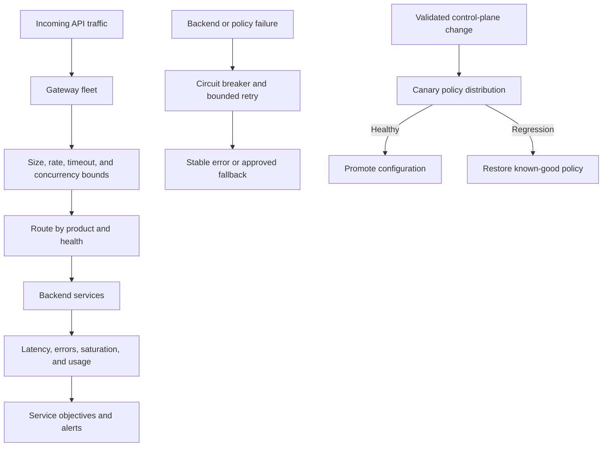

# API Gateway and Developer Portal

Part: [24 — Real-World Case Studies](PART_OVERVIEW.md)

This case study designs a shared API platform for internal and external consumers. The gateway provides a consistent entry point for authentication, routing, quotas, and telemetry; the developer portal supports discovery, credentials, testing, and lifecycle communication. Neither component replaces authorization in the underlying services or clear API ownership.

## Define Responsibilities and Trust Boundaries

The gateway owns edge concerns that benefit from consistent enforcement, such as TLS termination, token validation, request limits, and routing. Domain services own business authorization and invariants. The portal publishes API products and onboarding information but must not expose secrets or imply that catalog visibility grants access.

Separate the control plane, which manages configuration and products, from the data plane, which handles requests. A control-plane outage should not unexpectedly erase valid runtime configuration. Define how policy changes are validated, distributed, and rolled back.

## Process a Request With Consistent Policy

The request path validates identity, resolves the API product and policy, applies limits, and forwards to the service. The service rechecks permissions for the requested business resource. Avoid relying on a gateway-injected identity header unless it is protected from spoofing and the service trusts only authenticated gateway traffic.

Define stable error semantics for invalid credentials, denied operations, quota exhaustion, and upstream failures. Do not leak internal topology or token details in client responses. Correlation identifiers should connect gateway and service telemetry without logging credentials or sensitive payloads.

## Publish and Evolve API Products

Each API product needs an owner, consumer profile, contract, security model, service-level objective, support path, and lifecycle policy. Schema compatibility checks should run before publication. Deprecation needs notice, usage visibility, migration guidance, and a retirement decision; a version label alone does not manage compatibility.

Track consumers and versions so owners can distinguish inactive registrations from active dependencies. Apply retention and privacy rules to usage analytics. Provide a way to identify high-impact consumers before changing a contract or shutting down a version.

## Onboard Developers and Manage Credentials

The portal should guide users from discovery to an approved, least-privilege credential. Keep subscription approval, identity verification, environment selection, and credential issuance explicit. Use short-lived or rotatable credentials where feasible, and provide revocation and incident procedures.

```mermaid
flowchart LR
    Developer[Developer identity] --> Discover[Find API and owner]
    Discover --> Request[Request product access and purpose]
    Request --> Approve[Owner or policy approval]
    Approve --> Credential[Issue scoped credential]
    Credential --> Sandbox[Test against documented sandbox]
    Sandbox --> Integrate[Integrate with production controls]
    Integrate --> Monitor[Review usage, expiry, and rotation]
    Monitor --> Revoke[Revoke on expiry, incident, or access change]
```

Sandbox behavior should resemble production contracts without exposing production data. Secret values should be shown only at issuance when necessary, never stored in portal logs, and never embedded in sample code. Include ownership transfer for credentials tied to a person who leaves a team.

## Operate Gateway Capacity and Failure

The gateway is a shared dependency and should scale independently from backend services. Apply bounded request sizes, connection and timeout limits, circuit breaking, and tenant-aware quotas. Keep policy updates safe under partial distribution and provide a known-good configuration for rollback.

Retries can amplify load and duplicate non-idempotent operations. Define retry ownership and idempotency expectations. Monitor gateway and backend objectives together so a healthy edge does not conceal failing domain services.

## Worked Case: Retiring an API Version

An internal customer-data API has a legacy version with a weaker response contract. The owner inventories active consumers from gateway telemetry, contacts them through the portal, publishes a migration guide, and offers a test environment. The new version is deployed alongside the old one with contract tests and separate usage measures.

The owner sets a retirement date based on consumer readiness and risk. Alerts identify continued legacy traffic, while the gateway returns deprecation metadata before shutdown. If a critical consumer remains, the owner documents the exception and revised date rather than silently extending or abruptly removing support.

## Review Questions

1. Which policies belong at the gateway and which remain in domain services?
2. How are control-plane changes validated and rolled back?
3. Who owns each API contract, and how are consumers identified?
4. How are credentials issued, rotated, and revoked?
5. What prevents retries and limits from amplifying an outage?

An API platform is a product and policy boundary, not just a proxy. Separate control and data planes, retain domain authorization, make lifecycle ownership visible, and treat the portal as part of the security and support experience.
