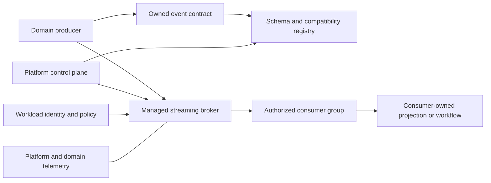
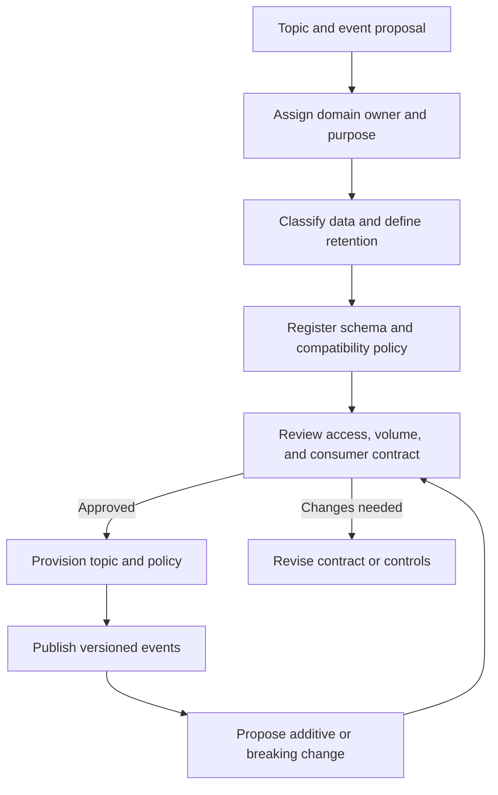
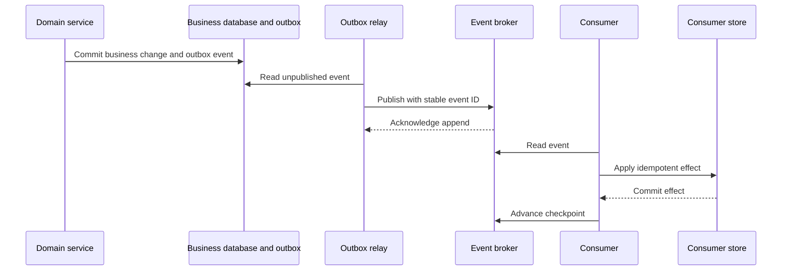
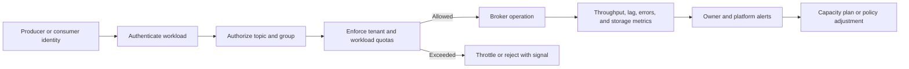
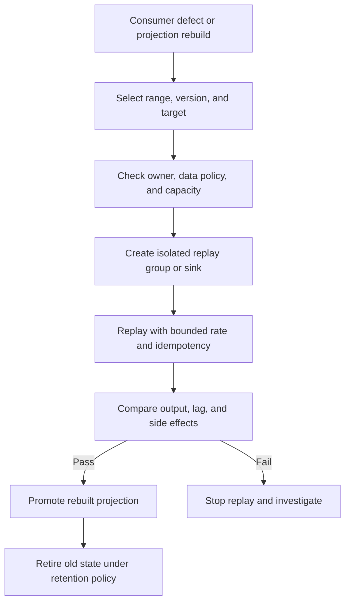

# Event Streaming Platform

Part: [24 — Real-World Case Studies](PART_OVERVIEW.md)

This case study designs a shared event streaming platform for domain teams that need durable, asynchronous integration. The platform provides topics, schemas, identity, quotas, observability, and operational support. Domain teams remain responsible for event meaning, publication correctness, and consumer behavior. Streaming is not a universal replacement for synchronous APIs or a license to share database tables as events.

## Establish the Platform Boundary

The platform exposes a managed path to publish and consume events. It separates control-plane tasks such as topic approval and schema registration from data-plane operations such as append, read, and checkpoint. Domain owners define business events and retention needs; platform operators define the supported broker, tenant isolation, and service objectives.

Do not let the platform team define every domain payload centrally. A federated contract model keeps business meaning with domain owners while enabling common compatibility and security checks. Make ownership discoverable for every topic and schema.

## Govern Topic and Schema Lifecycle

Topic creation should declare owner, purpose, data classification, retention, expected throughput, consumers, and recovery expectations. Schema review detects breaking changes, but compatibility mode alone does not ensure semantic compatibility. Producers should publish intentional domain facts rather than leaking internal database layouts.

Treat deletion, retention, and replay as data-governance decisions. A retained event may contain personal or regulated data even when downstream projections have removed it. Contract evolution requires consumer communication and a migration plan when compatibility cannot be maintained.

## Publish and Consume With Durable Progress

A producer should use an outbox or another atomic handoff when a business state change and event publication must remain consistent. Consumers should process idempotently, checkpoint only after durable work, and handle poison events without blocking unrelated partitions indefinitely. Delivery semantics vary by broker, client, and sink; state the actual guarantee at each boundary.

Retries can redeliver an event, and a consumer can fail after applying its effect but before checkpointing. Stable event identifiers and idempotent effects reduce duplicate impact. For external side effects, use a durable command workflow or deduplication at the receiver rather than assuming transport-level exactly once.

## Isolate Tenants and Protect Capacity

Authentication identifies the workload; authorization scopes it to approved topics and consumer groups. Enforce quotas for connections, throughput, storage, and partitions. Capacity policy should account for noisy producers, slow consumers, retention growth, and regional failure. Avoid broad wildcard permissions that turn one compromised workload into platform-wide access.

Quota responses should be observable and actionable. Provide consumer lag and retention estimates to domain owners before a slow consumer loses access to required history. Define how partition count, ordering scope, and key selection affect hot partitions and recovery time.

## Recover, Replay, and Retire Streams

Replay supports backfills, consumer fixes, and rebuilding projections. It can overload sources and sinks or repeat external effects. Use isolated replay groups, bounded rates, stable event IDs, versioned consumer logic, and explicit approval for sensitive streams. Retention should reflect both business recovery needs and legal deletion obligations.

Do not replay production events into external side effects by default. Make cancellation, progress, and resource impact visible. Before retiring a topic, identify active consumers and document whether the data has been archived, deleted, or retained for recovery.

## Worked Case: Order Lifecycle Events

An order service publishes `OrderPlaced`, `OrderPaid`, and `OrderCancelled` events. The service commits each event to an outbox with the corresponding state change. Consumers build fulfillment and customer-notification workflows independently. Each consumer has its own group, owner, lag objective, and idempotency strategy.

The platform registers schemas and rejects an incompatible change until the producer and consumers agree on migration. A slow notification consumer can recover from retained events without blocking fulfillment. Replaying the fulfillment consumer targets an isolated projection and does not re-send customer messages. Access to customer data is limited to approved workloads and retention is aligned with policy.

## Review Questions

1. Who owns the business meaning and lifecycle of each event?
2. How does a producer make business state and event publication consistent?
3. What duplicate or ordering behavior can consumers observe?
4. How are tenant permissions and noisy-neighbor effects controlled?
5. How do replay and retention comply with external side-effect and data policies?

An event streaming platform succeeds when teams can integrate without surrendering domain ownership or operational discipline. Govern contracts and access, make consumer progress durable, meter shared capacity, and design replay as a controlled production workflow.
