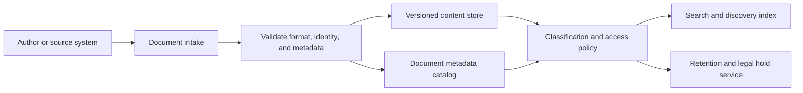
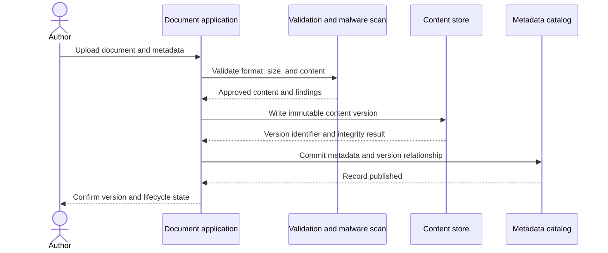
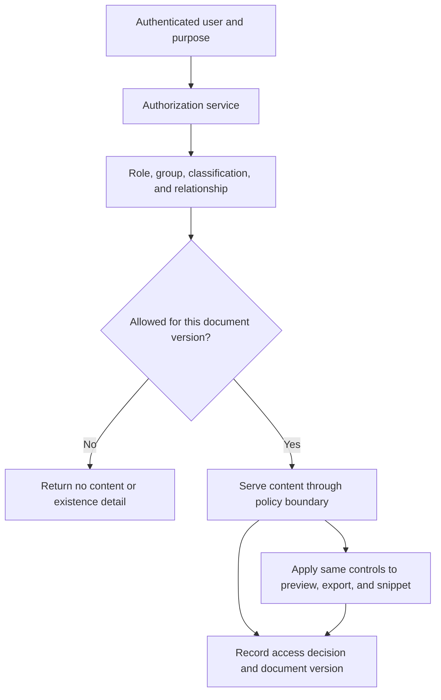
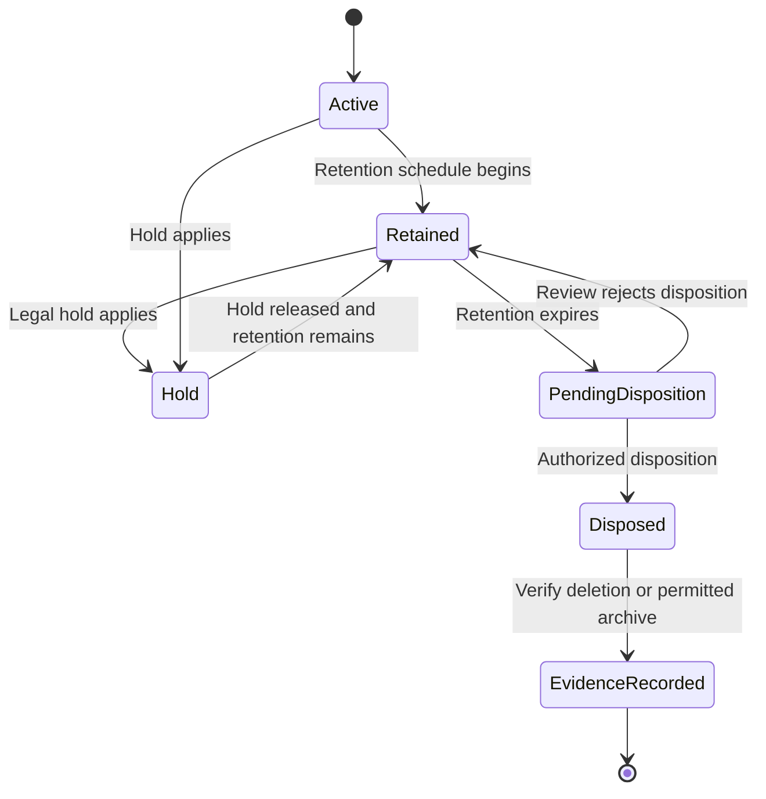
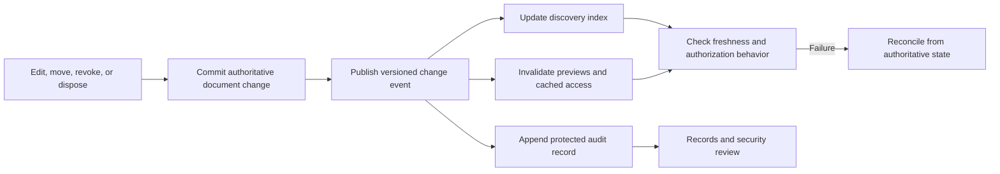

# Enterprise Document Management System

Part: [24 — Real-World Case Studies](PART_OVERVIEW.md)

This case study designs an enterprise document management system (EDMS) for creating, finding, sharing, and retaining business documents. The system must preserve content and metadata, enforce authorization, track versions, and honor retention and legal holds. It complements authoritative business systems rather than replacing their records of transactions or identity.

## Define the Document Record

A document record includes content, owner, classification, business context, version, access policy, lifecycle state, and provenance. Metadata should support discovery and governance without forcing every business domain into one universal taxonomy. Define which system is authoritative for each field and how updates propagate.

Keep content and metadata linked by stable document and version identifiers. Derived previews, extracted text, thumbnails, and search indexes inherit the document's security and retention constraints. Content integrity checks help detect incomplete transfer or unauthorized modification.

## Ingest and Version Content Safely

Ingestion validates the caller, scans content, checks required metadata, and stores an immutable version or a controlled revision. It should be idempotent for retried requests and preserve source timestamps and provenance. Large-file upload should support resumable transfer without exposing temporary content outside the same access policy.

If content storage succeeds but catalog publication fails, the system needs a reconciliation process for orphaned objects. If metadata is committed first and content fails, users must not see an incomplete version. Define transaction boundaries and recovery explicitly.

## Enforce Access Across Views and Derivatives

Access decisions combine user identity, group membership, document classification, business context, and sharing policy. Enforce them at each content-serving boundary, including previews, search snippets, exports, and links. A search index may narrow results, but the content service should revalidate authorization before returning the document.

Avoid permanent public links for sensitive records. Time-limited sharing should be bound to intended recipients, purpose, and expiration. Define how copied or exported documents retain classification and how access revocation affects already-downloaded copies.

## Manage Retention, Holds, and Disposition

Records policy determines retention schedules, hold precedence, disposition approval, and evidence. A legal hold suspends deletion for an applicable scope but should not silently broaden access. Disposition must account for primary content, versions, indexes, caches, replicas, and backups according to policy.

Automated lifecycle rules should report exceptions rather than silently skip them. Preserve an evidence record describing the policy, authorization, and disposition outcome without retaining the content that was required to be deleted. Backup expiry and restore procedures must preserve deletion and hold semantics.

## Search, Share, and Audit Changes

Search should honor current authorization and communicate when results are incomplete because of access restrictions. Index updates after edits, moves, revocation, or deletion should have measurable freshness objectives. Audit history should record who changed metadata, content versions, access policy, and lifecycle state, with tamper-resistant retention appropriate to the record class.

Treat search and preview as derived services. Rebuild them from authoritative records after corruption, and verify that rebuilding does not restore deleted or unauthorized data. Make the freshness delay and its security impact visible to users and operators.

## Worked Case: Employee Records Retention

Human Resources stores signed employee documents with restricted access and jurisdiction-specific retention. The system stores immutable versions, links them to the employee record, and limits access to authorized roles and business purposes. Search results expose only permitted metadata and revalidate access before download.

When a legal hold is issued, the records service applies it to matching employee documents and pauses disposition. When the hold is released, the existing retention schedule resumes. At expiry, an authorized disposition process deletes content and derived copies, records the outcome, and preserves evidence required by policy. A failed deletion enters an exception queue for remediation.

## Review Questions

1. Which system owns document content, metadata, and business relationships?
2. Do previews, snippets, exports, and indexes inherit access and retention rules?
3. How are partial ingestion failures reconciled?
4. How do legal holds interact with scheduled disposition?
5. What evidence demonstrates that deletion and access revocation completed?

An enterprise document management system is both a content service and a records-governance boundary. Preserve version provenance, revalidate access for every derivative, define retention and hold precedence, and verify disposition across the full storage lifecycle.
