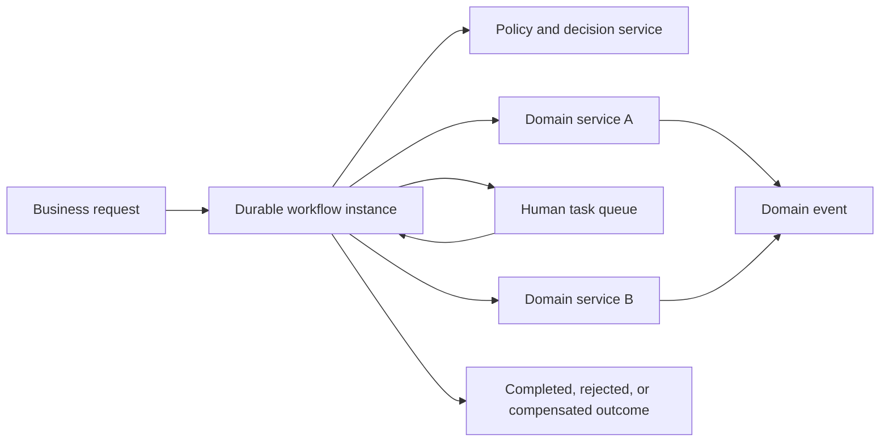
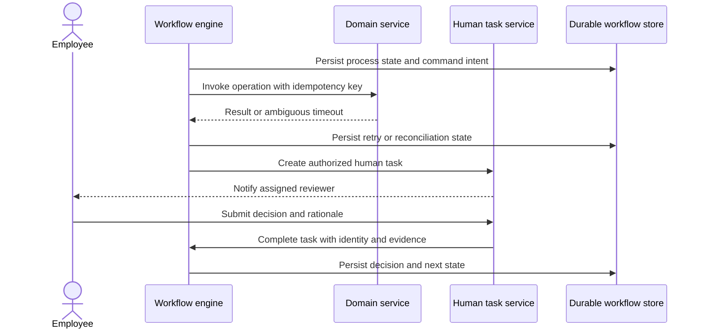
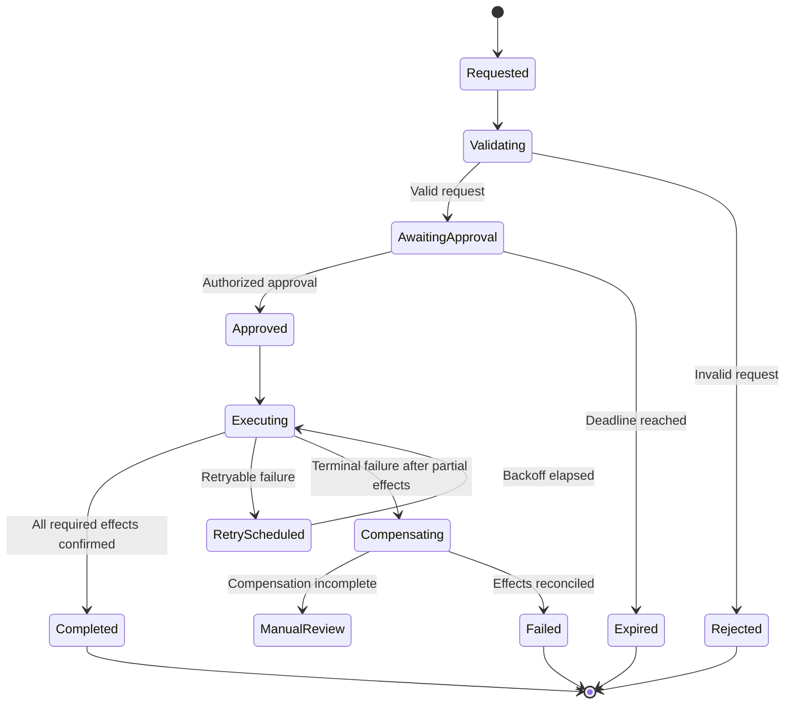
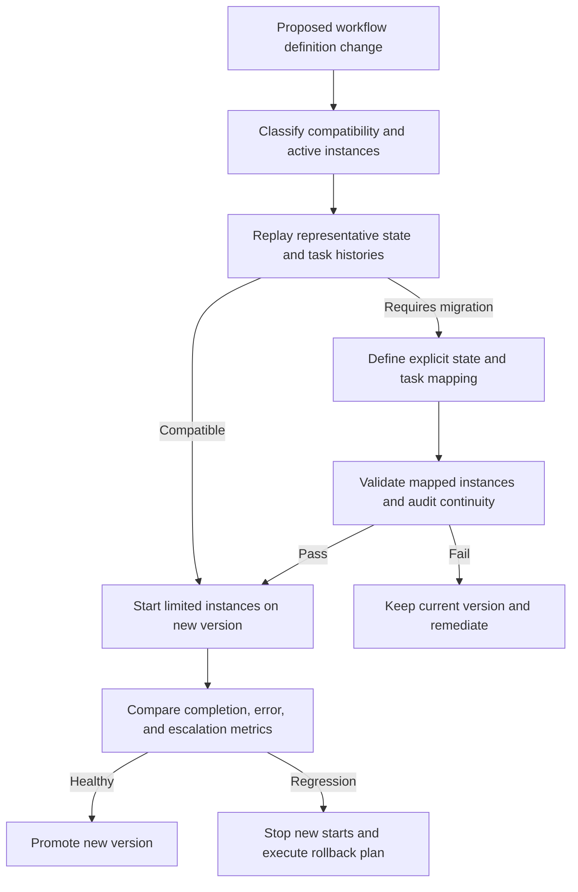
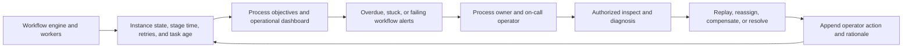

# Workflow and Business Process Management Engine

Part: [24 — Real-World Architecture Case Studies](PART_OVERVIEW.md)

This case study designs a workflow and business process management (BPM) engine for long-running business processes that span services and people. The engine coordinates durable state, timers, retries, decisions, and human tasks. Domain services remain authoritative for business data and operations. The workflow definition should clarify process ownership without turning every interaction into a central orchestration dependency.

## Choose Orchestration for the Process Boundary

Use a workflow engine where a business process has explicit stages, deadlines, compensation, or human decisions that benefit from durable visibility. Use events or direct service calls for local interactions that do not need centralized process state. The process owner defines outcomes, exception paths, and service-level objectives.

The engine coordinates and records progress; it should not become the owner of every domain entity. Store references to authoritative records and use explicit command and event contracts. Keep process definitions readable to the business owners who are accountable for outcomes.

## Execute Durable Work and Human Tasks

A workflow instance persists progress across worker failure and process restarts. External calls need idempotency keys or reconciliation because a timeout does not prove the operation failed. Human tasks require assignment rules, authorization, deadlines, escalation, and a clear record of the decision and supporting evidence.

Keep task identity and rationale in the workflow audit record. Apply privacy and retention policy to that record. Separate a user-visible task deadline from automated retry timing. If the external operation outcome is unknown, reconcile before repeating a non-idempotent action.

## Model Exceptions, Timeouts, and Compensation

Long-running workflows encounter unavailable services, rejected requests, missed deadlines, and changed business conditions. Define retryable and terminal errors, bounded attempts, escalation, and compensation. Compensation is a new business action, not a database rollback; it can fail and require manual resolution.

Retries should use backoff, jitter, and explicit budgets to avoid synchronized load. Expose the difference between process failure and business rejection. Record compensating actions and their results so operators can determine what remains outstanding.

## Evolve Workflow Definitions Safely

Workflow definitions change while instances are active. A versioning strategy should state whether existing instances remain on their original definition, migrate through explicit mappings, or complete before rollout. Test migrations against realistic persisted state and define rollback limits; changing the current definition does not automatically transform active instances.

Track definition version on every instance and task. Keep old workers and dependencies available while old instances remain in flight. Migration must preserve timers, authorization context, audit history, and idempotency state.

## Operate the Workflow Service

Operations need visibility into process age, stage duration, queue depth, retries, overdue tasks, stuck instances, and dependency failures. Provide authorized search and repair tools that preserve an audit trail. Establish ownership for dead-letter handling, manual task reassignment, and disaster recovery.

Avoid unrestricted manual state edits. Prefer supported repair actions that validate the current state and emit an audit record. Backups and restore tests should include workflow state, task assignments, timers, and the definitions needed to resume execution.

## Worked Case: Supplier Onboarding

Supplier onboarding collects organization details, verifies tax and banking information, obtains risk approval, and enables purchasing. The workflow calls domain services for validation, creates review tasks for authorized staff, and waits durably for external evidence. Rejected information returns to the supplier with a clear correction path.

If a banking update times out, the workflow queries the authoritative payment service before retrying. If risk approval fails after a supplier record was created, the process disables purchasing through a compensating domain operation and routes incomplete compensation to manual review. Each instance records the workflow version and decision evidence under the applicable retention policy.

## Review Questions

1. Which processes need durable orchestration rather than direct service calls?
2. Which system owns each piece of business state and side effect?
3. How are ambiguous timeouts and non-idempotent operations reconciled?
4. How do active instances behave when definitions change?
5. Which repair actions are available to operators, and how are they audited?

A workflow engine adds value when process state, human work, and recovery remain visible over time. Persist progress, model exceptions as business outcomes, make external effects idempotent or reconcilable, and version active processes deliberately.
