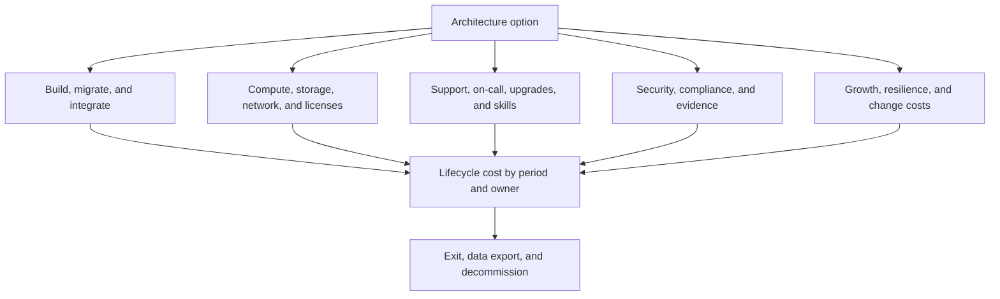
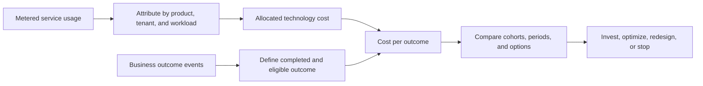
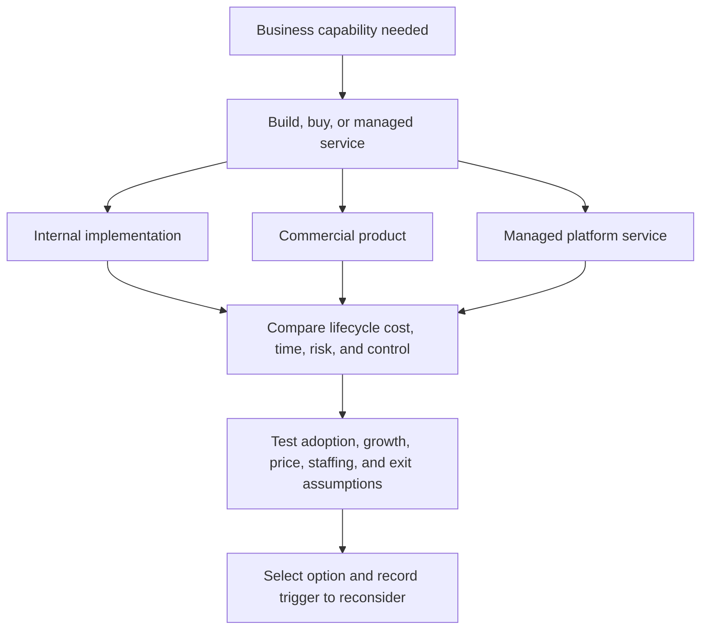
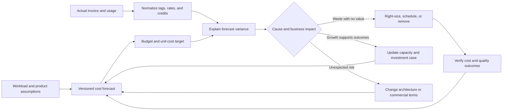
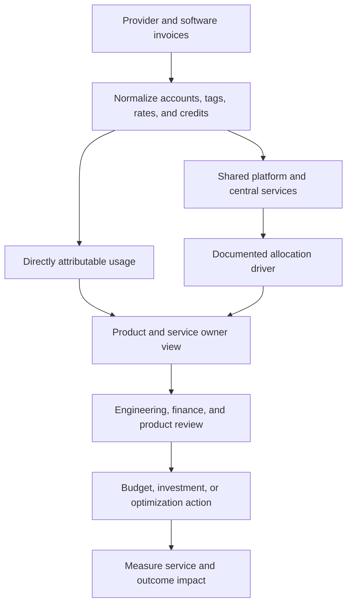

# FinOps and Software Engineering Economics

Part: [25 — Additional Architect Competencies](PART_OVERVIEW.md)

Financial Operations (FinOps) connects technology usage to business value through shared accountability among engineering, finance, product, and operations. An architect uses it to compare lifecycle options, make cost drivers visible, and establish feedback that changes design or operation when economics diverge from assumptions. FinOps does not mean minimizing the cloud invoice at the expense of reliability, security, or outcomes.

## Model Lifecycle Cost and Cost Drivers

Total cost of ownership (TCO) includes more than infrastructure charges. A useful model includes acquisition or migration, implementation, licenses, runtime, data movement, observability, security, support, staffing, training, change, and retirement. Separate one-time and recurring costs, fixed and usage-sensitive costs, and costs borne by different teams. Include workload growth and renewal assumptions over a stated horizon.

Cost estimates are models, not facts. State the source and confidence of each input, distinguish vendor quotes from measured usage, and expose what is excluded. A low monthly price can hide migration effort, minimum commitments, specialist staffing, or an expensive exit path.

## Connect Spend to Business Outcomes

Aggregate spend can rise while unit cost improves if workload volume grows faster. Conversely, a flat bill can conceal deteriorating efficiency or reduced adoption. Choose a denominator that represents value delivered, such as cost per completed transaction, onboarded customer, processed claim, or retained active user. Define success and failure consistently so teams cannot make unit cost appear better by excluding expensive unsuccessful work.

Unit economics connect engineering measures to product and finance decisions. Pair cost per outcome with quality and experience measures; otherwise a system can lower cost by shifting work to support, increasing failures, or excluding difficult customers. Compare like workloads, periods, and service levels.

## Compare Build, Buy, and Operate Options

Build, buy, and managed-service choices shift cost, risk, control, and opportunity cost. A purchased service can reduce delivery time but introduce usage tiers, egress, contractual limits, data-location constraints, and vendor dependence. Building in-house may increase control yet require a permanent team for patching, incident response, compatibility, and feature work.

Estimate the team capacity displaced by each option. Opportunity cost is the value of the best credible alternative use of that capacity, not a second invoice to add blindly to TCO. Use scenarios for uncertain adoption and price rather than false precision. Record which assumptions would reverse the decision.

## Forecast, Measure, and Optimize

Forecasts should connect architecture drivers to spend: requests, data volume, retention, concurrency, resilience targets, and pricing units. Compare actuals with forecast at a cadence that allows intervention. A variance is a question to investigate, not automatically evidence of waste; it may reflect adoption, a reliability event, an instrumentation change, or a price-model shift.

Optimization should be a governed engineering change with an owner, expected saving, quality guardrails, and a verification window. Rightsizing that reduces headroom may increase latency or incident risk. Discounts and commitments can lower rates but reduce flexibility; model utilization and exit exposure before purchase.

## Assign Cost Ownership Without Creating Perverse Incentives

Allocation models range from direct metering to shared-cost allocation. Direct costs should follow observed use where practical. Shared platform costs can be allocated by a causal driver such as reserved capacity, requests, or storage; when no fair driver exists, report them transparently rather than presenting an arbitrary split as precise consumption. Showback informs teams; chargeback additionally transfers budget responsibility.

Avoid incentives that reward teams for moving cost off their books, reducing useful resilience, or underinvesting in shared capabilities. Make allocation rules stable and explain changes. Reconcile allocated totals with source invoices and disclose unallocated amounts.

## Worked Case: Falling Cost per Successful Claim

An insurer's claims service invoice rises as claim volume grows. Finance requests a flat budget, while product reports faster claim resolution. The architecture team defines cost per successfully resolved claim and includes compute, document processing, storage, observability, and human review. It segments by claim complexity and reports resolution time and rework alongside cost.

Measurements show that a new document pipeline reduces manual review for common claims but increases processing cost for low-volume complex cases. The team retains the pipeline for the high-volume cohort, tests a lower-cost path for simple documents, and avoids optimizing away controls that prevent incorrect denials. A quarterly review compares realized savings, service quality, and the adoption assumptions in the business case.

## Review Questions

1. Which lifecycle costs and owners are excluded from the current estimate?
2. What denominator represents business value without hiding unsuccessful work?
3. Which assumptions could reverse a build, buy, or managed-service choice?
4. How can teams attribute forecast variance to workload, price, or architecture?
5. Do allocation rules encourage system-wide value or merely local cost shifting?

Economic architecture makes assumptions and trade-offs inspectable. Model lifecycle cost, connect it to outcomes, account for uncertainty and opportunity cost, and verify optimizations against quality rather than celebrating invoice reduction alone.
