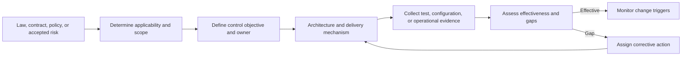
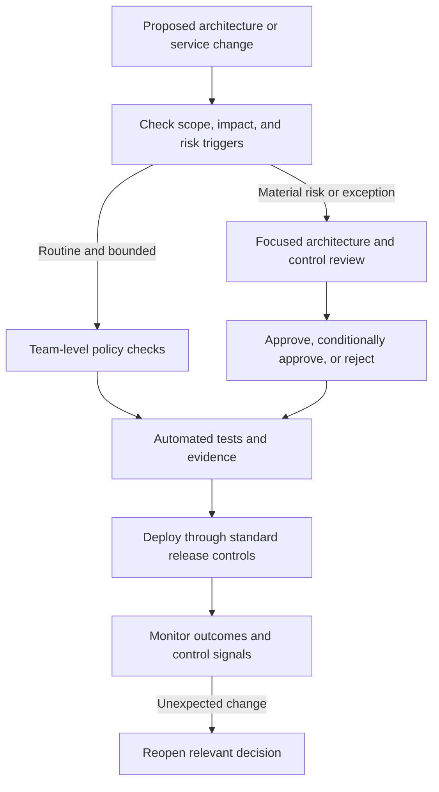
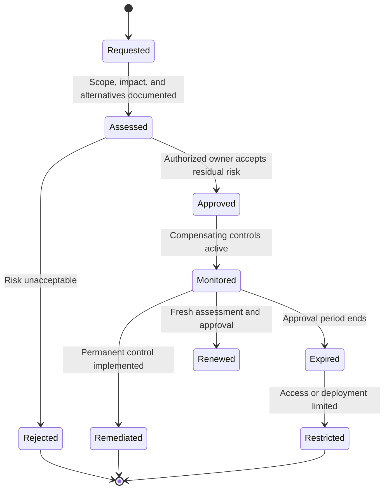
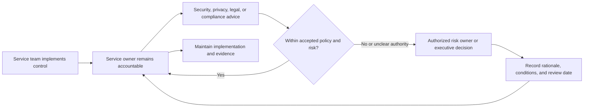
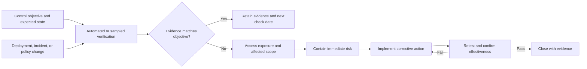

# Architecture Governance and Compliance

Part: [25 — Additional Architect Competencies](PART_OVERVIEW.md)

Architecture governance connects policy intent to decisions, implementation, evidence, and correction. Compliance asks whether obligations are met; governance defines who decides, how risks are accepted, and how assurance remains effective as systems change. This chapter focuses on applying those controls to engineering and architecture work. Enterprise architecture governance models belong to [Part 18 — Enterprise Architecture](../18_Enterprise_Architecture/PART_OVERVIEW.md).

## Translate Obligations Into Verifiable Controls

An obligation may come from law, contract, internal policy, or a risk decision. Translate each applicable obligation into a control statement that names scope, accountable owner, expected behavior, verification method, evidence, and review trigger. Avoid treating a regulation title as an implementable requirement: teams need to know which system behavior or operating practice satisfies it.

A control should be testable at a stated cadence and distinguish design intent from operating effectiveness. For example, requiring encrypted storage is not enough; define covered data stores, approved key-management boundaries, how configuration is checked, and what happens when a check fails. Security and privacy chapters own their detailed controls; governance records applicability and assurance.

## Use Proportionate Reviews in Delivery

Reviews add value when they reduce material risk or reveal cross-team consequences. Use lightweight asynchronous checks for routine, reversible changes and deeper review for regulated data, new trust boundaries, difficult recovery, large commitments, or broad reuse. Make entry criteria and decision rights explicit. Avoid a review board becoming a queue for decisions that service owners can make within policy.

Reviews should return an accountable decision, rationale, conditions, owner, and reconsideration trigger. A review is not a substitute for independent testing or continuous controls. Record evidence once in a discoverable system and link it to the relevant service and control rather than asking teams to recreate documents for every forum.

## Manage Exceptions as Risk Decisions

Exceptions are sometimes necessary while a control is infeasible, temporarily unavailable, or disproportionate to a bounded risk. An exception must identify affected assets, threat or obligation, compensating controls, business owner accepting residual risk, expiry, and conditions for earlier revocation. Approval must come from a person authorized to accept that risk, not merely from the team requesting relief.

An exception is not a permanent alternative standard. Expiration must cause a review or a defined operational restriction; otherwise expiry is only a calendar field. Track the age, risk category, compensating-control health, and accountable owner of every open exception.

## Connect Reviews to Accountability and Escalation

Architecture controls cross functional boundaries. Name who implements, who is accountable for the service, who interprets the control, and who can accept residual risk. Escalation should resolve decision authority or competing objectives; it should not be a way to transfer ownership to a committee. Apply the [Responsible, Accountable, Consulted, and Informed (RACI)](../01_Architecture_Mindset/CH02_Role_of_a_Solution_Architect.md) model only where role clarity is needed, rather than making a matrix for every decision.

Keep advice, implementation, and risk acceptance distinct. Specialists can interpret obligations and recommend controls, but service owners remain responsible for running their services. Escalate when policy conflicts, evidence is insufficient, risk exceeds delegated authority, or one team’s decision transfers material risk to another.

## Detect Control Drift and Prove Remediation

Controls can fail after initial approval because infrastructure changes, ownership moves, dependencies age, or evidence collection stops. Detect drift through automated configuration checks, deployment evidence, incident trends, access reviews, and periodic sampling. Classify findings by impact and exposure; assign an owner and due date; then verify the correction independently enough to avoid closing work based only on a declaration.

Evidence should be proportionate, time-bounded, attributable, and linked to the control and system version. Prefer machine-readable proof where it is reliable, but retain human review for context-dependent decisions. Measure stale evidence, repeat findings, time to remediate, and exceptions past expiry to reveal whether governance is working.

## Worked Case: Temporary Data Residency Exception

A product team needs to launch in a region where one analytics dependency does not yet support required data residency. The team inventories the data fields and flows, excludes direct identifiers, and evaluates a regional substitute. Privacy and legal specialists interpret the obligation; the service owner documents residual risk and compensating controls; the authorized risk owner approves the exception with a brief duration, a stated expiry, and clear launch conditions.

A deployment check verifies that excluded fields are not sent to the dependency. The exception is reviewed when the substitute becomes available or the data flow changes. If the check detects a prohibited field, the pipeline blocks release. It also alerts the owner. The exception closes only after migration evidence and a verification run are recorded.

## Review Questions

1. Can each obligation be traced to a control owner and verifiable evidence?
2. Are review depth and decision authority proportionate to the risk?
3. Do exceptions name residual-risk owners, compensating controls, and expiry behavior?
4. How are policy changes and system changes reflected in control checks?
5. Does closure demonstrate verified remediation rather than a status update?

Effective architecture governance makes risk decisions traceable and controls testable without turning review into ceremony. Connect obligations to implementation and evidence, give decisions to authorized owners, expire exceptions meaningfully, and detect drift throughout the service lifecycle.
