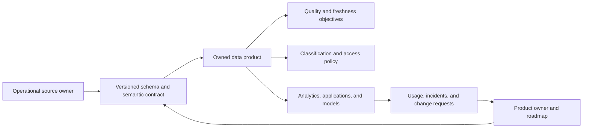
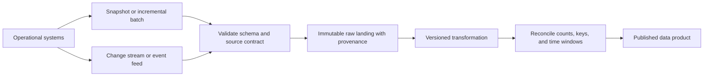
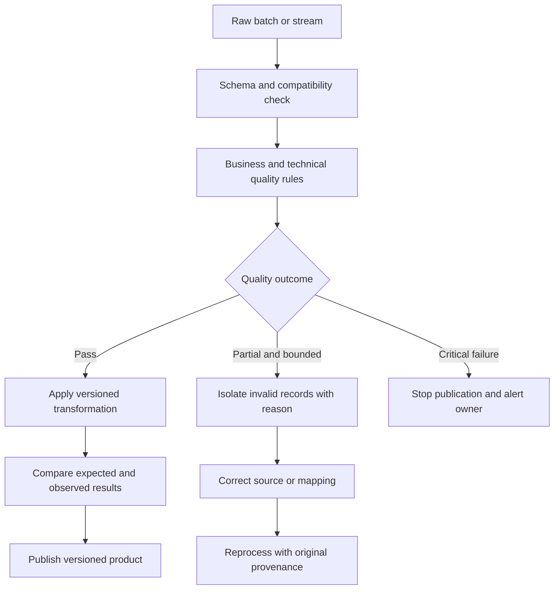
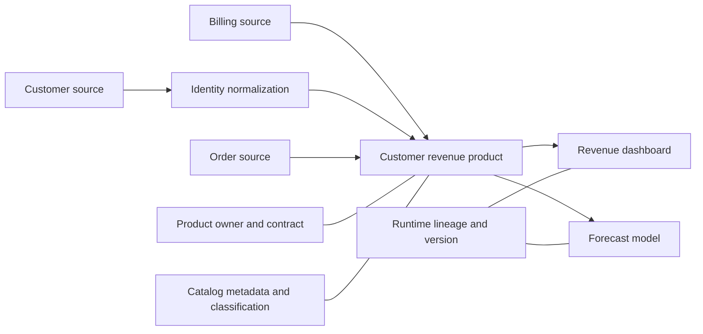
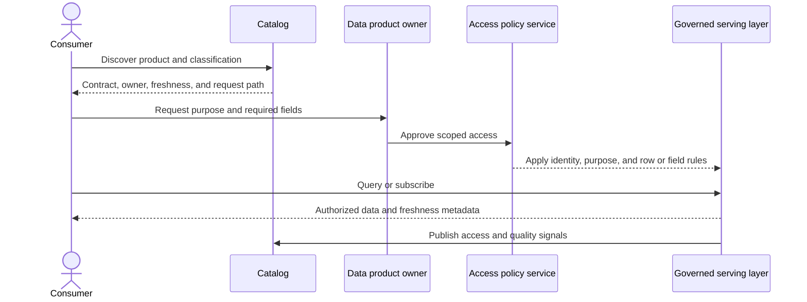

# Data Engineering for Architects

Part: [25 — Additional Architect Competencies](PART_OVERVIEW.md)

Data engineering turns data from operational systems into governed, dependable products for analytics, integration, and machine learning. An architect defines the contracts, movement, ownership, quality, access, and recovery boundaries across that lifecycle. Database engines and storage internals are covered in [Part 06 — Databases and Storage](../06_Databases_and_Storage/PART_OVERVIEW.md); this chapter focuses on cross-system data architecture.

## Establish Data Products and Source Contracts

A data product has an accountable owner, intended consumers, documented semantics, quality expectations, access policy, freshness target, and support path. A source contract defines fields, meaning, keys, update behavior, deletion semantics, and change compatibility. Without those semantics, downstream teams infer meaning from column names and fragile timing assumptions.

Distinguish a data product from a dataset or pipeline. A pipeline moves and transforms data; a product makes a supported promise to consumers. Contracts should document nullability, units, time zones, identifiers, late updates, and what happens when a field is removed or reinterpreted.

## Ingest Batch and Streaming Data

Batch ingestion processes bounded extracts or snapshots and is often simpler to reconcile and replay. Streaming ingestion processes ongoing changes with lower latency but introduces ordering, duplicate, checkpoint, and late-arrival behavior. Many platforms need both: streams for timely updates and periodic reconciliation for completeness. Choose latency based on the consumer decision, not because a stream is fashionable.

Capture source version, extraction time, event time, and ingestion time so freshness and delay can be measured. A snapshot can recover missed changes, but only if keys and deletion semantics are defined. A stream can improve timeliness but does not guarantee complete state without retention, checkpointing, and reconciliation design.

## Transform, Validate, and Quarantine

Transformations encode business meaning and should be versioned and testable. Data quality checks can cover schema, completeness, uniqueness, validity, timeliness, and reconciliation. A failed check needs an explicit policy: reject the batch, quarantine affected records, publish with a warning, or pause the product. Silent coercion can corrupt downstream decisions while making dashboards appear healthy.

Quarantine requires ownership and retention limits; otherwise it becomes an ungoverned shadow dataset. Preserve rejected-record reasons without exposing sensitive payloads broadly. Reprocessing must be idempotent and traceable to the transformation version and source range.

## Preserve Metadata, Ownership, and Lineage

A catalog should help consumers find datasets, understand semantics, determine owners, and request access. Lineage traces dependencies from source through transformations to products and decisions. It supports impact analysis, incident diagnosis, and change review, but only if lineage is captured from actual pipeline execution or validated configuration rather than maintained as an informal diagram alone.

When a source field changes, lineage should identify impacted products and consumers before deployment. Ownership metadata should include support and escalation, not only a team name. Retain enough transformation and source-version history to reproduce material outputs within the applicable retention policy.

## Govern Access and Serve Consumers

Access should follow purpose, classification, and least privilege. Serving patterns vary: warehouse queries, curated extracts, application APIs, feature services, and event feeds each trade freshness, isolation, cost, and consumer autonomy differently. Avoid copying sensitive data into a lower-control environment simply because it is convenient to query.

Where row or field filtering is required, enforce it at the serving boundary and test alternate paths such as extracts, caches, and service accounts. Define revocation propagation and whether consumers may retain copies. Log access metadata with privacy controls; do not make sensitive query content the default audit trail.

## Worked Case: Reliable Customer Revenue Product

Finance needs a daily customer revenue product combining orders, billing adjustments, and customer identity. The source owners agree on stable customer keys, correction windows, currency units, and deletion handling. Batch ingestion provides reconciliation with source totals; a change stream reduces update latency for the operational view. A daily snapshot detects missed events and repairs the analytical product.

A quality gate quarantines unmatched billing adjustments and blocks publication if the variance exceeds the agreed threshold. The owner investigates the source mapping, reprocesses the affected period using a versioned transformation, and records the correction. Catalog metadata names finance as the semantic owner and platform operations as pipeline support. Access is granted by purpose and fields, and lineage identifies dashboards that must be revalidated after a contract change.

## Review Questions

1. Who owns the semantics, quality objective, and support path for each product?
2. Which consumers truly need streaming freshness rather than reconciled batch data?
3. What happens to invalid or late data, and who resolves it?
4. Can a field change be traced to affected products and consumers?
5. Where are purpose, classification, and least privilege enforced at serving time?

Reliable data architecture combines explicit contracts with operational recovery. Define products and ownership, choose movement patterns from consumer needs, quarantine failures visibly, preserve lineage, and enforce governance where data is served.
