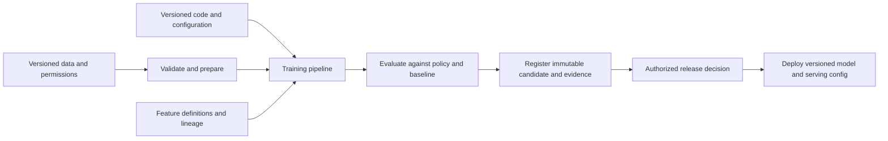
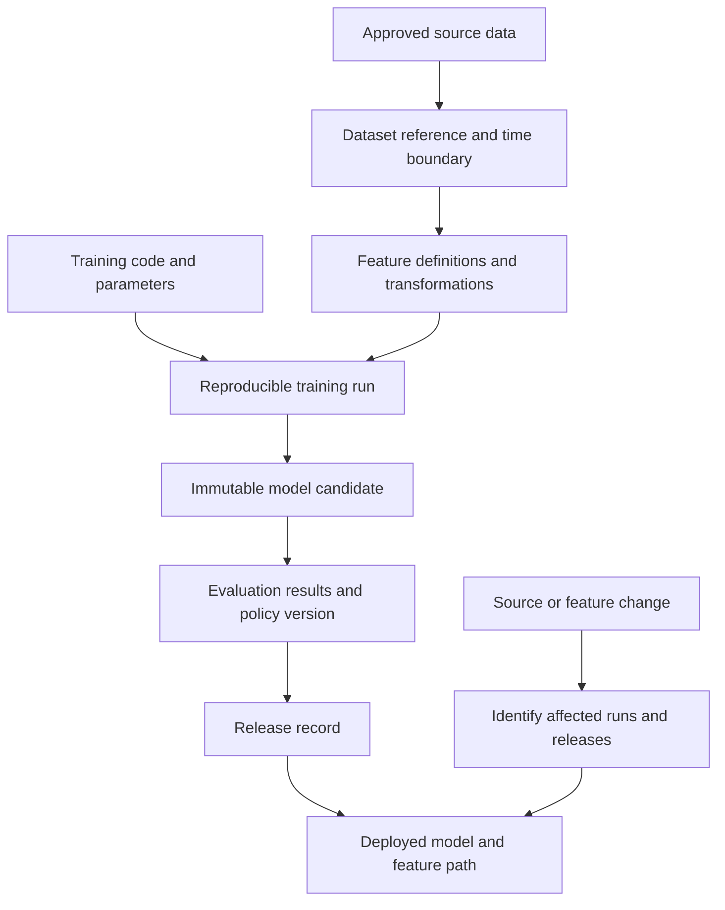
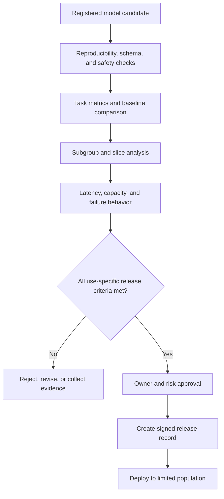
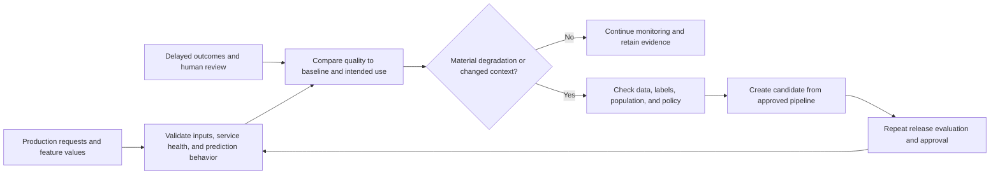
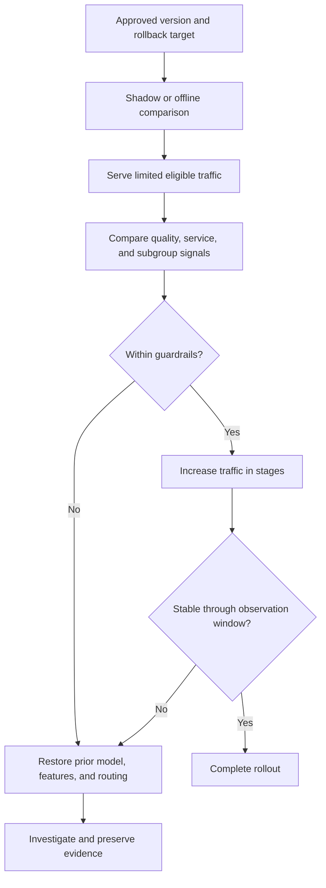

# MLOps (Machine Learning Operations)

Part: [25 — Additional Architect Competencies](PART_OVERVIEW.md)

Machine Learning Operations (MLOps) makes changes to data, features, models, and serving behavior reproducible and governable throughout a model's lifecycle. It connects experimentation to production promotion, monitoring, rollback, and retirement. [Part 16 — AI, Machine Learning, and Generative AI](../16_AI_and_GenAI/PART_OVERVIEW.md) owns machine-learning methods; [Part 17 — AI Architecture](../17_AI_Architecture/PART_OVERVIEW.md) owns system-level AI architecture. This chapter focuses on operating the lifecycle and preserving evidence across handoffs.

## Build a Reproducible Training and Release Path

A model release depends on more than a model file. Record code, data references and versions, feature definitions, parameters, evaluation results, environment, and intended use. Keep training and serving transformations consistent or explicitly measure their differences. Make pipeline stages repeatable and identify which inputs invalidate prior artifacts.

Reproducibility does not mean retaining prohibited data indefinitely. Store immutable references, hashes, and permitted snapshots under retention policy. Record environment dependencies and deterministic settings where feasible; when exact reproduction is impossible, document the source of nondeterminism and preserve the evidence needed to explain the result.

## Preserve Dataset, Feature, and Artifact Lineage

Lineage makes a deployed model's provenance inspectable: which source data, transformations, features, code, and evaluation produced it. It also supports impact analysis when a source contract or feature changes. Feature definitions should identify ownership, training and serving computation, freshness, and missing-value behavior.

A registry should distinguish a candidate from an approved, deployable release. The release record ties artifact identity to approval, intended population, owner, deployment configuration, and rollback target. Lineage needs operational enforcement: if a required input version or evaluation record is missing, promotion should stop rather than create an unverifiable deployment.

## Gate Promotion on Evidence and Intended Use

Evaluation criteria depend on the model's role and impact. Compare candidates to an agreed baseline on representative data; examine subgroup behavior and known limitations; check operational constraints such as latency, memory, and failure handling. Define thresholds and authorized approvers before seeing results to reduce selection bias. An evaluation report should support a decision, not merely display a score.

Thresholds should reflect consequences, uncertainty, and a model's intended use. For a low-impact ranking suggestion, a human correction path may be enough; for eligibility or safety decisions, stronger independent review and appeal mechanisms may be required. Do not average away a critical subgroup failure behind a favorable global metric.

## Monitor Performance, Drift, and Retraining Triggers

Production monitoring spans service health and model behavior. Track input validity, missing features, prediction distributions, outcome quality when labels arrive, subgroup measures, latency, cost, and human override patterns. Data drift or a changed prediction distribution is a signal to investigate, not proof that model quality degraded. Retraining should follow evidence and a release gate, not run automatically because a timer fired.

Labels may arrive late or reflect biased operational decisions. Track observation windows and label provenance, and avoid treating missing outcomes as successful predictions. Define alert thresholds, review owners, and containment actions; a monitoring signal without an operational response is not a control.

## Deploy Gradually and Roll Back Deliberately

Deployment strategies include shadow evaluation, small canaries, cohort routing, and broader staged rollout. Select by risk, traffic, and ability to compare outcomes. Keep the prior approved artifact and compatible feature contract available until the new release is stable. A rollback may require reverting model, preprocessing, configuration, or routing together.

Define what traffic is eligible for a canary and how outcomes are compared; a model can appear better simply because it sees easier cases. Rollback criteria should be measurable and tested before release. For irreversible external actions, define a safe fallback. A human review path may also be necessary.

## Worked Case: Fraud-Risk Model Promotion

A payments team updates a fraud-risk model as transaction patterns change. The pipeline records the permitted dataset period, feature versions, training code, and candidate artifact. Evaluation compares loss prevention and false declines across regions and customer segments, then checks latency and capacity under peak traffic. The risk owner approves only the intended transaction cohort and records limitations.

The release begins in shadow mode, then a small eligible cohort. A rise in false declines for a region triggers an automatic traffic stop and rollback to the prior model and feature configuration. Analysts investigate a source-field change; the corrected feature pipeline produces a new candidate and repeats evaluation. The team retains release evidence and does not retrain on disputed labels until their provenance is reviewed.

## Review Questions

1. Can a deployed artifact be traced to its data, code, features, and evaluation policy?
2. What evidence and approvals are required for this model's intended use?
3. How are late labels, subgroup performance, and input drift interpreted?
4. Which model, feature, and routing components must roll back together?
5. Who responds to each production signal, and what containment action is available?

MLOps is the operating discipline that makes model changes reviewable and recoverable. Version the inputs and artifacts, gate promotion on use-specific evidence, monitor model and service behavior, and rehearse rollback across the complete serving path.
