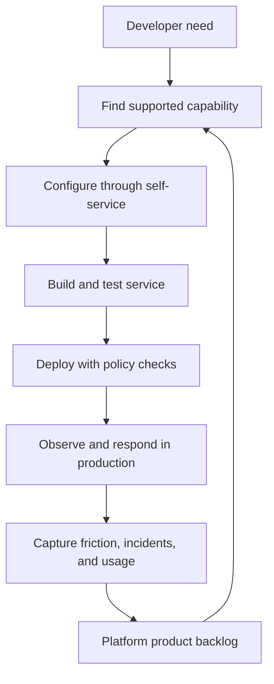
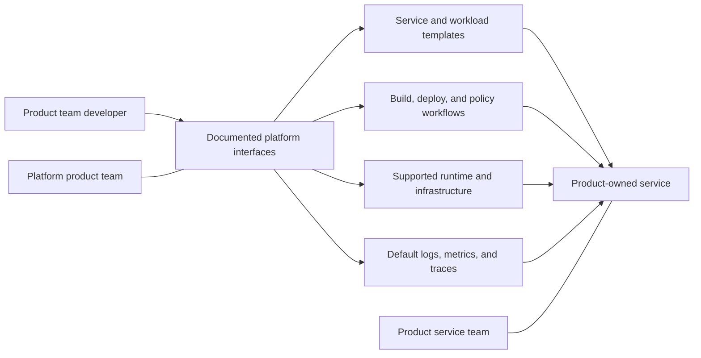
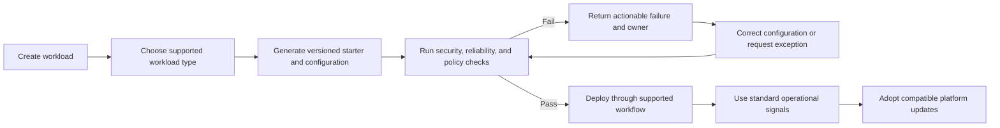
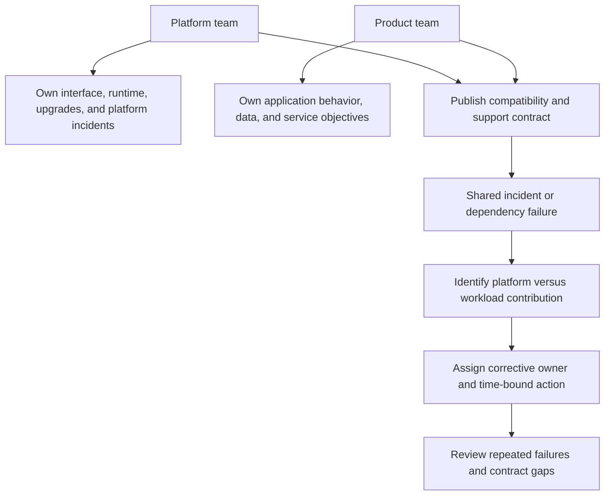
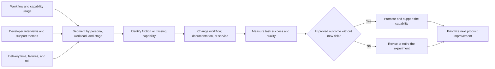

# Platform Engineering

Part: [25 — Additional Architect Competencies](PART_OVERVIEW.md)

Platform engineering provides reusable capabilities that let product teams deliver and operate services with less repeated cognitive and operational load. An internal developer platform is a product, not merely a cluster, portal, or central team. Its value depends on supported workflows, clear boundaries, reliability, adoption, and whether teams can still make justified choices outside the default path.

## Design Around Developer Work

Start with developer tasks and friction rather than a catalog of infrastructure components. Identify personas and journeys such as creating a service, obtaining data access, deploying safely, diagnosing production, and retiring a workload. Measure lead time, failure, toil, and satisfaction at the task level; a polished portal that does not remove waiting or repeated work is not useful self-service.

Design for the complete lifecycle, including local development, security review, production access, upgrades, and decommissioning. Gather evidence from interviews and workflow telemetry; low adoption can indicate missing capabilities, poor usability, misaligned incentives, or simply that the task is rare.

## Define the Platform Product Boundary

The platform team owns supported interfaces and operational capabilities it promises to product teams. It may provide templates, deployment workflows, identity integration, observability defaults, and managed infrastructure. Product teams still own service behavior, data semantics, business authorization, and their on-call outcomes. A platform boundary should make these responsibilities explicit rather than hide them behind a portal.

Offer capabilities through documented interfaces. Publish compatibility and support policies for each. A platform can be composed from vendor products or internal services; the architectural contract is the developer-facing workflow and operating model, not a required implementation stack. Part 13 owns general delivery automation; this chapter addresses the platform as a reusable product surface.

## Build Paved Paths With Escape Hatches

A paved path packages a repeatable approach for a common workload type. Examples include stateless services and scheduled data jobs. It should include defaults, automated checks, upgrade behavior, and operational guidance. Defaults reduce repeated decisions but must not prevent a team from meeting a legitimate constraint the path does not cover.

Make the compliant path easier than bypassing it, but retain an exception route for novel or constrained workloads. An exception should identify the unmet capability and owner so it informs the roadmap. Version templates and migrations; forcing a breaking upgrade across every service can turn a paved path into a platform-wide outage.

## Make Team Responsibilities and Reliability Explicit

Platform engineering is a collaboration contract. The platform team is accountable for the availability and support boundaries of platform services; consuming teams are accountable for their applications and data. Define shared responsibilities for incident response, dependency upgrades, quota limits, and policy exceptions. Set service level objectives (SLOs) for platform capabilities that block or affect product delivery.

Measure the developer-facing consequences of platform reliability: failed deployments, time to recover, support response, and blocked teams. A platform's high availability is not sufficient if its control plane is unavailable during every release window. Provide degraded modes and a recovery path when self-service dependencies fail.

## Measure Adoption and Improve the Product

Adoption is evidence, not a goal by itself. Pair usage with successful task completion, lead time, reliability, support burden, and user feedback. Segment by workload type and team maturity so a rising adoption percentage does not conceal teams forced into an unsuitable path. Retire unused capabilities carefully because dependencies can exist outside observed telemetry.

Use platform telemetry with privacy boundaries and clear purpose. Do not turn usage tracking into individual developer surveillance. Publish what is measured, how it is used, and how teams can report work that the instrumentation misses.

## Worked Case: A Paved Path for a New Service

A product team needs a new web service with identity, deployment, telemetry, and production support. The platform path creates a repository with tested build and deployment configuration, connects workload identity, provisions an isolated environment, and applies security and reliability checks. The team owns business logic, data access, and service objectives; the platform team supports the shared runtime and deployment workflow.

The first deployment fails because the service needs a regional dependency not yet supported by the template. The path explains the failed policy check and offers a documented exception process. The platform team tracks the request as product feedback, assesses whether the capability recurs across teams, and either adds a supported option or keeps the exception bounded. Release-time and failure metrics show whether the new path removes work without creating operational risk.

## Review Questions

1. Which developer task and persona is the platform capability designed to improve?
2. What is owned by the platform team and what remains with each product team?
3. Does the paved path include checks, upgrades, and operational support?
4. How can a team meet a constraint outside the default without bypassing controls?
5. Do adoption measures correspond to successful outcomes and reduced toil?

Platform engineering works when reusable capabilities reduce effort while preserving team accountability. Design around developer tasks, publish stable interfaces, make defaults operable and adaptable, and use outcome evidence to guide the platform product roadmap.
