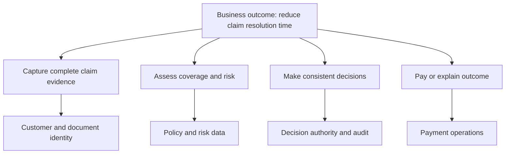
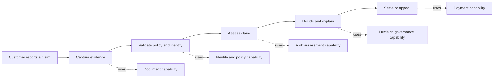
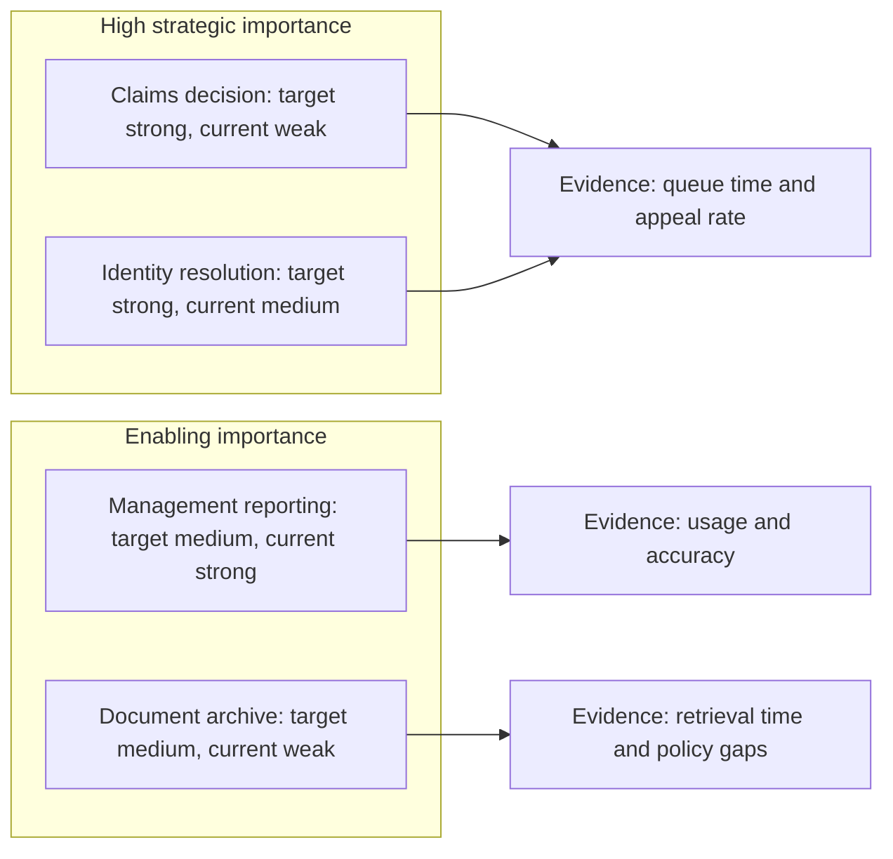
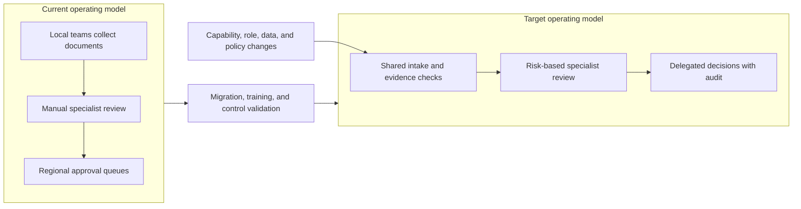
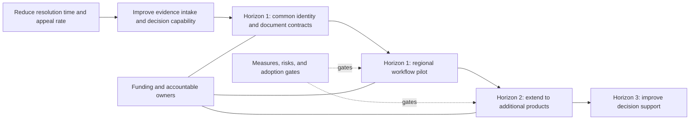

# Business Architecture Strategy

Part: [25 — Additional Architect Competencies](PART_OVERVIEW.md)

Business architecture translates strategic intent into a view of capabilities, value delivery, information, organization, and change. It helps architects test whether a proposed technology investment builds a needed business ability and whether operating responsibilities can sustain it. Enterprise-architecture frameworks and portfolio methods belong to [Part 18 — Enterprise Architecture](../18_Enterprise_Architecture/PART_OVERVIEW.md); this chapter focuses on the architect's strategy-to-change reasoning.

## Translate Outcomes Into Capabilities

A strategic outcome states a measurable change in value, risk, or service. Capabilities describe what the organization must be able to do regardless of its organizational structure today. Decompose an outcome into capabilities, identify which are differentiating or constrained, and test whether current processes, information, people, and technology can support them.

Keep outcomes measurable and owned. A statement such as “become digital” does not identify a capability gap or investment. Capabilities are relatively stable, while processes, organizational units, applications, and vendors may change; confusing them makes a strategy map obsolete whenever a team is reorganized.

## Connect Value Streams to Enabling Capabilities

A value stream describes how a stakeholder receives value through a sequence of stages. Map the actors, triggers, handoffs, evidence, and outcomes in the current flow. Link each stage to the capabilities and information it needs. This exposes delays caused by approval boundaries, missing data, or mismatched incentives. A system replacement alone does not resolve these delays.

A value stream reveals where value is delayed; a capability map reveals what ability must improve. Use both to avoid optimizing one step while moving queues or rework elsewhere. Identify the measures at each stage, such as elapsed time, first-pass completeness, appeal rate, or settlement accuracy.

## Prioritize Capability Gaps With Evidence

A capability heat map compares current ability with target importance, performance, risk, or investment. Make the rating criteria explicit and attach evidence, confidence, and an accountable owner; colors without definitions create false precision. Prioritize gaps by strategic contribution, urgency, dependency, cost, and feasibility rather than treating every weak capability as an equal project.

The visual groups capabilities by importance and current state; it is not a score to compare blindly across domains. Validate subjective ratings with operational evidence, stakeholder interviews, and risk analysis. Record when a capability is deliberately not improved because the outcome does not justify the cost.

## Shape the Target Operating Model

Changing capability often changes decision rights, skills, process ownership, data stewardship, and support. A target operating model explains who performs work, who makes decisions, what information flows, and how technology enables the interaction. State the transition from current to target and identify temporary dual-running or retraining needs.

Do not present the target state as an org chart alone. Define decision rights and exception paths, preserve appropriate local variation, and make the human workload visible. If automation changes who can approve a decision, control design and accountability must change with it.

## Sequence Investment and Traceability

Roadmaps should link investment to outcomes, capability gaps, dependencies, funding, and evidence checkpoints. Sequence enabling work before dependent capabilities, and distinguish near-term commitments from options that require further learning. Investment horizons are a planning aid, not permission to defer maintenance or assume that distant work is guaranteed.

Each roadmap item should have a traceable outcome, owner, capability effect, cost range, key dependency, and validation measure. Revisit sequencing when evidence changes, not only at annual planning. A capability investment without funding, people, and an operating owner is an aspiration rather than an executable strategy.

## Worked Case: Reducing Claims Resolution Time

An insurer targets faster claim resolution without increasing incorrect denials. The value stream shows repeated document requests and a regional review queue. Capability analysis identifies inconsistent evidence intake and unclear decision authority. The current-state heat map uses measured cycle time, missing-document frequency, and appeal outcomes to distinguish the largest gaps.

The target operating model standardizes intake, routes only defined risk cases to specialists, and gives trained adjusters bounded decision authority. The roadmap first funds common document identifiers and an evidence-quality gate, then pilots the process in one region. The team measures elapsed time, first-pass completeness, appeal rate, and workload transfer before expanding. If appeals rise, scale-up pauses while policy and training are reviewed.

## Review Questions

1. Which measurable outcome motivates the strategy and who owns it?
2. Which capabilities and value-stream stages constrain that outcome?
3. What evidence supports current and target capability ratings?
4. Which roles, decision rights, and controls change in the target operating model?
5. Can each roadmap investment be traced to funding, capability change, and evidence?

Business architecture makes strategy actionable by connecting outcomes to capabilities, work, information, ownership, and investment. Use value streams to expose delivery friction, evidence to prioritize capability gaps, and a funded roadmap to test whether the target operating model creates the intended result.
