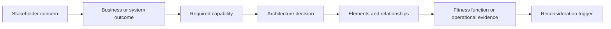
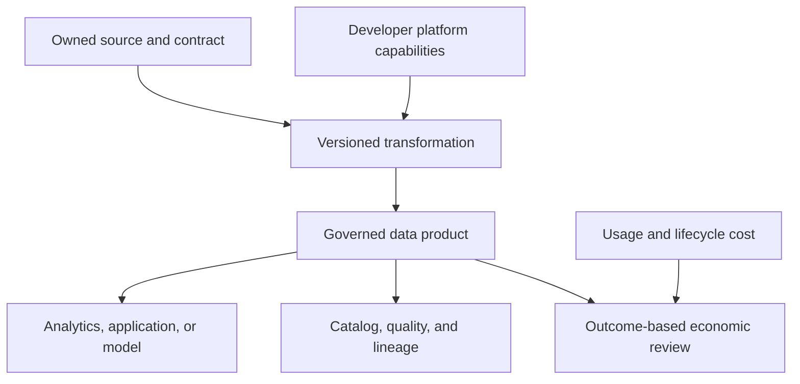
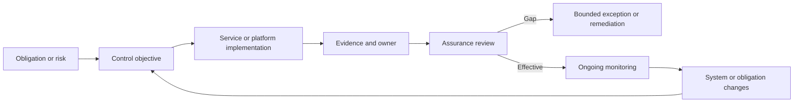
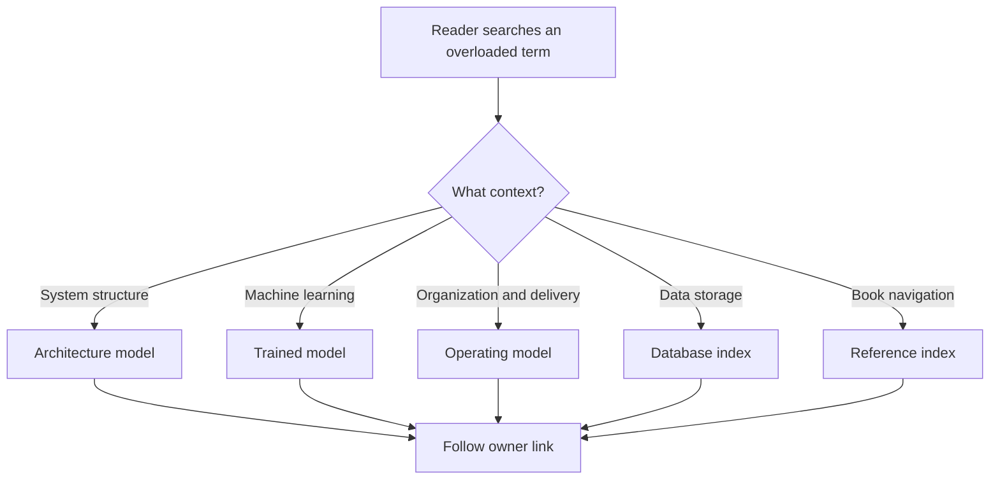
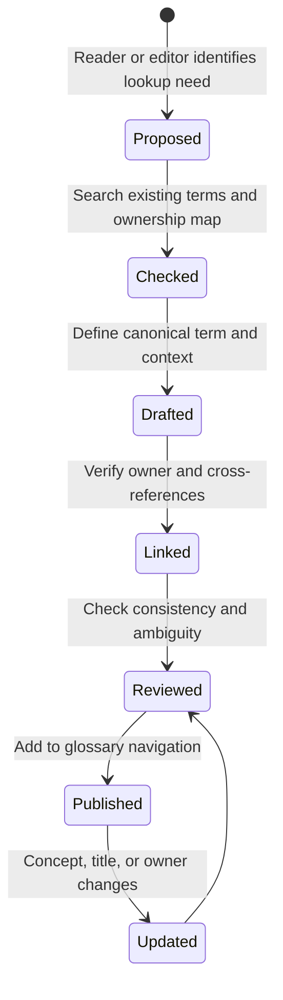
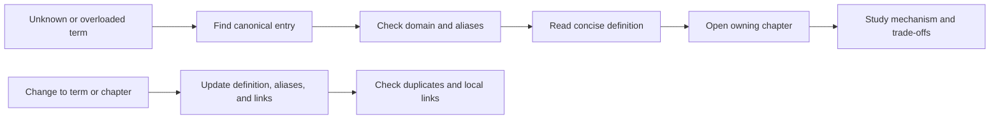

# Glossary of Terms

Part: [26 — Appendices and Glossary](PART_OVERVIEW.md)

This glossary gives concise lookup definitions and points to the chapter that owns the fuller explanation. It is a navigation aid, not a substitute for the owning chapter's reasoning or implementation guidance. Terms with multiple meanings are qualified by domain; aliases are listed to improve lookup without treating every synonym as interchangeable.

## Architecture and Decision Practice

| Term | Definition and context | Aliases or distinction | Owner |
|---|---|---|---|
| Architecture | The significant elements of a system, their relationships, and the rationale that constrains its evolution. The useful boundary depends on stakeholder concerns and change cost. | Not a synonym for a diagram or technology stack. | [Part 01 — Architecture Mindset](../01_Architecture_Mindset/PART_OVERVIEW.md) |
| Architecture Decision Record (ADR) | A concise, versioned record of a consequential decision, its context, choice, alternatives, and consequences. | A decision log may track many decisions; an ADR captures one decision and rationale. | [Architecture Thinking](../01_Architecture_Mindset/CH03_Architecture_Thinking.md) |
| Architecture fitness function | An executable or repeatable check that provides evidence about whether an architectural property remains true as a system changes. | Broader than a unit test; can evaluate dependency rules, performance, or deployment behavior. | [What Is Software Architecture?](../01_Architecture_Mindset/CH01_What_is_Software_Architecture.md) |
| Capability | An enduring description of what an organization must be able to do to achieve an outcome, independent of a specific application or team structure. | Distinct from a process, which describes work sequence, and an organizational unit, which names people. | [Business Architecture Strategy](../25_Additional_Architect_Competencies/CH06_Business_Architecture_Strategy.md) |
| Quality attribute | A measurable property of system behavior or structure, such as availability, performance, security, or modifiability. | Often called a non-functional requirement; it still needs a concrete scenario and threshold. | [What Is Software Architecture?](../01_Architecture_Mindset/CH01_What_is_Software_Architecture.md) |
| Value stream | The end-to-end stages through which a stakeholder receives a business outcome, including handoffs and enabling capabilities. | Not merely a process chart; focus on value, delay, and outcomes across the stages. | [Business Architecture Strategy](../25_Additional_Architect_Competencies/CH06_Business_Architecture_Strategy.md) |

The relationship diagram connects terms that are often used independently. It is not a mandatory sequence for every architecture decision; it shows how a concern can be made testable and revisited using evidence.

## Data and Platform Terms

| Term | Definition and context | Aliases or distinction | Owner |
|---|---|---|---|
| Data contract | An agreed schema and semantic promise between a data producer and its consumers, including compatibility and change behavior. | More than a schema: meaning, keys, units, timing, and deletion semantics matter. | [Data Engineering for Architects](../25_Additional_Architect_Competencies/CH03_Data_Engineering_for_Architects.md) |
| Data lineage | Traceability from source data through transformations to derived products, reports, or models. | Provenance emphasizes origin and version; lineage emphasizes dependency paths and transformations. | [Data Engineering for Architects](../25_Additional_Architect_Competencies/CH03_Data_Engineering_for_Architects.md) |
| Data product | A supported data offering with an owner, consumer contract, quality and freshness expectations, access policy, and support path. | Not every dataset or pipeline is a data product. | [Data Engineering for Architects](../25_Additional_Architect_Competencies/CH03_Data_Engineering_for_Architects.md) |
| FinOps | Financial Operations practices that connect technology usage and cost to business outcomes through shared accountability. | Not cost cutting alone; quality, risk, and value constrain optimization. | [FinOps and Software Engineering Economics](../25_Additional_Architect_Competencies/CH01_FinOps_and_Software_Engineering_Economics.md) |
| Internal developer platform | A productized set of interfaces and workflows that helps engineering teams build, deploy, and operate software with supported defaults. | Not synonymous with a portal, container cluster, or central team. | [Platform Engineering](../25_Additional_Architect_Competencies/CH05_Platform_Engineering.md) |
| MLOps | Machine Learning Operations: the practices and systems that make model development, promotion, monitoring, and recovery reproducible and governed. | Distinct from machine-learning algorithms and from the complete architecture of an AI application. | [MLOps](../25_Additional_Architect_Competencies/CH04_MLOps_Machine_Learning_Operations.md) |
| Total cost of ownership (TCO) | Lifecycle cost across acquisition, implementation, operation, change, support, and retirement over a stated period. | Wider than a subscription price or monthly infrastructure bill. | [FinOps and Software Engineering Economics](../25_Additional_Architect_Competencies/CH01_FinOps_and_Software_Engineering_Economics.md) |

These terms form a useful data-platform vocabulary. Data lineage and a data contract are related but answer different questions: what is promised to consumers, and where did a derived result come from?

## Governance and Service Terms

| Term | Definition and context | Aliases or distinction | Owner |
|---|---|---|---|
| Control evidence | A time-bounded artifact or observation that shows whether a defined control was implemented and effective for a stated scope. | A policy document expresses intent; it is not by itself proof of operation. | [Architecture Governance and Compliance](../25_Additional_Architect_Competencies/CH02_Architecture_Governance_and_Compliance.md) |
| Exception | An authorized, bounded acceptance of residual risk when a required control cannot currently be met, with compensating controls and expiry behavior. | Not a permanent alternate standard or a waiver without an accountable risk owner. | [Architecture Governance and Compliance](../25_Additional_Architect_Competencies/CH02_Architecture_Governance_and_Compliance.md) |
| Service level objective (SLO) | A target for a measured service indicator over a defined window, used to guide reliability decisions. | A service level agreement is a commitment; a service level indicator is the measurement. | [Part 14 — Observability](../14_Observability/PART_OVERVIEW.md) |
| Tenant isolation | Controls that prevent one customer organization from accessing or affecting another tenant's data and resources beyond approved sharing. | Shared infrastructure does not imply shared authorization scope. | [Multi-tenant SaaS Platform](../24_Real_World_Case_Studies/CH21_Multi_Tenant_SaaS_Platform.md) |
| Workflow orchestration | Durable coordination of business steps, service calls, timers, and human tasks with explicit state and recovery behavior. | Distinct from choreography, where participants react to events without one durable process coordinator. | [Workflow and BPM Engine](../24_Real_World_Case_Studies/CH25_Workflow_and_BPM_Engine.md) |

Governance terms describe different artifacts and states. A control is the expected behavior, evidence supports an assurance conclusion, and an exception records a time-bounded risk decision when the control is not met.

## Disambiguate Overloaded Terms

| Term | Common meanings | Use in this handbook |
|---|---|---|
| Model | A representation of a system; a trained statistical or machine-learning artifact; a business or operating model. | Name the domain when ambiguity matters: architecture model, trained model, or operating model. |
| Platform | A technical runtime; a product capability used by developers; a business or ecosystem platform. | Specify developer platform, runtime platform, or business platform. |
| Event | A fact that something happened; an operating-system or user-interface notification; a scheduled occurrence. | In distributed integration, identify the business fact and its producer and version. |
| Governance | Decision rights and assurance practices; sometimes a review meeting or committee. | Name the policy, decision, evidence, and owner rather than using “governance” as a catch-all. |
| Index | A database access structure; a reference list in this appendix; a search index for content. | Qualify as database index, acronym index, technology index, or retrieval index. |

Disambiguation is especially important in search and cross-chapter references. Prefer a qualified term in headings, glossary entries, and links when several domains use the same word.

## Maintain and Use the Glossary

Add an entry when a term is important to multiple chapters, has a meaningful ambiguity, or has a canonical expansion readers are likely to seek. Keep definitions concise and point to the owner chapter. When ownership changes, update the link and resolve duplicate entries rather than copying the full explanation into this appendix.

A reader can start with a term, disambiguate its domain, use the short definition, and continue to the owning chapter. Editors can use the same ownership link to find where a technical definition must be changed. Review links whenever chapters are moved or renamed.

## Editorial Notes

Definitions are intentionally short and scoped. The owner column points to the chapter that should carry the full explanation; a link to a part overview is used where a single owning chapter is not identified in the glossary. Acronym expansions are consolidated in [CH02 — Acronym Index](CH02_Acronym_Index.md), and technologies are consolidated in [CH03 — Technology Index](CH03_Technology_Index.md).
