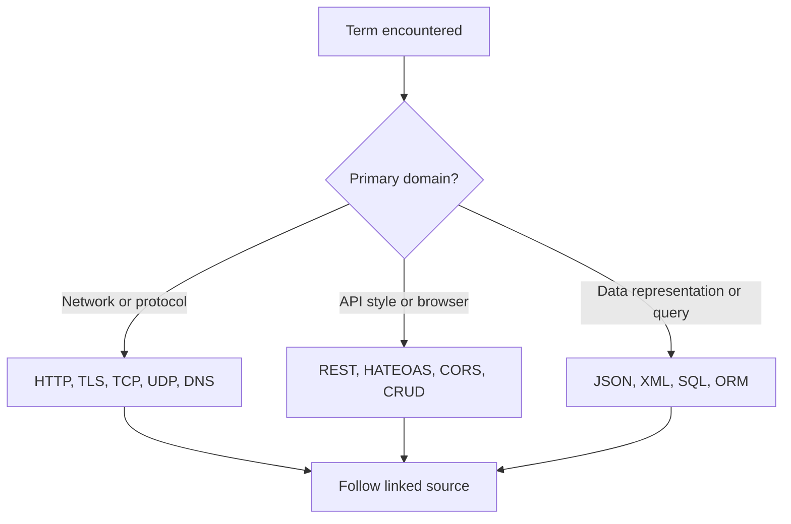
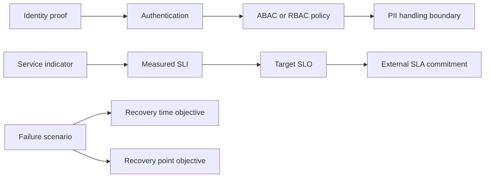
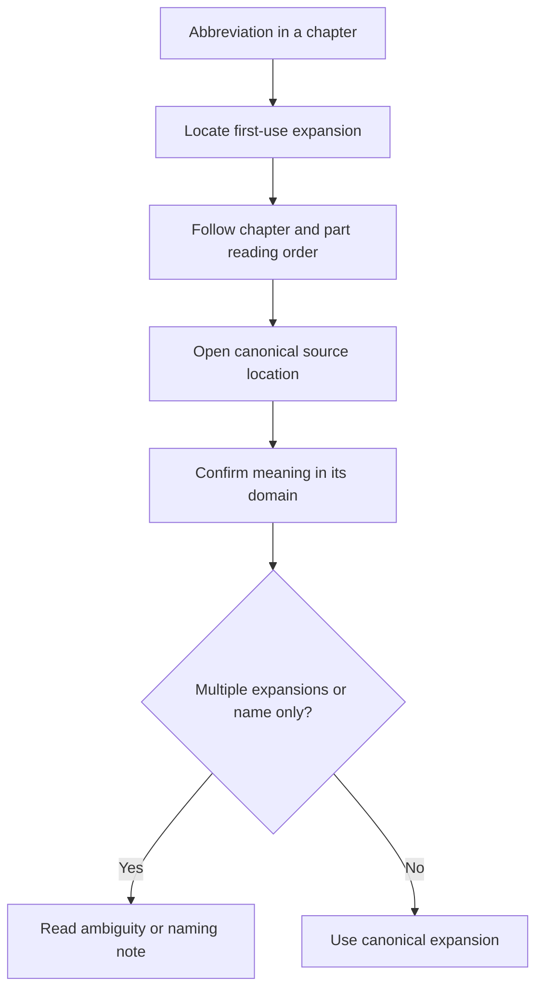

# Acronym Index

Part: [26 — Appendices and Glossary](PART_OVERVIEW.md)

This index expands common abbreviations used in the handbook and links to the most relevant source chapter or part. The linked location is a lookup starting point; an acronym may first appear in other chapters, and chapter-specific first-use rules still apply. Entries that are names rather than expansions are labeled so readers do not infer a false derivation.

## Architecture, Delivery, and Operations

| Acronym | Expansion or status | Domain | Source location |
|---|---|---|---|
| ADR | Architecture Decision Record | Architecture practice | [Part 01 — Architecture Mindset](../01_Architecture_Mindset/CH03_Architecture_Thinking.md) |
| API | Application Programming Interface | API architecture | [Part 08 — API Architecture](../08_API_Architecture/PART_OVERVIEW.md) |
| ASR | Architecturally Significant Requirement | Architecture practice | [Part 01 — Architecture Mindset](../01_Architecture_Mindset/CH01_What_is_Software_Architecture.md) |
| ATAM | Architecture Tradeoff Analysis Method | Architecture analysis | [Part 01 — Architecture Mindset](../01_Architecture_Mindset/CH03_Architecture_Thinking.md) |
| BPM | Business Process Management | Workflow | [Part 24 — Real-World Case Studies](../24_Real_World_Case_Studies/CH25_Workflow_and_BPM_Engine.md) |
| CI/CD | Continuous Integration and Continuous Delivery or Deployment | Delivery engineering | [Part 13 — DevOps](../13_DevOps/PART_OVERVIEW.md) |
| FinOps | Financial Operations; established practice name, not a strict initialism | Technology economics | [Part 25 — Additional Architect Competencies](../25_Additional_Architect_Competencies/CH01_FinOps_and_Software_Engineering_Economics.md) |
| IaC | Infrastructure as Code | Delivery engineering | [Part 13 — DevOps](../13_DevOps/PART_OVERVIEW.md) |
| MLOps | Machine Learning Operations | Model operations | [Part 25 — Additional Architect Competencies](../25_Additional_Architect_Competencies/CH04_MLOps_Machine_Learning_Operations.md) |
| RACI | Responsible, Accountable, Consulted, Informed | Governance and roles | [Part 01 — Architecture Mindset](../01_Architecture_Mindset/CH02_Role_of_a_Solution_Architect.md) |
| ROI | Return on Investment | Technology economics | [Part 25 — Additional Architect Competencies](../25_Additional_Architect_Competencies/CH01_FinOps_and_Software_Engineering_Economics.md) |
| SRE | Site Reliability Engineering | Reliability practice | [Part 13 — DevOps](../13_DevOps/PART_OVERVIEW.md) |
| TCO | Total Cost of Ownership | Technology economics | [Part 25 — Additional Architect Competencies](../25_Additional_Architect_Competencies/CH01_FinOps_and_Software_Engineering_Economics.md) |

Expansions can vary by domain or standard edition. The source chapter provides context; this index should not override a domain-specific definition when a term is overloaded.

## Networking, APIs, and Data

| Acronym | Expansion or status | Domain | Source location |
|---|---|---|---|
| CDN | Content Delivery Network | Performance and networking | [Part 19 — Performance Engineering](../19_Performance_Engineering/PART_OVERVIEW.md) |
| CORS | Cross-Origin Resource Sharing | Web security | [HTTP](../05_Networking_and_OS/CH01_HTTP.md) |
| CRUD | Create, Read, Update, Delete | Data and APIs | [Part 08 — API Architecture](../08_API_Architecture/PART_OVERVIEW.md) |
| DNS | Domain Name System | Networking | [Part 05 — Networking and Operating Systems](../05_Networking_and_OS/PART_OVERVIEW.md) |
| HATEOAS | Hypermedia as the Engine of Application State | REST API design | [REST](../08_API_Architecture/CH01_REST.md) |
| HTTP | Hypertext Transfer Protocol | Web protocol | [HTTP](../05_Networking_and_OS/CH01_HTTP.md) |
| JSON | JavaScript Object Notation | Data interchange | [Part 08 — API Architecture](../08_API_Architecture/PART_OVERVIEW.md) |
| ORM | Object-Relational Mapping | Data access | [Part 06 — Databases and Storage](../06_Databases_and_Storage/PART_OVERVIEW.md) |
| REST | Representational State Transfer | API architectural style | [REST](../08_API_Architecture/CH01_REST.md) |
| SQL | Structured Query Language | Relational data | [Part 06 — Databases and Storage](../06_Databases_and_Storage/PART_OVERVIEW.md) |
| TCP | Transmission Control Protocol | Networking | [Part 05 — Networking and Operating Systems](../05_Networking_and_OS/PART_OVERVIEW.md) |
| TLS | Transport Layer Security | Transport security | [TLS](../05_Networking_and_OS/CH06_TLS.md) |
| UDP | User Datagram Protocol | Networking | [Part 05 — Networking and Operating Systems](../05_Networking_and_OS/PART_OVERVIEW.md) |
| XML | Extensible Markup Language | Data interchange | [Part 08 — API Architecture](../08_API_Architecture/PART_OVERVIEW.md) |

Group terms by use, not only by spelling. For example, HTTP and REST are related but not synonymous: one names a protocol and the other an architectural style that commonly uses it.

## Security, Identity, and Reliability

| Acronym | Expansion or status | Domain | Source location |
|---|---|---|---|
| ABAC | Attribute-Based Access Control | Authorization | [Part 15 — Security](../15_Security/PART_OVERVIEW.md) |
| GDPR | General Data Protection Regulation | Privacy regulation | [Part 15 — Security](../15_Security/PART_OVERVIEW.md) |
| HIPAA | Health Insurance Portability and Accountability Act | Healthcare privacy and security | [Part 15 — Security](../15_Security/PART_OVERVIEW.md) |
| IAM | Identity and Access Management | Identity security | [Part 15 — Security](../15_Security/PART_OVERVIEW.md) |
| JWT | JSON Web Token | Identity and token format | [Part 15 — Security](../15_Security/PART_OVERVIEW.md) |
| MFA | Multi-Factor Authentication | Identity security | [Part 15 — Security](../15_Security/PART_OVERVIEW.md) |
| MTBF | Mean Time Between Failures | Reliability measurement | [Part 14 — Observability](../14_Observability/PART_OVERVIEW.md) |
| MTTR | Mean Time to Recovery | Reliability measurement | [Part 14 — Observability](../14_Observability/PART_OVERVIEW.md) |
| OIDC | OpenID Connect | Federated identity | [Part 15 — Security](../15_Security/PART_OVERVIEW.md) |
| PII | Personally Identifiable Information | Privacy and data handling | [Part 15 — Security](../15_Security/PART_OVERVIEW.md) |
| RBAC | Role-Based Access Control | Authorization | [Part 15 — Security](../15_Security/PART_OVERVIEW.md) |
| RPO | Recovery Point Objective | Disaster recovery | [Part 14 — Observability](../14_Observability/PART_OVERVIEW.md) |
| RTO | Recovery Time Objective | Disaster recovery | [Part 14 — Observability](../14_Observability/PART_OVERVIEW.md) |
| SLI | Service Level Indicator | Reliability measurement | [Part 14 — Observability](../14_Observability/PART_OVERVIEW.md) |
| SLA | Service Level Agreement | Service commitment | [Part 14 — Observability](../14_Observability/PART_OVERVIEW.md) |
| SLO | Service Level Objective | Reliability target | [Part 14 — Observability](../14_Observability/PART_OVERVIEW.md) |
| SAML | Security Assertion Markup Language | Federated identity | [Part 15 — Security](../15_Security/PART_OVERVIEW.md) |
| WAF | Web Application Firewall | Application security | [Part 15 — Security](../15_Security/PART_OVERVIEW.md) |

Security and reliability abbreviations describe different layers. Authentication establishes an identity; authorization decides what it may do. A target, a measurement, and a contractual commitment are also distinct even when they share an indicator.

## AI, Hosted Infrastructure, and Business Domains

| Acronym | Expansion or status | Domain | Source location |
|---|---|---|---|
| AI | Artificial Intelligence | Intelligent systems | [Part 16 — AI, Machine Learning, and Generative AI](../16_AI_and_GenAI/PART_OVERVIEW.md) |
| CRM | Customer Relationship Management | Business application | [Part 24 — Real-World Case Studies](../24_Real_World_Case_Studies/CH16_CRM_Platform.md) |
| EMR | Electronic Medical Record | Healthcare application | [Part 24 — Real-World Case Studies](../24_Real_World_Case_Studies/CH15_Healthcare_EMR_System.md) |
| ERP | Enterprise Resource Planning | Business application | [Part 24 — Real-World Case Studies](../24_Real_World_Case_Studies/CH17_ERP_System.md) |
| IoT | Internet of Things | Connected devices | [Part 24 — Real-World Case Studies](../24_Real_World_Case_Studies/CH18_IoT_Telemetry_Platform.md) |
| LLM | Large Language Model | Generative AI | [Part 16 — AI, Machine Learning, and Generative AI](../16_AI_and_GenAI/PART_OVERVIEW.md) |
| MCP | Model Context Protocol | AI tool and context integration | [Model Context Protocol](../16_AI_and_GenAI/CH22_Model_Context_Protocol.md) |
| ML | Machine Learning | Statistical learning | [Part 16 — AI, Machine Learning, and Generative AI](../16_AI_and_GenAI/PART_OVERVIEW.md) |
| OTT | Over-the-Top | Media delivery | [Part 24 — Real-World Case Studies](../24_Real_World_Case_Studies/CH05_OTT_Platform.md) |
| RAG | Retrieval-Augmented Generation | Generative AI | [Part 16 — AI, Machine Learning, and Generative AI](../16_AI_and_GenAI/PART_OVERVIEW.md) |
| SaaS | Software as a Service | Hosted software service model | [Multi-tenant SaaS Platform](../24_Real_World_Case_Studies/CH21_Multi_Tenant_SaaS_Platform.md) |
| UPI | Unified Payments Interface | Digital payments | [Part 24 — Real-World Case Studies](../24_Real_World_Case_Studies/CH09_UPI_Payment_Gateway.md) |
| VPC | Virtual Private Cloud | Provider virtual networking | [Part 09 — Cloud Computing](../09_Cloud_Computing/PART_OVERVIEW.md) |
| VNet | Virtual Network | Provider virtual networking | [Part 09 — Cloud Computing](../09_Cloud_Computing/PART_OVERVIEW.md) |

Some abbreviations are context-sensitive and some product or protocol names are not expansions. Preserve official capitalization and do not invent expansions for names such as OAuth or OpenID Connect.

## Maintain the Index

When adding an entry, confirm the canonical expansion against an authoritative chapter or standard, link to the relevant source, and record ambiguity. When chapter order changes, verify first-use references again. Remove duplicate spellings only after confirming that they share meaning; otherwise keep separate entries with domain qualifiers.

This maintenance workflow keeps the index connected to the book rather than allowing it to become a second, conflicting glossary.
