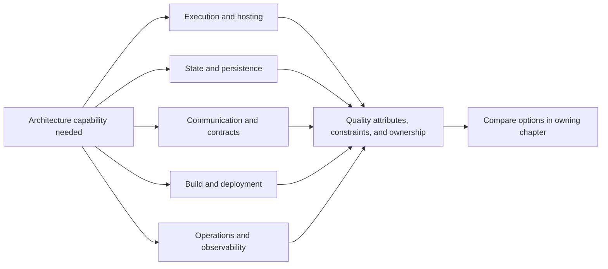
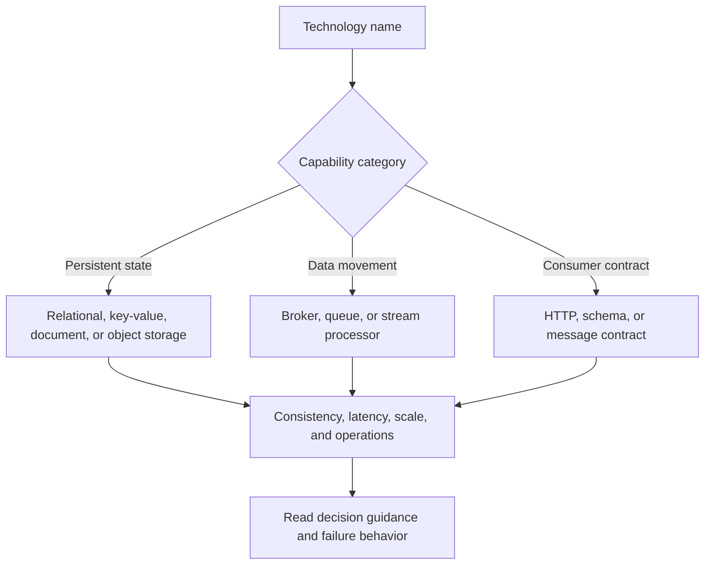
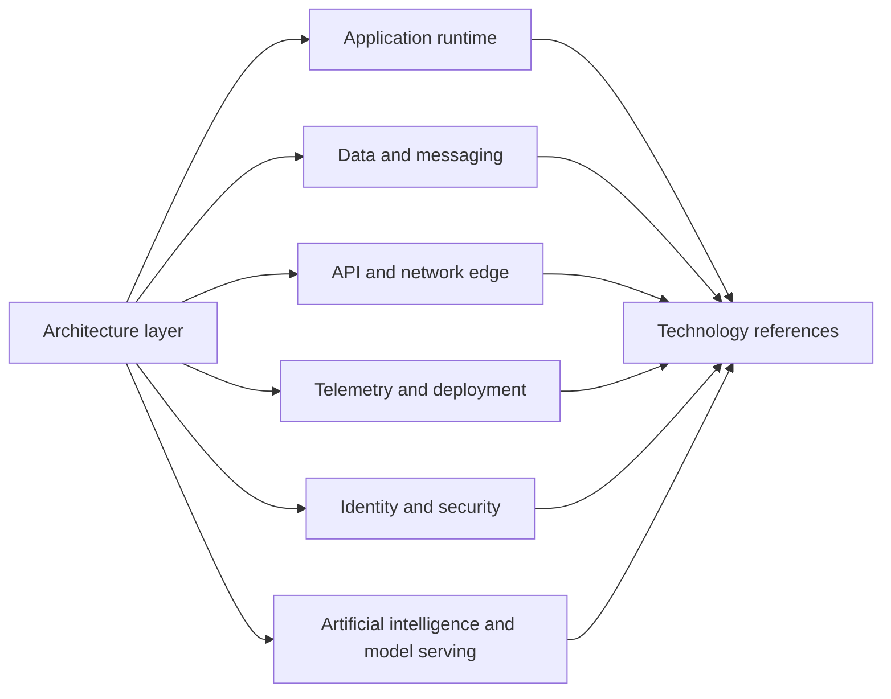
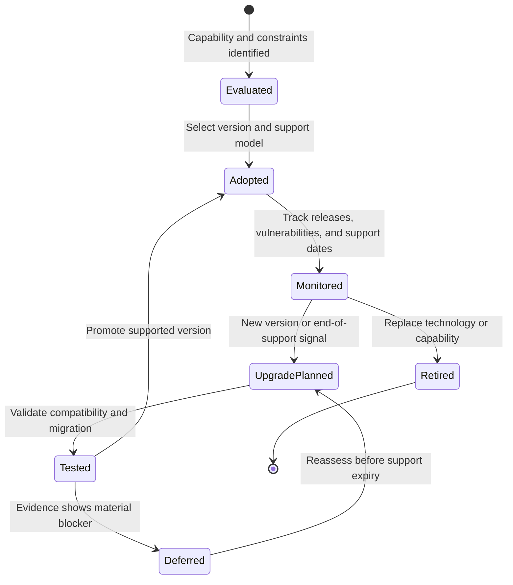
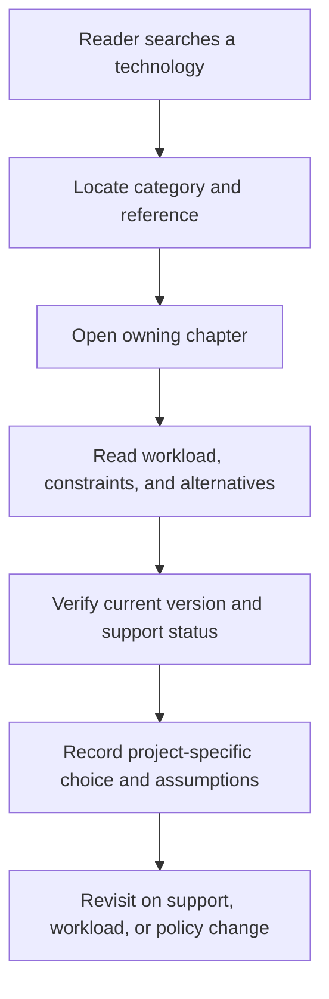

# Technology Index

Part: [26 — Appendices and Glossary](PART_OVERVIEW.md)

This index helps readers find technologies and standards discussed in the handbook and the architecture context in which they matter. A name in the index is not an endorsement or a recommendation. Product names, versions, editions, and managed-service capabilities change; consult the linked chapter and current vendor documentation before committing to a design.

## Architecture and Runtime Technologies

| Technology or standard | Category and context | Version sensitivity | Reference |
|---|---|---|---|
| Amazon Web Services (AWS) | Cloud services and workload architecture | Service features, limits, and pricing change | [Part 09 — Cloud Computing](../09_Cloud_Computing/PART_OVERVIEW.md) |
| Microsoft Azure | Cloud services and workload architecture | Service features, limits, and regional availability change | [Part 09 — Cloud Computing](../09_Cloud_Computing/PART_OVERVIEW.md) |
| Google Cloud Platform (GCP) | Cloud services and workload architecture | Product names, features, and pricing change | [Part 09 — Cloud Computing](../09_Cloud_Computing/PART_OVERVIEW.md) |
| Docker | Container packaging and local or production execution | Image format and engine behavior depend on versions and deployment model | [Part 13 — DevOps](../13_DevOps/PART_OVERVIEW.md) |
| Kubernetes | Container orchestration and workload scheduling | API versions, distributions, and extensions require compatibility review | [Part 13 — DevOps](../13_DevOps/PART_OVERVIEW.md) |
| Terraform | Infrastructure provisioning and configuration management | Provider schemas and state behavior change by release | [Part 13 — DevOps](../13_DevOps/PART_OVERVIEW.md) |
| Spring Boot | Java application framework | Framework, Java, and dependency versions must be aligned | [Part 03 — Software Engineering Foundations](../03_Software_Engineering_Foundations/PART_OVERVIEW.md) |
| FastAPI | Python web application framework | Python and dependency compatibility should be checked | [Part 03 — Software Engineering Foundations](../03_Software_Engineering_Foundations/PART_OVERVIEW.md) |
| React | User-interface library | Runtime, rendering, and framework integration evolve | [Part 04 — Frontend Architecture](../04_Frontend_Architecture/PART_OVERVIEW.md) |
| Angular | Web application framework | Major versions can introduce migration and support changes | [Part 04 — Frontend Architecture](../04_Frontend_Architecture/PART_OVERVIEW.md) |

The map emphasizes that technologies support capabilities; the architecture decision also depends on workload, skills, operating model, service requirements, and exit constraints.

## Data, Messaging, and Integration

| Technology or standard | Category and context | Version sensitivity | Reference |
|---|---|---|---|
| PostgreSQL | Relational database and transactional data | Major versions, extensions, and managed offerings differ | [Part 06 — Databases and Storage](../06_Databases_and_Storage/PART_OVERVIEW.md) |
| MySQL | Relational database and transactional data | Engine, edition, and managed-service behavior differ | [Part 06 — Databases and Storage](../06_Databases_and_Storage/PART_OVERVIEW.md) |
| Redis | In-memory data structures, caching, and coordination use cases | Persistence, clustering, and licensing depend on edition and version | [Part 19 — Performance Engineering](../19_Performance_Engineering/PART_OVERVIEW.md) |
| Apache Kafka | Distributed event streaming | Broker protocol, partitioning, and managed-service guarantees vary | [Event Streaming Platform](../24_Real_World_Case_Studies/CH23_Event_Streaming_Platform.md) |
| Apache Flink | Stateful stream processing | Runtime, connector, and state compatibility matter during upgrades | [Real-Time Analytics Platform](../24_Real_World_Case_Studies/CH19_Real_Time_Analytics_Platform.md) |
| Protocol Buffers | Schema-based binary serialization and remote procedure call contracts | Schema evolution and generated-code compatibility require care | [Part 08 — API Architecture](../08_API_Architecture/PART_OVERVIEW.md) |
| OpenAPI | Machine-readable description of HTTP APIs | Specification version and tooling support affect generated clients | [API Gateway and Developer Portal](../24_Real_World_Case_Studies/CH22_API_Gateway_and_Developer_Portal.md) |
| Representational State Transfer (REST) | Resource-oriented application programming interface (API) architectural style | Architectural constraints are distinct from any one library | [REST](../08_API_Architecture/CH01_REST.md) |
| GraphQL | Client-selected API query language and execution model | Schema evolution, authorization, and query-cost controls are implementation-dependent | [Part 08 — API Architecture](../08_API_Architecture/PART_OVERVIEW.md) |
| Apache Spark | Distributed data processing | Runtime, connector, and file-format compatibility change | [Data Engineering for Architects](../25_Additional_Architect_Competencies/CH03_Data_Engineering_for_Architects.md) |

Products in the same category can have materially different failure, consistency, and operational models. Compare the guarantees required by the workload rather than treating category membership as interchangeability.

## Operations, Security, and AI

| Technology or standard | Category and context | Version sensitivity | Reference |
|---|---|---|---|
| OpenTelemetry | Vendor-neutral telemetry application programming interfaces (APIs), data model, and collection ecosystem | Semantic conventions, software development kits (SDKs), and collector components evolve | [Part 14 — Observability](../14_Observability/PART_OVERVIEW.md) |
| Prometheus | Metrics collection and query ecosystem | Query behavior, storage, and operational topology depend on version and deployment | [Part 14 — Observability](../14_Observability/PART_OVERVIEW.md) |
| Grafana | Visualization and operational dashboards | Data-source plugins and dashboard compatibility vary | [Part 14 — Observability](../14_Observability/PART_OVERVIEW.md) |
| OAuth 2.0 | Authorization framework for delegated access | Security guidance and extension profiles evolve; it is not an acronym expansion | [Part 15 — Security](../15_Security/PART_OVERVIEW.md) |
| OpenID Connect | Federated identity layer built on OAuth 2.0 | Provider behavior, claims, and profiles require validation | [Part 15 — Security](../15_Security/PART_OVERVIEW.md) |
| Web Application Firewall (WAF) | Filtering and inspection control for web application traffic | Rule sets and managed-service coverage vary | [Part 15 — Security](../15_Security/PART_OVERVIEW.md) |
| Large language models | Generative model family used for language tasks | Model versions, limits, behavior, and terms change rapidly | [Part 16 — AI, Machine Learning, and Generative AI](../16_AI_and_GenAI/PART_OVERVIEW.md) |
| Model Context Protocol | Standardized connection pattern between model applications and context or tools | Protocol revisions and implementation security require review | [Model Context Protocol](../16_AI_and_GenAI/CH22_Model_Context_Protocol.md) |
| Vector database | Storage and retrieval optimized for vector representations | Index algorithms, distance metrics, filtering, and consistency vary | [Part 16 — AI, Machine Learning, and Generative AI](../16_AI_and_GenAI/PART_OVERVIEW.md) |

The table associates technologies with architecture layers but does not imply that one tool spans only one layer. For example, a managed data platform may also provide identity integration, monitoring, and workflow orchestration.

## Version Sensitivity and Lifecycle

Treat version as part of an architecture decision when it affects support, compatibility, security fixes, migration, or managed-service behavior. Record the supported version range, upgrade owner, end-of-support signal, and compatibility test. Avoid freezing a version in an index unless the handbook's explanation depends on that version; link readers to the owning chapter for the decision context.

Version sensitivity is an operational obligation. A technology with a strong fit today can become a risk when its support window ends or its upgrade path conflicts with the organization's release cadence.

## Find a Technology in Decision Context

Start with the capability or constraint that motivated the technology choice, then read the owning chapter for alternatives, quality attributes, failure behavior, and operations. Verify current product documentation for service limits and support status. Record the selected version and managed-service assumptions in the project decision record, not in this evergreen index.

The index is successful when it sends a reader toward a decision, not when it ranks products. Keep product-neutral comparisons in the domain chapters and maintain this page as a navigational catalog.
