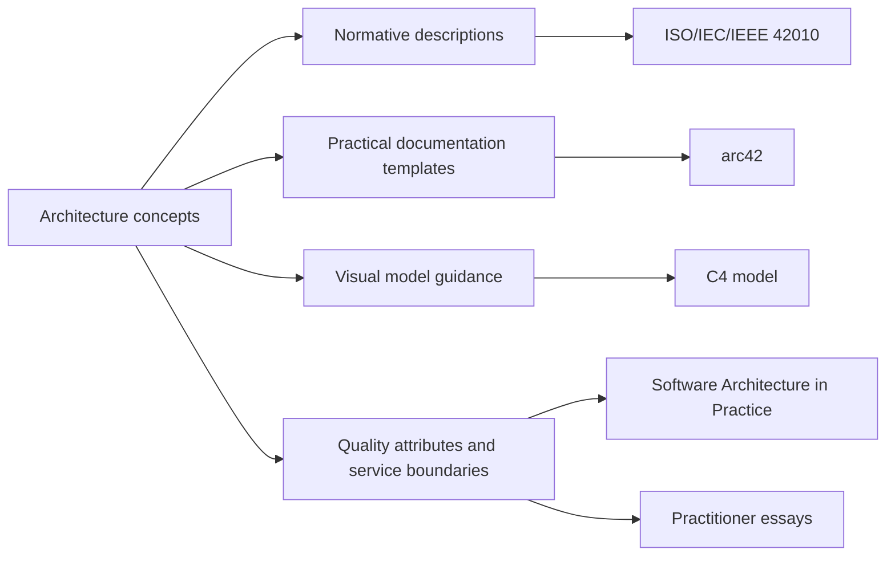
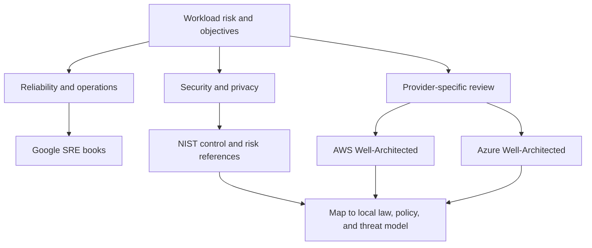
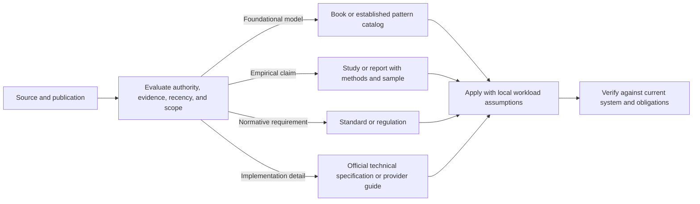
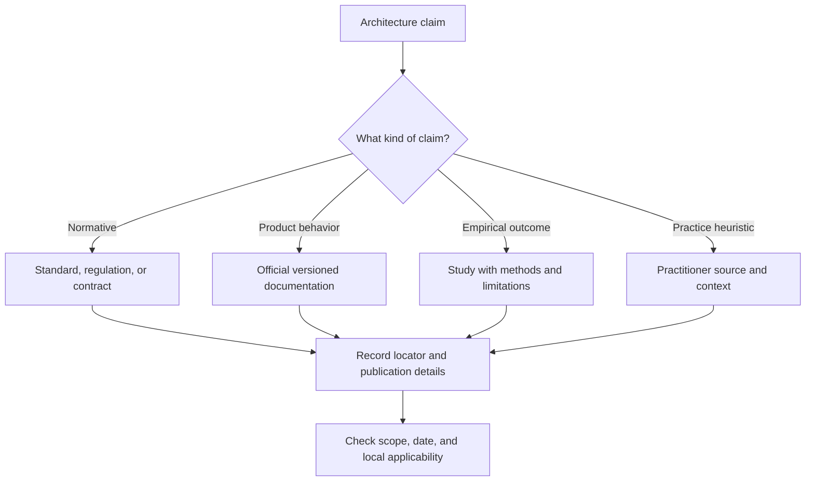
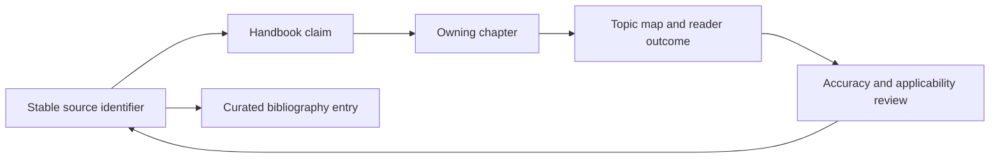
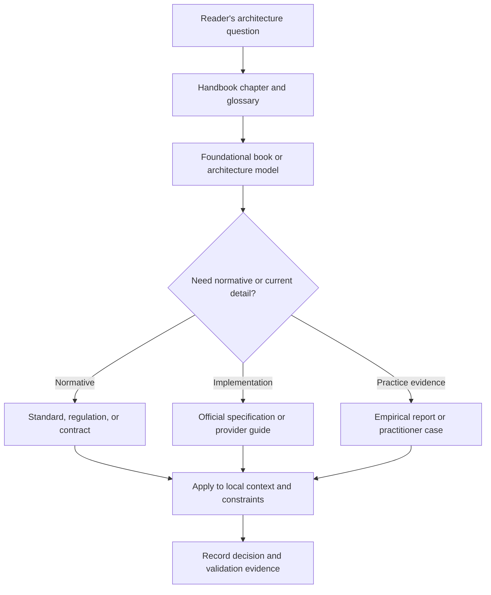
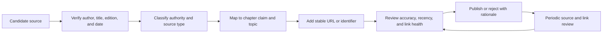

# Further Reading and Bibliography

Part: [26 — Appendices and Glossary](PART_OVERVIEW.md)

This bibliography selects sources that extend the handbook's architecture explanations. It distinguishes standards and normative references from official implementation guidance, empirical research, and practitioner books. Inclusion is not endorsement; check publication date, scope, edition, and current status before relying on a source for a project decision.

## Architecture and Documentation

| ID | Source and publication details | Type and use | Locator |
|---|---|---|---|
| [ARCH-01] | ISO/IEC/IEEE. *ISO/IEC/IEEE 42010:2022, Software, systems and enterprise — Architecture description*. 2022. | International standard for architecture descriptions, frameworks, viewpoints, and model kinds. | [ISO standard record](https://www.iso.org/standard/74393.html) |
| [ARCH-02] | Bass, Len; Clements, Paul; Kazman, Rick. *Software Architecture in Practice*. Fourth edition. Addison-Wesley Professional, 2021. | Architecture fundamentals, quality attributes, and design reasoning. | International Standard Book Number (ISBN) 978-0136886099 |
| [ARCH-03] | arc42. *arc42 Documentation Template*. Living documentation and sections. | Practitioner template for goals, constraints, quality requirements, decisions, risks, and deployment views. | [arc42 documentation](https://docs.arc42.org/) |
| [ARCH-04] | Brown, Simon. *The C4 Model for Visualising Software Architecture*. Living model and guidance. | Hierarchical context, container, component, and code views. | [C4 model](https://c4model.com/) |
| [ARCH-05] | Fowler, Martin. “Microservices.” 2014, with subsequent updates. | Practitioner discussion of service boundaries and trade-offs; date-sensitive and not a normative standard. | [martinfowler.com](https://martinfowler.com/articles/microservices.html) |

A standard defines requirements and terminology within its scope; a template suggests a useful arrangement of information; a practitioner article offers an argument or experience. Do not cite them as though they have equal authority or the same purpose.

## Reliability, Security, and Provider-Hosted Architecture

| ID | Source and publication details | Type and use | Locator |
|---|---|---|---|
| [REL-01] | Beyer, Betsy; Jones, Chris; Petoff, Jennifer; Murphy, Niall Richard, editors. *Site Reliability Engineering: How Google Runs Production Systems*. O'Reilly Media, 2016. | Practitioner book on production reliability and operations. | [Online book](https://sre.google/sre-book/table-of-contents/) |
| [REL-02] | Beyer, Betsy; Murphy, Niall Richard; Rensin, David K.; Kawahara, Kent; Thorne, Stephen, editors. *The Site Reliability Workbook*. O'Reilly Media, 2018. | Applied site reliability engineering (SRE) practices and operational examples. | [Online workbook](https://sre.google/workbook/table-of-contents/) |
| [SEC-01] | National Institute of Standards and Technology (NIST). *Security and Privacy Controls for Information Systems and Organizations*, Special Publication 800-53 Revision 5, updated 2020. | Security and privacy control catalog; use the applicable baseline and organization interpretation. | [NIST publication](https://csrc.nist.gov/pubs/sp/800/53/r5/upd1/final) |
| [SEC-02] | NIST. *Zero Trust Architecture*, Special Publication 800-207. 2020. | Reference architecture and principles for zero trust. | [NIST publication](https://csrc.nist.gov/pubs/sp/800/207/final) |
| [SEC-03] | NIST. *The NIST Cybersecurity Framework (CSF) 2.0*. 2024. | The Cybersecurity Framework (CSF) defines risk-management outcomes and functions. | [NIST publication](https://nvlpubs.nist.gov/nistpubs/CSWP/NIST.CSWP.29.pdf) |
| [CLOUD-01] | Amazon Web Services. *AWS Well-Architected Framework*. Living guidance. | Workload review questions and trade-offs for AWS deployments. | [AWS framework](https://docs.aws.amazon.com/wellarchitected/latest/framework/welcome.html) |
| [CLOUD-02] | Microsoft. *Azure Well-Architected Framework*. Living guidance. | Workload review guidance for Azure deployments. | [Azure framework](https://learn.microsoft.com/en-us/azure/well-architected/what-is-well-architected-framework) |

Provider frameworks are useful for workload review but remain specific to their services. NIST publications and international standards have different authority and scope; local law, contracts, and organizational controls still determine applicability.

## Data, Delivery, and Organizational Practice

| ID | Source and publication details | Type and use | Locator |
|---|---|---|---|
| [DATA-01] | Kleppmann, Martin. *Designing Data-Intensive Applications*. O'Reilly Media, 2017. | Practitioner text on data systems, distributed processing, and trade-offs. | ISBN 978-1449373320 |
| [DATA-02] | Hohpe, Gregor; Woolf, Bobby. *Enterprise Integration Patterns*. Addison-Wesley, 2003. | Pattern catalog for asynchronous and message-based integration. | [Catalog and companion resources](https://www.enterpriseintegrationpatterns.com/) |
| [DEL-01] | Forsgren, Nicole; Humble, Jez; Kim, Gene. *Accelerate: The Science of Lean Software and DevOps*. IT Revolution Press, 2018. | Research-informed discussion of delivery performance and organizational outcomes. | ISBN 978-1942788331 |
| [DEL-02] | DORA. *Research Program and Reports*. Living research publications. | Empirical software delivery research; compare report year, sample, and measures. | [DORA research](https://dora.dev/research/) |
| [FIN-01] | FinOps Foundation. *FinOps Framework*. Living framework and practice guidance. | Shared vocabulary and operating practices for technology economics. | [FinOps Framework](https://www.finops.org/framework/) |
| [DATA-03] | OpenTelemetry. *Specifications*. Living technical specifications. | Telemetry data model and interoperability contracts. | [OpenTelemetry specifications](https://opentelemetry.io/docs/specs/otel/) |

A source's recency matters differently by type. A foundational book may remain useful while product limits or protocol guidance require a current specification. For empirical reports, examine methods, population, and definitions before transferring findings to another organization.

## Source Quality and Citation Practice

Use the strongest source suited to the claim. Normative requirements should cite the relevant standard, regulation, or contract. Product behavior should cite current official documentation or a versioned specification. Claims about outcomes should cite evidence and report population and limitations. Practitioner books and essays are valuable for models and experience but should not be presented as universal empirical findings.

Keep citations close to the claim they support. Use a stable identifier, title, responsible author or organization, publication date or version, and stable locator. A URL alone is not sufficient bibliographic metadata; a book title without edition or year can point readers to the wrong source.

## Citation-to-Chapter Crosswalk

| Topic | Handbook destination | Useful sources |
|---|---|---|
| Architecture description and views | [Part 21 — Architecture Documentation](../21_Architecture_Documentation/PART_OVERVIEW.md) | ARCH-01, ARCH-03, ARCH-04 |
| Architecture trade-offs and decisions | [Part 01 — Architecture Mindset](../01_Architecture_Mindset/PART_OVERVIEW.md) | ARCH-02, ARCH-05 |
| Reliability and production operation | [Part 14 — Observability](../14_Observability/PART_OVERVIEW.md) | REL-01, REL-02, DEL-01, DEL-02 |
| Security controls and zero trust | [Part 15 — Security](../15_Security/PART_OVERVIEW.md) | SEC-01, SEC-02, SEC-03 |
| Provider workload reviews | [Part 09](../09_Cloud_Computing/PART_OVERVIEW.md) | CLOUD-01, CLOUD-02 |
| Data and event architecture | [Part 25 — Additional Architect Competencies](../25_Additional_Architect_Competencies/CH03_Data_Engineering_for_Architects.md) | DATA-01, DATA-02, DATA-03 |
| Delivery performance and economic decisions | [Part 25 — Additional Architect Competencies](../25_Additional_Architect_Competencies/CH01_FinOps_and_Software_Engineering_Economics.md) | DEL-01, DEL-02, FIN-01 |

The crosswalk makes citation coverage navigable. A source should be included because it supports or extends a topic, not because it is famous or easy to link. The owning chapter remains responsible for explaining how the evidence applies.

## Reading Paths by Depth

Readers can follow a path appropriate to their question. Begin with a conceptual source to understand a model, then use a standard or official specification for exact requirements, and finally apply practitioner or empirical material to operations. Skip sources that are outside the workload's domain or authority boundary.

A reading path should reduce uncertainty for a decision. Do not add citations as decoration; identify what the reader should learn from the source and what remains a local judgment.

## Maintain the Bibliography

When adding a source, record complete publication details, source type, topic association, and stable locator. Prefer canonical publisher, standards-body, research, or official documentation links. Check broken links and replaced editions periodically. Date-sensitive product guidance should say that it is living documentation; if a claim depends on a particular version, cite that version directly.

This bibliography is curated, not exhaustive. Chapter authors should add narrowly relevant primary sources when a specific technical claim needs stronger evidence than this cross-book list provides.
