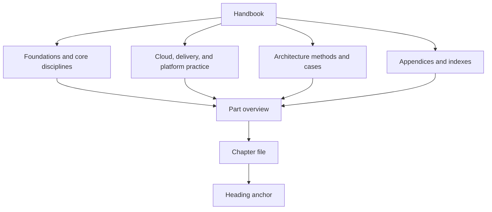
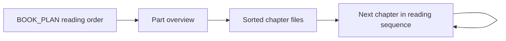
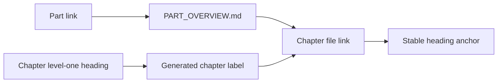
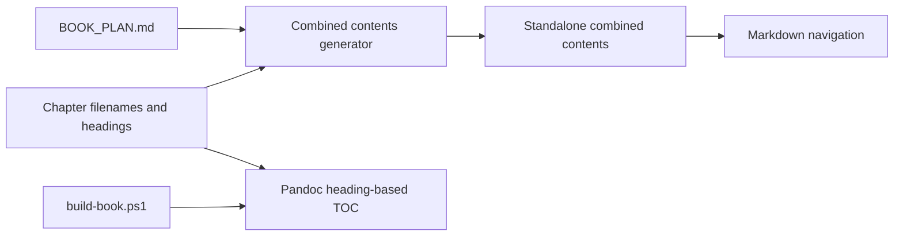
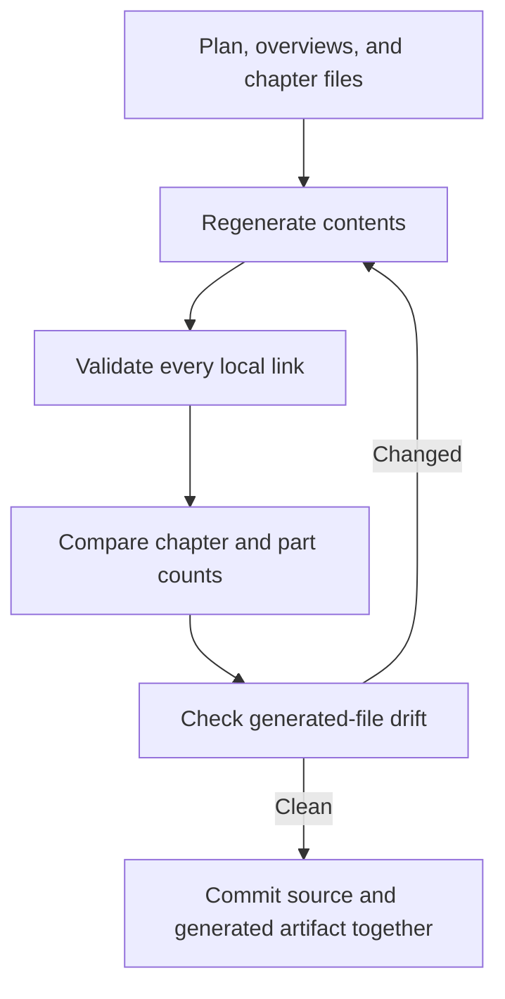

<!-- Generated by scripts/generate-combined-toc.ps1 from BOOK_PLAN.md and chapter headings. Do not edit by hand. -->
# Combined Table of Contents

This standalone Markdown navigation page follows the part order in [BOOK_PLAN.md](../BOOK_PLAN.md) and chapter filename order used by [build-book.ps1](../scripts/build-book.ps1). Part overviews remain the source for chapter summaries and status. The PDF and EPUB builds also generate their own heading-based contents with Pandoc.

Generated content boundary: part order and part links come from `BOOK_PLAN.md`; chapter links and labels come from chapter files and their first level-one headings. Update those sources, then run `scripts/generate-combined-toc.ps1`.

## Part 01 - [Architecture Mindset](../01_Architecture_Mindset/PART_OVERVIEW.md)

- [Chapter: What is Software Architecture?](../01_Architecture_Mindset/CH01_What_is_Software_Architecture.md)
- [Chapter: Role of a Solution Architect](../01_Architecture_Mindset/CH02_Role_of_a_Solution_Architect.md)
- [Chapter: Architecture Thinking](../01_Architecture_Mindset/CH03_Architecture_Thinking.md)

## Part 02 - [Design Thinking and Product Management](../02_Design_Thinking_and_Product_Management/PART_OVERVIEW.md)

- [Chapter: Empathy](../02_Design_Thinking_and_Product_Management/CH01_Empathy.md)
- [Chapter: Research](../02_Design_Thinking_and_Product_Management/CH02_Research.md)
- [Chapter: Personas](../02_Design_Thinking_and_Product_Management/CH03_Personas.md)
- [Chapter: User Interviews](../02_Design_Thinking_and_Product_Management/CH04_User_Interviews.md)
- [Chapter: Journey Mapping](../02_Design_Thinking_and_Product_Management/CH05_Journey_Mapping.md)
- [Chapter: Problem Framing](../02_Design_Thinking_and_Product_Management/CH06_Problem_Framing.md)
- [Chapter: Ideation](../02_Design_Thinking_and_Product_Management/CH07_Ideation.md)
- [Chapter: Rapid Prototyping](../02_Design_Thinking_and_Product_Management/CH08_Rapid_Prototyping.md)
- [Chapter: Wireframing](../02_Design_Thinking_and_Product_Management/CH09_Wireframing.md)
- [Chapter: Usability Testing](../02_Design_Thinking_and_Product_Management/CH10_Usability_Testing.md)
- [Chapter: Accessibility](../02_Design_Thinking_and_Product_Management/CH11_Accessibility.md)
- [Chapter: Service Design](../02_Design_Thinking_and_Product_Management/CH12_Service_Design.md)
- [Chapter: Lean UX](../02_Design_Thinking_and_Product_Management/CH13_Lean_UX.md)
- [Chapter: Product Discovery](../02_Design_Thinking_and_Product_Management/CH14_Product_Discovery.md)
- [Chapter: Product Strategy](../02_Design_Thinking_and_Product_Management/CH15_Product_Strategy.md)
- [Chapter: Market Analysis](../02_Design_Thinking_and_Product_Management/CH16_Market_Analysis.md)
- [Chapter: Competitive Analysis](../02_Design_Thinking_and_Product_Management/CH17_Competitive_Analysis.md)
- [Chapter: Personas (Product Management)](../02_Design_Thinking_and_Product_Management/CH18_Personas_Product_Management.md)
- [Chapter: Journey Mapping (Product Management)](../02_Design_Thinking_and_Product_Management/CH19_Journey_Mapping_Product_Management.md)
- [Chapter: Story Mapping](../02_Design_Thinking_and_Product_Management/CH20_Story_Mapping.md)
- [Chapter: Roadmaps](../02_Design_Thinking_and_Product_Management/CH21_Roadmaps.md)
- [Chapter 22: Backlog](../02_Design_Thinking_and_Product_Management/CH22_Backlog.md)
- [Chapter 23: MVP (Minimum Viable Product)](../02_Design_Thinking_and_Product_Management/CH23_MVP.md)
- [Chapter 24: Metrics](../02_Design_Thinking_and_Product_Management/CH24_Metrics.md)
- [Chapter 25: North Star Metrics](../02_Design_Thinking_and_Product_Management/CH25_North_Star_Metrics.md)
- [Chapter 26: Experimentation](../02_Design_Thinking_and_Product_Management/CH26_Experimentation.md)
- [Chapter 27: A/B Testing](../02_Design_Thinking_and_Product_Management/CH27_A_B_Testing.md)
- [Chapter 28: Prioritization](../02_Design_Thinking_and_Product_Management/CH28_Prioritization.md)
- [Chapter 29: Pricing](../02_Design_Thinking_and_Product_Management/CH29_Pricing.md)
- [Chapter 30: Go-to-Market Strategy](../02_Design_Thinking_and_Product_Management/CH30_Go_to_Market.md)
- [Chapter 31: Customer Feedback](../02_Design_Thinking_and_Product_Management/CH31_Customer_Feedback.md)

## Part 03 - [Software Engineering Foundations](../03_Software_Engineering_Foundations/PART_OVERVIEW.md)

- [Chapter 1 — Java Architecture](../03_Software_Engineering_Foundations/CH01_Java_Architecture.md)
- [Chapter: Python Architecture](../03_Software_Engineering_Foundations/CH02_Python_Architecture.md)
- [Chapter: Node.js Architecture](../03_Software_Engineering_Foundations/CH03_Nodejs.md)
- [Chapter 4: Go Architecture](../03_Software_Engineering_Foundations/CH04_Go.md)
- [Chapter: Rust Architecture](../03_Software_Engineering_Foundations/CH05_Rust.md)

## Part 04 - [Frontend Architecture](../04_Frontend_Architecture/PART_OVERVIEW.md)

- [Chapter: HTML](../04_Frontend_Architecture/CH01_HTML.md)
- [Chapter: CSS](../04_Frontend_Architecture/CH02_CSS.md)
- [Chapter: JavaScript](../04_Frontend_Architecture/CH03_JavaScript.md)
- [Chapter: TypeScript](../04_Frontend_Architecture/CH04_TypeScript.md)
- [Chapter: Angular](../04_Frontend_Architecture/CH05_Angular.md)
- [Chapter: React](../04_Frontend_Architecture/CH06_React.md)
- [Chapter: Next.js](../04_Frontend_Architecture/CH07_Nextjs.md)
- [Chapter 8: Micro Frontends](../04_Frontend_Architecture/CH08_Micro_Frontends.md)

## Part 05 - [Networking and Operating Systems](../05_Networking_and_OS/PART_OVERVIEW.md)

- [Chapter: HTTP](../05_Networking_and_OS/CH01_HTTP.md)
- [Chapter: OSI Model](../05_Networking_and_OS/CH02_OSI_Model.md)
- [Chapter: TCP/IP](../05_Networking_and_OS/CH03_TCPIP.md)
- [Chapter: HTTP/2](../05_Networking_and_OS/CH04_HTTP2.md)
- [Chapter: HTTP/3](../05_Networking_and_OS/CH05_HTTP3.md)
- [Chapter: TLS (Transport Layer Security)](../05_Networking_and_OS/CH06_TLS.md)
- [Chapter 7: SSL (Secure Sockets Layer)](../05_Networking_and_OS/CH07_SSL.md)
- [Chapter: DNS (Domain Name System)](../05_Networking_and_OS/CH08_DNS.md)
- [Chapter: CDN (Content Delivery Network)](../05_Networking_and_OS/CH09_CDN.md)
- [Chapter: Load Balancer](../05_Networking_and_OS/CH10_Load_Balancer.md)
- [Chapter: Reverse Proxy](../05_Networking_and_OS/CH11_Reverse_Proxy.md)
- [Chapter 12: NAT (Network Address Translation)](../05_Networking_and_OS/CH12_NAT.md)
- [Chapter: VPN (Virtual Private Network)](../05_Networking_and_OS/CH13_VPN.md)
- [Chapter 14: Firewalls](../05_Networking_and_OS/CH14_Firewalls.md)
- [Certificates](../05_Networking_and_OS/CH15_Certificates.md)
- [Chapter: Sockets](../05_Networking_and_OS/CH16_Sockets.md)
- [Chapter: WebSockets](../05_Networking_and_OS/CH17_WebSockets.md)
- [Chapter: QUIC](../05_Networking_and_OS/CH18_QUIC.md)
- [Chapter: OAuth](../05_Networking_and_OS/CH19_OAuth.md)
- [Chapter 20: OIDC (OpenID Connect)](../05_Networking_and_OS/CH20_OIDC.md)
- [Chapter 21: JWT (JSON Web Token)](../05_Networking_and_OS/CH21_JWT.md)
- [SAML (Security Assertion Markup Language)](../05_Networking_and_OS/CH22_SAML.md)
- [Chapter 23: PingFederate](../05_Networking_and_OS/CH23_PingFederate.md)
- [Chapter: Processes and Threads](../05_Networking_and_OS/CH24_Processes_and_Threads.md)
- [Chapter 25: Memory Management](../05_Networking_and_OS/CH25_Memory_Management.md)
- [Chapter 26: File Systems](../05_Networking_and_OS/CH26_File_Systems.md)
- [Chapter 27: I/O and Scheduling](../05_Networking_and_OS/CH27_IO_and_Scheduling.md)
- [Chapter 28: Virtualization and Container Fundamentals](../05_Networking_and_OS/CH28_Virtualization_and_Container_Fundamentals.md)
- [Chapter 29: Linux Internals for Architects](../05_Networking_and_OS/CH29_Linux_Internals_for_Architects.md)

## Part 06 - [Databases and Storage](../06_Databases_and_Storage/PART_OVERVIEW.md)

- [Chapter: Normalization (Database Design)](../06_Databases_and_Storage/CH01_Normalization.md)
- [Chapter: Denormalization](../06_Databases_and_Storage/CH02_Denormalization.md)
- [Chapter: Indexes](../06_Databases_and_Storage/CH03_Indexes.md)
- [Chapter: Query Optimizers](../06_Databases_and_Storage/CH04_Query_Optimizers.md)
- [Chapter: Partitioning](../06_Databases_and_Storage/CH05_Partitioning.md)
- [Chapter: Sharding](../06_Databases_and_Storage/CH06_Sharding.md)
- [Chapter: Replication](../06_Databases_and_Storage/CH07_Replication.md)
- [Chapter: Transactions](../06_Databases_and_Storage/CH08_Transactions.md)
- [Chapter: Caching](../06_Databases_and_Storage/CH09_Caching.md)
- [Chapter: Locking](../06_Databases_and_Storage/CH10_Locking.md)
- [Chapter: PostgreSQL](../06_Databases_and_Storage/CH11_PostgreSQL.md)
- [Chapter: MySQL](../06_Databases_and_Storage/CH12_MySQL.md)
- [Chapter: Oracle](../06_Databases_and_Storage/CH13_Oracle.md)
- [Chapter: SQL Server](../06_Databases_and_Storage/CH14_SQLServer.md)
- [Chapter: MongoDB](../06_Databases_and_Storage/CH15_MongoDB.md)
- [Chapter: Redis](../06_Databases_and_Storage/CH16_Redis.md)
- [Chapter: DynamoDB](../06_Databases_and_Storage/CH17_DynamoDB.md)
- [Chapter: Cassandra](../06_Databases_and_Storage/CH18_Cassandra.md)
- [Chapter: Neo4j](../06_Databases_and_Storage/CH19_Neo4j.md)
- [Chapter: ElasticSearch](../06_Databases_and_Storage/CH20_ElasticSearch.md)
- [Chapter: Vector Databases](../06_Databases_and_Storage/CH21_Vector_Databases.md)
- [Chapter: Time Series Databases](../06_Databases_and_Storage/CH22_Time_Series_Databases.md)

## Part 07 - [System Design and Distributed Systems](../07_System_Design_and_Distributed_Systems/PART_OVERVIEW.md)

- [Chapter: Functional Requirements](../07_System_Design_and_Distributed_Systems/CH01_Functional_Requirements.md)
- [Chapter: Non-Functional Requirements](../07_System_Design_and_Distributed_Systems/CH02_Non_Functional_Requirements.md)
- [Chapter: High-Level Design (HLD)](../07_System_Design_and_Distributed_Systems/CH03_High_Level_Design.md)
- [Chapter: Low-Level Design (LLD)](../07_System_Design_and_Distributed_Systems/CH04_Low_Level_Design.md)
- [Chapter: The CAP Theorem](../07_System_Design_and_Distributed_Systems/CH05_CAP_Theorem.md)
- [Chapter: PACELC](../07_System_Design_and_Distributed_Systems/CH06_PACELC.md)
- [Chapter: Consensus](../07_System_Design_and_Distributed_Systems/CH07_Consensus.md)
- [Chapter: Leader Election](../07_System_Design_and_Distributed_Systems/CH08_Leader_Election.md)
- [Chapter: Gossip Protocols](../07_System_Design_and_Distributed_Systems/CH09_Gossip_Protocols.md)
- [Chapter: Replication (as a General Distributed-Systems Pattern)](../07_System_Design_and_Distributed_Systems/CH10_Replication.md)
- [Chapter: Partitioning (Distributed Systems)](../07_System_Design_and_Distributed_Systems/CH11_Partitioning.md)
- [Chapter: Distributed Transactions](../07_System_Design_and_Distributed_Systems/CH12_Distributed_Transactions.md)
- [Chapter 13: Saga Pattern](../07_System_Design_and_Distributed_Systems/CH13_Saga_Pattern.md)
- [Chapter 14: CQRS (Command Query Responsibility Segregation)](../07_System_Design_and_Distributed_Systems/CH14_CQRS.md)
- [Chapter 15: Event Sourcing](../07_System_Design_and_Distributed_Systems/CH15_Event_Sourcing.md)
- [Chapter 16: Idempotency](../07_System_Design_and_Distributed_Systems/CH16_Idempotency.md)
- [Chapter 17: Exactly-Once Processing](../07_System_Design_and_Distributed_Systems/CH17_Exactly_Once_Processing.md)
- [Chapter 18: Ordering Guarantees](../07_System_Design_and_Distributed_Systems/CH18_Ordering_Guarantees.md)
- [Chapter 19: Deduplication](../07_System_Design_and_Distributed_Systems/CH19_Deduplication.md)

## Part 08 - [API Architecture](../08_API_Architecture/PART_OVERVIEW.md)

- [Chapter: REST](../08_API_Architecture/CH01_REST.md)
- [Chapter: GraphQL](../08_API_Architecture/CH02_GraphQL.md)
- [Chapter: gRPC](../08_API_Architecture/CH03_gRPC.md)
- [Chapter: WebSocket API](../08_API_Architecture/CH04_WebSocket_API.md)
- [Chapter: Server-Sent Events as an API Contract](../08_API_Architecture/CH05_Server_Sent_Events.md)
- [Chapter: Asynchronous APIs](../08_API_Architecture/CH06_Async_APIs.md)
- [Chapter: OpenAPI Specification (OAS)](../08_API_Architecture/CH07_OpenAPI.md)
- [Chapter: API Gateway Architecture](../08_API_Architecture/CH08_API_Gateway.md)
- [Chapter: Application Programming Interface (API) Security](../08_API_Architecture/CH09_API_Security.md)
- [Chapter: Cross-Style API Versioning](../08_API_Architecture/CH10_Versioning.md)
- [Chapter: API Rate Limiting, Quotas, and Fairness](../08_API_Architecture/CH11_Rate_Limiting.md)

## Part 09 - [Cloud Computing](../09_Cloud_Computing/PART_OVERVIEW.md)

- [Chapter: Amazon Web Services Architecture](../09_Cloud_Computing/CH01_AWS.md)
- [Chapter: Microsoft Azure Architecture](../09_Cloud_Computing/CH02_Azure.md)
- [Chapter: Google Cloud Platform Architecture](../09_Cloud_Computing/CH03_GCP.md)
- [Chapter: Cloud Compute Architecture](../09_Cloud_Computing/CH04_Compute.md)
- [Chapter: Cloud Networking Architecture](../09_Cloud_Computing/CH05_Networking.md)
- [Chapter: Cloud Storage Architecture](../09_Cloud_Computing/CH06_Storage.md)
- [Chapter: Cloud Container Platforms](../09_Cloud_Computing/CH07_Containers.md)
- [Chapter: Managed Kubernetes Architecture](../09_Cloud_Computing/CH08_Kubernetes.md)
- [Chapter: Cloud Identity and Access Management](../09_Cloud_Computing/CH09_IAM.md)
- [Chapter: Cloud Monitoring Architecture](../09_Cloud_Computing/CH10_Monitoring.md)
- [Chapter: Serverless Architecture](../09_Cloud_Computing/CH11_Serverless.md)
- [Chapter: Cloud Messaging Architecture](../09_Cloud_Computing/CH12_Messaging.md)
- [Chapter: Cloud Secrets Management](../09_Cloud_Computing/CH13_Secrets_Management.md)
- [Chapter: Cloud Cost Optimization](../09_Cloud_Computing/CH14_Cost_Optimization.md)
- [Chapter: Cloud Landing Zones](../09_Cloud_Computing/CH15_Landing_Zones.md)
- [Chapter: Cloud Migration Execution](../09_Cloud_Computing/CH16_Cloud_Migration.md)

## Part 10 - [Cloud Architecture (supplements Part 09)](../10_Cloud_Architecture/PART_OVERVIEW.md)

- [Cloud Architecture Foundations and Shared Responsibility](../10_Cloud_Architecture/CH01_Cloud_Architecture_Foundations.md)
- [Organizational Hierarchy, Accounts, and Landing-Zone Architecture](../10_Cloud_Architecture/CH02_Organizational_Hierarchy_and_Landing_Zones.md)
- [Cloud Network and Connectivity Architectures](../10_Cloud_Architecture/CH03_Cloud_Network_and_Connectivity_Architectures.md)
- [Cloud Identity and Access Architecture](../10_Cloud_Architecture/CH04_Cloud_Identity_and_Access_Architecture.md)
- [Compute Placement and Runtime Architecture](../10_Cloud_Architecture/CH05_Compute_Placement_and_Runtime_Architecture.md)
- [Cloud Storage and Data Architecture](../10_Cloud_Architecture/CH06_Cloud_Storage_and_Data_Architecture.md)
- [Cloud-Native Application and Integration Patterns](../10_Cloud_Architecture/CH07_Cloud_Native_Application_and_Integration_Patterns.md)
- [Event, Queue, and Messaging Architectures in Cloud](../10_Cloud_Architecture/CH08_Event_Queue_and_Messaging_Architectures_in_Cloud.md)
- [Resilience, Availability, and Disaster-Recovery Architectures](../10_Cloud_Architecture/CH09_Resilience_Availability_and_Disaster_Recovery_Architectures.md)
- [Hybrid Cloud and Multi-Cloud Architecture](../10_Cloud_Architecture/CH10_Hybrid_and_Multi_Cloud_Architecture.md)
- [Edge, Regional, and Global Workload Placement](../10_Cloud_Architecture/CH11_Edge_Regional_and_Global_Workload_Placement.md)
- [Cloud Security, Governance, and Compliance Architecture](../10_Cloud_Architecture/CH12_Cloud_Security_Governance_and_Compliance_Architecture.md)
- [Cloud Cost, Performance, and Sustainability Architecture](../10_Cloud_Architecture/CH13_Cloud_Cost_Performance_and_Sustainability_Architecture.md)
- [Cloud Migration and Modernization Architecture](../10_Cloud_Architecture/CH14_Cloud_Migration_and_Modernization_Architecture.md)
- [Cloud Architecture Reviews and Reference Designs](../10_Cloud_Architecture/CH15_Cloud_Architecture_Reviews_and_Reference_Designs.md)

## Part 11 - [AWS Well-Architected Framework (supplements Parts 09 and 10)](../11_AWS_Well_Architected_Framework/PART_OVERVIEW.md)

- [AWS Well-Architected Framework Foundations and Review Method](../11_AWS_Well_Architected_Framework/CH01_Framework_Foundations_and_Review_Method.md)
- [Operational Excellence Pillar](../11_AWS_Well_Architected_Framework/CH02_Operational_Excellence_Pillar.md)
- [Security Pillar](../11_AWS_Well_Architected_Framework/CH03_Security_Pillar.md)
- [Reliability Pillar](../11_AWS_Well_Architected_Framework/CH04_Reliability_Pillar.md)
- [Performance Efficiency Pillar](../11_AWS_Well_Architected_Framework/CH05_Performance_Efficiency_Pillar.md)
- [Cost Optimization Pillar](../11_AWS_Well_Architected_Framework/CH06_Cost_Optimization_Pillar.md)
- [Sustainability Pillar](../11_AWS_Well_Architected_Framework/CH07_Sustainability_Pillar.md)
- [AWS Well-Architected Tool, Lenses, and Workload Evidence](../11_AWS_Well_Architected_Framework/CH08_AWS_Well_Architected_Tool_Lenses_and_Workload_Evidence.md)
- [Risk Prioritization and Remediation Planning](../11_AWS_Well_Architected_Framework/CH09_Risk_Prioritization_and_Remediation_Planning.md)
- [Enterprise-Scale Reviews and Case Studies](../11_AWS_Well_Architected_Framework/CH10_Enterprise_Scale_Reviews_and_Case_Studies.md)

## Part 12 - [Kubernetes](../12_Kubernetes/PART_OVERVIEW.md)

- [Pods](../12_Kubernetes/CH01_Pods.md)
- [Deployments](../12_Kubernetes/CH02_Deployments.md)
- [ReplicaSets](../12_Kubernetes/CH03_ReplicaSets.md)
- [Services](../12_Kubernetes/CH04_Services.md)
- [Ingress](../12_Kubernetes/CH05_Ingress.md)
- [Networking](../12_Kubernetes/CH06_Networking.md)
- [Storage](../12_Kubernetes/CH07_Storage.md)
- [Volumes](../12_Kubernetes/CH08_Volumes.md)
- [Autoscaling](../12_Kubernetes/CH09_Autoscaling.md)
- [Operators](../12_Kubernetes/CH10_Operators.md)
- [Helm](../12_Kubernetes/CH11_Helm.md)
- [Argo CD](../12_Kubernetes/CH12_ArgoCD.md)
- [Security](../12_Kubernetes/CH13_Security.md)
- [Observability](../12_Kubernetes/CH14_Observability.md)
- [Multi-Cluster](../12_Kubernetes/CH15_Multi_Cluster.md)

## Part 13 - [DevOps](../13_DevOps/PART_OVERVIEW.md)

- [Git](../13_DevOps/CH01_Git.md)
- [CI/CD (Continuous Integration / Continuous Delivery)](../13_DevOps/CH02_CI_CD.md)
- [Docker](../13_DevOps/CH03_Docker.md)
- [Kubernetes (Deployment Perspective)](../13_DevOps/CH04_Kubernetes.md)
- [GitHub Actions](../13_DevOps/CH05_GitHub_Actions.md)
- [Jenkins](../13_DevOps/CH06_Jenkins.md)
- [Azure DevOps](../13_DevOps/CH07_Azure_DevOps.md)
- [Terraform](../13_DevOps/CH08_Terraform.md)
- [Pulumi](../13_DevOps/CH09_Pulumi.md)
- [Ansible](../13_DevOps/CH10_Ansible.md)
- [Helm (Deployment Perspective)](../13_DevOps/CH11_Helm.md)
- [GitOps](../13_DevOps/CH12_GitOps.md)
- [Progressive Delivery](../13_DevOps/CH13_Progressive_Delivery.md)
- [Feature Flags](../13_DevOps/CH14_Feature_Flags.md)
- [Blue-Green Deployment](../13_DevOps/CH15_Blue_Green_Deployment.md)
- [Canary Deployment](../13_DevOps/CH16_Canary_Deployment.md)
- [Chaos Engineering](../13_DevOps/CH17_Chaos_Engineering.md)

## Part 14 - [Observability](../14_Observability/PART_OVERVIEW.md)

- [Logs](../14_Observability/CH01_Logs.md)
- [Metrics](../14_Observability/CH02_Metrics.md)
- [Tracing](../14_Observability/CH03_Tracing.md)
- [OpenTelemetry](../14_Observability/CH04_OpenTelemetry.md)
- [Prometheus](../14_Observability/CH05_Prometheus.md)
- [Grafana](../14_Observability/CH06_Grafana.md)
- [Splunk](../14_Observability/CH07_Splunk.md)
- [Jaeger](../14_Observability/CH08_Jaeger.md)
- [Zipkin](../14_Observability/CH09_Zipkin.md)
- [Alerting](../14_Observability/CH10_Alerting.md)
- [SLO (Service Level Objective)](../14_Observability/CH11_SLO.md)
- [SLI (Service Level Indicator)](../14_Observability/CH12_SLI.md)
- [Error Budgets](../14_Observability/CH13_Error_Budgets.md)

## Part 15 - [Security](../15_Security/PART_OVERVIEW.md)

- [OWASP Top 10](../15_Security/CH01_OWASP_Top_10.md)
- [Authentication](../15_Security/CH02_Authentication.md)
- [Authorization](../15_Security/CH03_Authorization.md)
- [RBAC (Role-Based Access Control)](../15_Security/CH04_RBAC.md)
- [ABAC (Attribute-Based Access Control)](../15_Security/CH05_ABAC.md)
- [OAuth](../15_Security/CH06_OAuth.md)
- [OIDC (OpenID Connect)](../15_Security/CH07_OIDC.md)
- [Zero Trust](../15_Security/CH08_Zero_Trust.md)
- [Secrets Management](../15_Security/CH09_Secrets_Management.md)
- [Encryption](../15_Security/CH10_Encryption.md)
- [PKI (Public Key Infrastructure)](../15_Security/CH11_PKI.md)
- [Threat Modeling](../15_Security/CH12_Threat_Modeling.md)
- [Secure SDLC (Software Development Lifecycle)](../15_Security/CH13_Secure_SDLC.md)
- [Container Security](../15_Security/CH14_Container_Security.md)
- [Supply Chain Security](../15_Security/CH15_Supply_Chain_Security.md)
- [SBOM (Software Bill of Materials)](../15_Security/CH16_SBOM.md)

## Part 16 - [AI, Machine Learning, and Generative AI](../16_AI_and_GenAI/PART_OVERVIEW.md)

- [Machine Learning Foundations](../16_AI_and_GenAI/CH01_Machine_Learning_Foundations.md)
- [Data Preparation, Feature Engineering, and Leakage](../16_AI_and_GenAI/CH02_Data_Preparation_Feature_Engineering_and_Leakage.md)
- [Regression and Classification](../16_AI_and_GenAI/CH03_Regression_and_Classification.md)
- [Decision Trees and Ensemble Learning](../16_AI_and_GenAI/CH04_Decision_Trees_and_Ensemble_Learning.md)
- [Unsupervised Learning and Representation Reduction](../16_AI_and_GenAI/CH05_Unsupervised_Learning_and_Representation_Reduction.md)
- [Model Evaluation, Validation, and Selection](../16_AI_and_GenAI/CH06_Model_Evaluation_Validation_and_Selection.md)
- [Deep Learning Foundations](../16_AI_and_GenAI/CH07_Deep_Learning_Foundations.md)
- [Convolutional Neural Networks (CNNs)](../16_AI_and_GenAI/CH08_Convolutional_Neural_Networks.md)
- [Recurrent Neural Networks and Long Short-Term Memory](../16_AI_and_GenAI/CH09_Recurrent_Neural_Networks_and_LSTM.md)
- [Transformers and Attention](../16_AI_and_GenAI/CH10_Transformers_and_Attention.md)
- [Generative Adversarial Networks](../16_AI_and_GenAI/CH11_Generative_Adversarial_Networks.md)
- [Diffusion Models](../16_AI_and_GenAI/CH12_Diffusion_Models.md)
- [Reinforcement Learning](../16_AI_and_GenAI/CH13_Reinforcement_Learning.md)
- [Reinforcement Learning from Human Feedback (RLHF)](../16_AI_and_GenAI/CH14_Reinforcement_Learning_from_Human_Feedback.md)
- [Large Language Model Fundamentals and Inference](../16_AI_and_GenAI/CH15_Large_Language_Model_Fundamentals_and_Inference.md)
- [Embeddings and Semantic Representations](../16_AI_and_GenAI/CH16_Embeddings_and_Semantic_Representations.md)
- [Prompt Engineering and Structured Outputs](../16_AI_and_GenAI/CH17_Prompt_Engineering_and_Structured_Outputs.md)
- [Retrieval-Augmented Generation Architecture](../16_AI_and_GenAI/CH18_RAG_Architecture.md)
- [Retrieval Quality and RAG Evaluation](../16_AI_and_GenAI/CH19_Retrieval_Quality_and_RAG_Evaluation.md)
- [Fine-Tuning, PEFT, and LoRA](../16_AI_and_GenAI/CH20_Fine_Tuning_PEFT_and_LoRA.md)
- [Agents, Tool Calling, Memory, Planning, and Reasoning](../16_AI_and_GenAI/CH21_Agents_Tool_Calling_Memory_Planning.md)
- [Model Context Protocol (MCP)](../16_AI_and_GenAI/CH22_Model_Context_Protocol.md)
- [Multimodal Generative AI](../16_AI_and_GenAI/CH23_Multimodal_Generative_AI.md)
- [Generative AI Evaluation, Guardrails, and Hallucinations](../16_AI_and_GenAI/CH24_Generative_AI_Evaluation_Guardrails_and_Hallucinations.md)
- [AI Framework Ecosystem](../16_AI_and_GenAI/CH25_AI_Framework_Ecosystem.md)
- [Vector Databases for AI Retrieval](../16_AI_and_GenAI/CH26_Vector_Databases_for_AI_Retrieval.md)
- [AI Infrastructure and Platform Components](../16_AI_and_GenAI/CH27_AI_Infrastructure_and_Platform_Components.md)
- [Inference Optimization and Model Serving](../16_AI_and_GenAI/CH28_Inference_Optimization_and_Model_Serving.md)
- [MLOps and LLMOps](../16_AI_and_GenAI/CH29_MLOps_and_LLMOps.md)
- [AI Data Governance, Privacy, and Provenance](../16_AI_and_GenAI/CH30_AI_Data_Governance_Privacy_and_Provenance.md)
- [Responsible AI and Safety Governance](../16_AI_and_GenAI/CH31_Responsible_AI_and_Safety_Governance.md)

## Part 17 - [AI Architecture (supplements Part 16)](../17_AI_Architecture/PART_OVERVIEW.md)

- [AI Workload Qualification and Architecture Foundations](../17_AI_Architecture/CH01_AI_Workload_Qualification_and_Architecture_Foundations.md)
- [AI Capability and Model Selection](../17_AI_Architecture/CH02_AI_Capability_and_Model_Selection.md)
- [Reference Architectures for Predictive, Generative, and Agentic Systems](../17_AI_Architecture/CH03_Reference_Architectures_for_Predictive_Generative_and_Agentic_Systems.md)
- [AI Data Architecture and Preparation Boundaries](../17_AI_Architecture/CH04_AI_Data_Architecture_and_Preparation_Boundaries.md)
- [Retrieval-Augmented Generation System Architecture](../17_AI_Architecture/CH05_Retrieval_Augmented_Generation_System_Architecture.md)
- [Agentic System Architecture and Tool Boundaries](../17_AI_Architecture/CH06_Agentic_System_Architecture_and_Tool_Boundaries.md)
- [Inference Serving and Model Placement](../17_AI_Architecture/CH07_Inference_Serving_and_Model_Placement.md)
- [Model Gateway, Routing, and Fallback Architecture](../17_AI_Architecture/CH08_Model_Gateway_Routing_and_Fallback_Architecture.md)
- [Human Oversight and AI-Assisted Workflow Integration](../17_AI_Architecture/CH09_Human_Oversight_and_AI_Assisted_Workflow_Integration.md)
- [AI Platform and Model Lifecycle Architecture](../17_AI_Architecture/CH10_AI_Platform_and_Model_Lifecycle_Architecture.md)
- [Evaluation and Observability Architecture for AI Systems](../17_AI_Architecture/CH11_Evaluation_and_Observability_Architecture_for_AI_Systems.md)
- [AI Safety, Security, Privacy, and Governance Architecture](../17_AI_Architecture/CH12_AI_Safety_Security_Privacy_and_Governance_Architecture.md)
- [Reliability and Resilience Patterns for AI Workloads](../17_AI_Architecture/CH13_Reliability_and_Resilience_Patterns_for_AI_Workloads.md)
- [AI Cost, Performance, and Sustainability Decisions](../17_AI_Architecture/CH14_AI_Cost_Performance_and_Sustainability_Decisions.md)
- [End-to-End AI Architecture Reviews and Case Studies](../17_AI_Architecture/CH15_End_to_End_AI_Architecture_Reviews_and_Case_Studies.md)

## Part 18 - [Enterprise Architecture](../18_Enterprise_Architecture/PART_OVERVIEW.md)

- [TOGAF: The Open Group Architecture Framework](../18_Enterprise_Architecture/CH01_TOGAF.md)
- [Zachman Framework](../18_Enterprise_Architecture/CH02_Zachman_Framework.md)
- [ArchiMate](../18_Enterprise_Architecture/CH03_ArchiMate.md)
- [Business Architecture](../18_Enterprise_Architecture/CH04_Business_Architecture.md)
- [Application Architecture](../18_Enterprise_Architecture/CH05_Application_Architecture.md)
- [Data Architecture](../18_Enterprise_Architecture/CH06_Data_Architecture.md)
- [Technology Architecture](../18_Enterprise_Architecture/CH07_Technology_Architecture.md)
- [Architecture Governance](../18_Enterprise_Architecture/CH08_Architecture_Governance.md)
- [Architecture Review Boards](../18_Enterprise_Architecture/CH09_Architecture_Review_Boards.md)
- [Reference Architectures](../18_Enterprise_Architecture/CH10_Reference_Architectures.md)
- [Capability Mapping](../18_Enterprise_Architecture/CH11_Capability_Mapping.md)

## Part 19 - [Performance Engineering](../19_Performance_Engineering/PART_OVERVIEW.md)

- [Caching](../19_Performance_Engineering/CH01_Caching.md)
- [CDN: Content Delivery Network](../19_Performance_Engineering/CH02_CDN_Content_Delivery_Network.md)
- [Compression](../19_Performance_Engineering/CH03_Compression.md)
- [Memory Performance](../19_Performance_Engineering/CH04_Memory_Performance.md)
- [CPU Performance](../19_Performance_Engineering/CH05_CPU_Performance.md)
- [Latency](../19_Performance_Engineering/CH06_Latency.md)
- [Profiling](../19_Performance_Engineering/CH07_Profiling.md)
- [Benchmarking](../19_Performance_Engineering/CH08_Benchmarking.md)
- [Garbage Collector Tuning](../19_Performance_Engineering/CH09_GC_Tuning.md)
- [Connection Pools](../19_Performance_Engineering/CH10_Connection_Pools.md)
- [Thread Pools](../19_Performance_Engineering/CH11_Thread_Pools.md)
- [Database Optimization](../19_Performance_Engineering/CH12_Database_Optimization.md)
- [Network Optimization](../19_Performance_Engineering/CH13_Network_Optimization.md)
- [Frontend Optimization](../19_Performance_Engineering/CH14_Frontend_Optimization.md)

## Part 20 - [Architecture Patterns](../20_Architecture_Patterns/PART_OVERVIEW.md)

- [Layered Architecture](../20_Architecture_Patterns/CH01_Layered_Architecture.md)
- [Hexagonal Architecture](../20_Architecture_Patterns/CH02_Hexagonal_Architecture.md)
- [Clean Architecture](../20_Architecture_Patterns/CH03_Clean_Architecture.md)
- [Onion Architecture](../20_Architecture_Patterns/CH04_Onion_Architecture.md)
- [Microservices](../20_Architecture_Patterns/CH05_Microservices.md)
- [SOA: Service-Oriented Architecture](../20_Architecture_Patterns/CH06_SOA_Service_Oriented_Architecture.md)
- [Event-Driven Architecture](../20_Architecture_Patterns/CH07_Event_Driven_Architecture.md)
- [Serverless](../20_Architecture_Patterns/CH08_Serverless.md)
- [CQRS: Command Query Responsibility Segregation](../20_Architecture_Patterns/CH09_CQRS.md)
- [Saga Pattern](../20_Architecture_Patterns/CH10_Saga_Pattern.md)
- [Event Sourcing](../20_Architecture_Patterns/CH11_Event_Sourcing.md)
- [Actor Model](../20_Architecture_Patterns/CH12_Actor_Model.md)
- [Pipeline Pattern](../20_Architecture_Patterns/CH13_Pipeline_Pattern.md)
- [Plugin Architecture](../20_Architecture_Patterns/CH14_Plugin_Architecture.md)
- [Microkernel Architecture](../20_Architecture_Patterns/CH15_Microkernel_Architecture.md)
- [Space-Based Architecture](../20_Architecture_Patterns/CH16_Space_Based_Architecture.md)
- [Blackboard Pattern](../20_Architecture_Patterns/CH17_Blackboard_Pattern.md)
- [Cell-Based Architecture](../20_Architecture_Patterns/CH18_Cell_Based_Architecture.md)

## Part 21 - [Architecture Documentation](../21_Architecture_Documentation/PART_OVERVIEW.md)

- [C4 Model](../21_Architecture_Documentation/CH01_C4_Model.md)
- [UML: Unified Modeling Language](../21_Architecture_Documentation/CH02_UML.md)
- [ADR: Architecture Decision Record](../21_Architecture_Documentation/CH03_ADR_Architecture_Decision_Record.md)
- [RFC: Request for Comments](../21_Architecture_Documentation/CH04_RFC_Request_for_Comments.md)
- [Sequence Diagrams](../21_Architecture_Documentation/CH05_Sequence_Diagrams.md)
- [Deployment Diagrams](../21_Architecture_Documentation/CH06_Deployment_Diagrams.md)
- [Runbooks](../21_Architecture_Documentation/CH07_Runbooks.md)
- [Playbooks](../21_Architecture_Documentation/CH08_Playbooks.md)
- [Threat Models](../21_Architecture_Documentation/CH09_Threat_Models.md)
- [Decision Logs](../21_Architecture_Documentation/CH10_Decision_Logs.md)
- [Architecture Reviews](../21_Architecture_Documentation/CH11_Architecture_Reviews.md)

## Part 22 - [Architectural Thinking and Decision Practice (supplements Part 01)](../22_Architectural_Thinking_and_Decision_Practice/PART_OVERVIEW.md)

- [Framing Architecture Problems and Decision Boundaries](../22_Architectural_Thinking_and_Decision_Practice/CH01_Framing_Architecture_Problems_and_Decision_Boundaries.md)
- [Systems Thinking for Architecture](../22_Architectural_Thinking_and_Decision_Practice/CH02_Systems_Thinking_for_Architecture.md)
- [Decomposition, Boundaries, and Dependency Reasoning](../22_Architectural_Thinking_and_Decision_Practice/CH03_Decomposition_Boundaries_and_Dependency_Reasoning.md)
- [Evidence, Assumptions, and Uncertainty](../22_Architectural_Thinking_and_Decision_Practice/CH04_Evidence_Assumptions_and_Uncertainty.md)
- [Reversibility, Optionality, and Decision Timing](../22_Architectural_Thinking_and_Decision_Practice/CH05_Reversibility_Optionality_and_Decision_Timing.md)
- [Facilitating Architecture Trade-off Workshops](../22_Architectural_Thinking_and_Decision_Practice/CH06_Facilitating_Architecture_Tradeoff_Workshops.md)
- [Socio-Technical Architecture Reasoning](../22_Architectural_Thinking_and_Decision_Practice/CH07_Socio_Technical_Architecture_Reasoning.md)
- [Architecture Pre-Mortems and Challenge Reviews](../22_Architectural_Thinking_and_Decision_Practice/CH08_Architecture_Pre_Mortems_and_Challenge_Reviews.md)
- [Measuring Decision Outcomes and Reconsideration Triggers](../22_Architectural_Thinking_and_Decision_Practice/CH09_Measuring_Decision_Outcomes_and_Reconsideration_Triggers.md)
- [Integrated Architecture Decision Clinics](../22_Architectural_Thinking_and_Decision_Practice/CH10_Integrated_Architecture_Decision_Clinics.md)

## Part 23 - [Soft Skills](../23_Soft_Skills/PART_OVERVIEW.md)

- [Executive Communication](../23_Soft_Skills/CH01_Executive_Communication.md)
- [Architecture Reviews](../23_Soft_Skills/CH02_Architecture_Reviews.md)
- [Presentation Skills](../23_Soft_Skills/CH03_Presentation_Skills.md)
- [Negotiation](../23_Soft_Skills/CH04_Negotiation.md)
- [Conflict Resolution](../23_Soft_Skills/CH05_Conflict_Resolution.md)
- [Stakeholder Management](../23_Soft_Skills/CH06_Stakeholder_Management.md)
- [Technical Writing](../23_Soft_Skills/CH07_Technical_Writing.md)
- [Mentoring](../23_Soft_Skills/CH08_Mentoring.md)
- [Leadership](../23_Soft_Skills/CH09_Leadership.md)
- [Hiring](../23_Soft_Skills/CH10_Hiring.md)
- [Estimation](../23_Soft_Skills/CH11_Estimation.md)
- [Planning](../23_Soft_Skills/CH12_Planning.md)
- [Budgeting](../23_Soft_Skills/CH13_Budgeting.md)
- [Risk Management](../23_Soft_Skills/CH14_Risk_Management.md)
- [Vendor Management](../23_Soft_Skills/CH15_Vendor_Management.md)

## Part 24 - [Real-World Case Studies](../24_Real_World_Case_Studies/PART_OVERVIEW.md)

- [URL Shortener](../24_Real_World_Case_Studies/CH01_URL_Shortener.md)
- [Ride Sharing Platform](../24_Real_World_Case_Studies/CH02_Ride_Sharing_Platform.md)
- [Food Delivery Platform](../24_Real_World_Case_Studies/CH03_Food_Delivery_Platform.md)
- [Video Streaming Platform](../24_Real_World_Case_Studies/CH04_Video_Streaming_Platform.md)
- [OTT: Over-the-Top Platform](../24_Real_World_Case_Studies/CH05_OTT_Platform.md)
- [Social Media Platform](../24_Real_World_Case_Studies/CH06_Social_Media_Platform.md)
- [Chat Application](../24_Real_World_Case_Studies/CH07_Chat_Application.md)
- [Banking System](../24_Real_World_Case_Studies/CH08_Banking_System.md)
- [UPI Payment Gateway](../24_Real_World_Case_Studies/CH09_UPI_Payment_Gateway.md)
- [Mutual Fund Platform](../24_Real_World_Case_Studies/CH10_Mutual_Fund_Platform.md)
- [E-commerce Marketplace](../24_Real_World_Case_Studies/CH11_Ecommerce_Marketplace.md)
- [Inventory Management](../24_Real_World_Case_Studies/CH12_Inventory_Management.md)
- [Logistics Platform](../24_Real_World_Case_Studies/CH13_Logistics_Platform.md)
- [Airline Reservation System](../24_Real_World_Case_Studies/CH14_Airline_Reservation_System.md)
- [Healthcare Electronic Medical Record System](../24_Real_World_Case_Studies/CH15_Healthcare_EMR_System.md)
- [CRM: Customer Relationship Management Platform](../24_Real_World_Case_Studies/CH16_CRM_Platform.md)
- [ERP: Enterprise Resource Planning System](../24_Real_World_Case_Studies/CH17_ERP_System.md)
- [IoT Telemetry Platform](../24_Real_World_Case_Studies/CH18_IoT_Telemetry_Platform.md)
- [Real-Time Analytics Platform](../24_Real_World_Case_Studies/CH19_Real_Time_Analytics_Platform.md)
- [AI-Powered Enterprise Knowledge Assistant](../24_Real_World_Case_Studies/CH20_AI_Powered_Enterprise_Knowledge_Assistant.md)
- [Multi-Tenant SaaS Platform](../24_Real_World_Case_Studies/CH21_Multi_Tenant_SaaS_Platform.md)
- [API Gateway and Developer Portal](../24_Real_World_Case_Studies/CH22_API_Gateway_and_Developer_Portal.md)
- [Event Streaming Platform](../24_Real_World_Case_Studies/CH23_Event_Streaming_Platform.md)
- [Enterprise Document Management System](../24_Real_World_Case_Studies/CH24_Enterprise_Document_Management_System.md)
- [Workflow and Business Process Management Engine](../24_Real_World_Case_Studies/CH25_Workflow_and_BPM_Engine.md)

## Part 25 - [Additional Architect Competencies](../25_Additional_Architect_Competencies/PART_OVERVIEW.md)

- [FinOps and Software Engineering Economics](../25_Additional_Architect_Competencies/CH01_FinOps_and_Software_Engineering_Economics.md)
- [Architecture Governance and Compliance](../25_Additional_Architect_Competencies/CH02_Architecture_Governance_and_Compliance.md)
- [Data Engineering for Architects](../25_Additional_Architect_Competencies/CH03_Data_Engineering_for_Architects.md)
- [MLOps (Machine Learning Operations)](../25_Additional_Architect_Competencies/CH04_MLOps_Machine_Learning_Operations.md)
- [Platform Engineering](../25_Additional_Architect_Competencies/CH05_Platform_Engineering.md)
- [Business Architecture Strategy](../25_Additional_Architect_Competencies/CH06_Business_Architecture_Strategy.md)

## Part 26 - [Appendices and Glossary](../26_Appendices_and_Glossary/PART_OVERVIEW.md)

- [Glossary of Terms](../26_Appendices_and_Glossary/CH01_Glossary_of_Terms.md)
- [Acronym Index](../26_Appendices_and_Glossary/CH02_Acronym_Index.md)
- [Technology Index](../26_Appendices_and_Glossary/CH03_Technology_Index.md)
- [Further Reading and Bibliography](../26_Appendices_and_Glossary/CH04_Further_Reading_and_Bibliography.md)
- [Combined Table of Contents](../26_Appendices_and_Glossary/CH05_Combined_Table_of_Contents.md)

## Navigation Model

The hierarchy below distinguishes book order, part overviews, chapter files, and in-chapter anchors. Chapter titles link to their source files; heading anchors remain owned by those files and may change when headings change.

The generator found 391 chapter files across 26 parts. Run it with -Check in validation to detect stale generated output.

