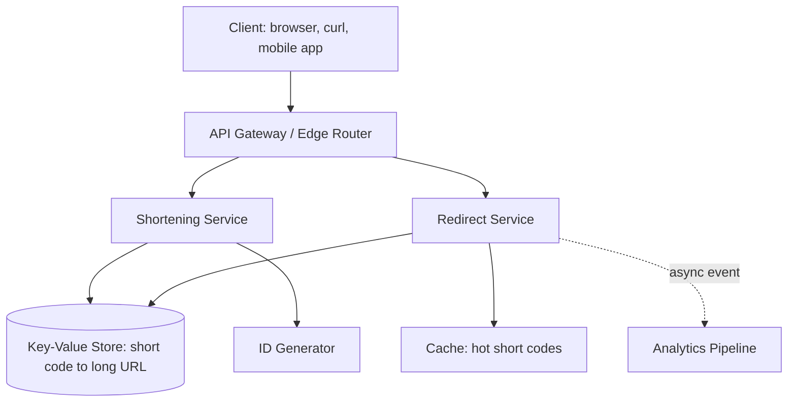
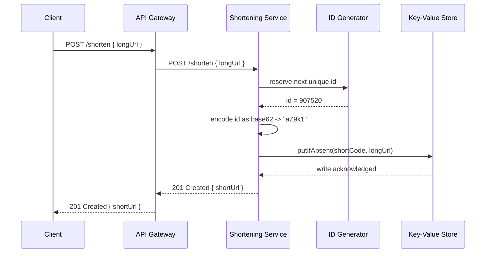
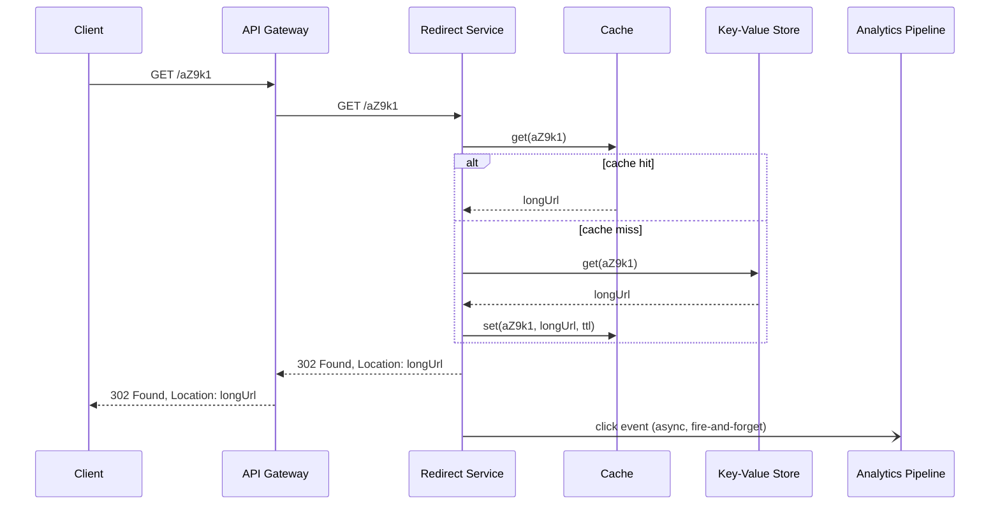
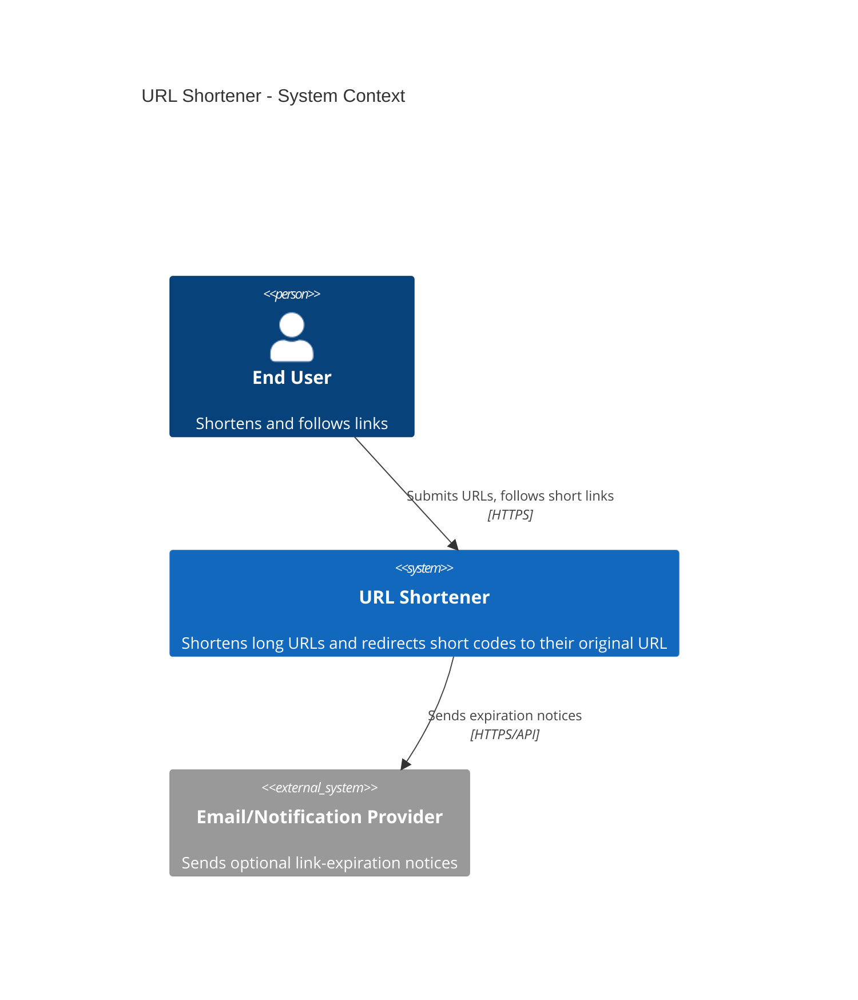
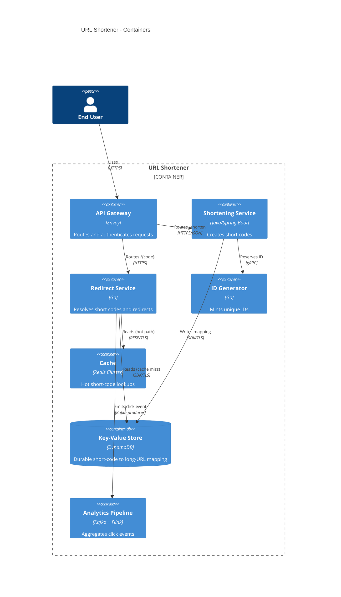
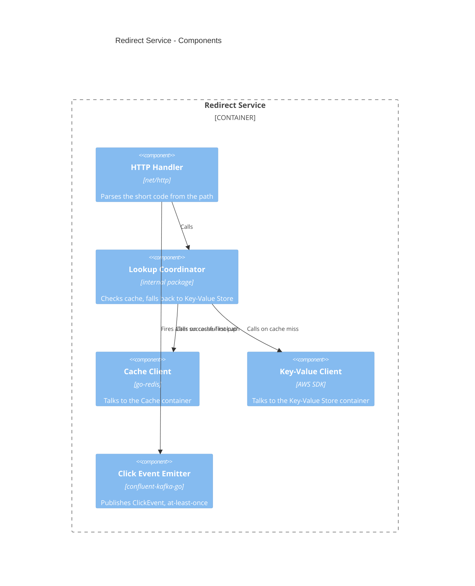
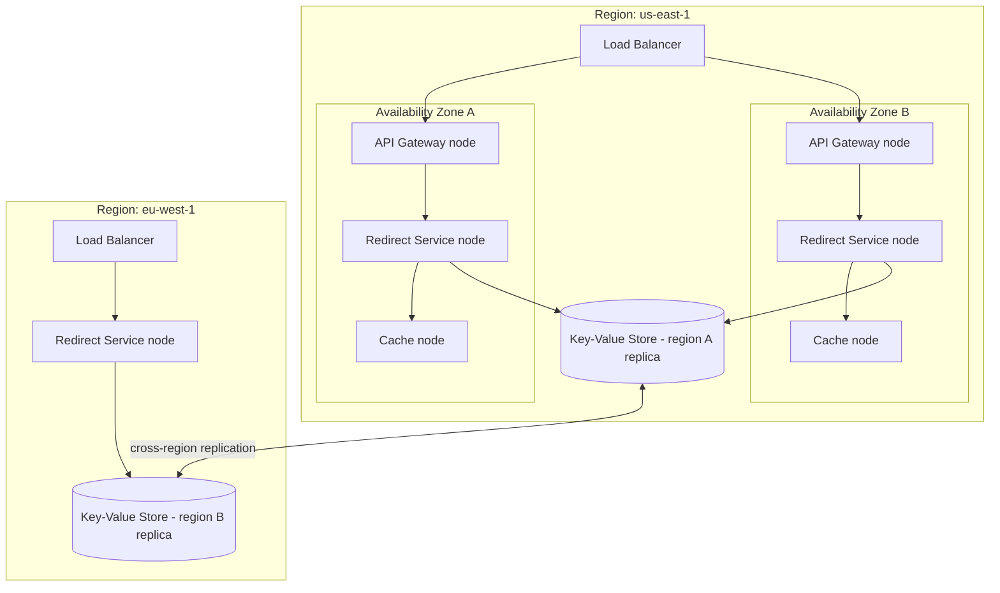

# Worked Example — High-Level Design (HLD) Walkthrough: A URL Shortener

This artifact is the fully worked example referenced from
[CH03_High_Level_Design.md](../../../07_System_Design_and_Distributed_Systems/CH03_High_Level_Design.md)
Section 10. It walks a single system — a URL shortener, in the shape of
`bit.ly`/`tinyurl.com` — through every stage of the High-Level Design (HLD)
workflow taught in that chapter's Section 4: component identification,
boundary/responsibility definition, data-flow and storage-choice mapping,
API/contract definition, and bottleneck/single-point-of-failure (SPOF)
identification. It also produces the C4-model diagram set (Context,
Container, Component) and the UML diagrams (deployment, sequence) that same
chapter teaches how to read and produce.

Assume the Functional Requirements (FR) and Non-Functional Requirements (NFR)
below were already produced by the FR/NFR discipline covered in this book's
CH01_Functional_Requirements.md and CH02_Non_Functional_Requirements.md
(both being authored in the same batch as this chapter; treat their content
as a given input here, not something this artifact re-derives).

## Assumed inputs (from Functional/Non-Functional Requirements)

**Functional requirements (abridged):**

- A user submits a long URL and receives a short URL (for example,
  `https://short.ly/aZ9k1`).
- Visiting the short URL redirects the browser to the original long URL.
- A user may optionally choose a custom alias instead of a generated code.
- Short URLs may have an optional expiration date.
- Basic click analytics (count, and coarse-grained referrer/geography) are
  tracked per short URL.

**Non-functional requirements (abridged):**

- Read (redirect) traffic dominates write (shorten) traffic by roughly
  100:1 to 1000:1 — typical of link-shortening workloads.
- Redirect latency must stay under 100 ms at the 99th percentile (p99),
  because the redirect sits directly in a user's click path.
- The system must tolerate a single data-center failure without losing
  previously created short URLs.
- Short codes must not collide: two different long URLs must never
  resolve from the same short code.
- Target scale: 500 million new short URLs per month, 50 billion redirects
  per month.

## Step 1 — Component/service identification

Reading the functional requirements as verbs applied to nouns ("submit a
URL," "redirect a request," "track a click") surfaces five candidate
components, deliberately drawn at container granularity, not class
granularity:



Each arrow above is a *candidate* dependency, not yet a committed contract —
that commitment happens in Step 4.

## Step 2 — Boundary and responsibility definition

| Component | Owns | Does NOT own | Rationale |
|---|---|---|---|
| Shortening Service | Validating submitted URLs, generating/reserving a short code, persisting the mapping | Serving redirects, click analytics | Write-path logic is small and independent of the much higher-volume read path — splitting lets each scale on its own axis |
| Redirect Service | Looking up a short code, issuing the HTTP redirect, emitting a click event | Generating short codes, running analytics aggregation | Isolates the latency-critical p99-under-100ms path from anything that could add write-path or analytics-path latency |
| ID Generator | Producing globally unique, collision-free identifiers for new short codes | Persisting the code-to-URL mapping | Making uniqueness a dedicated concern lets it be swapped (counter-based, Snowflake-style, or hash-based) without touching the Shortening Service |
| Key-Value Store | Durable, primary-copy storage of the short-code-to-long-URL mapping | Caching hot reads | Durability and read-latency optimization have different failure and scaling profiles; conflating them would force one storage engine to satisfy two different NFRs |
| Cache | Serving the hot subset of redirects with sub-millisecond lookups | Being the system of record | A cache miss must always be safely resolvable from the Key-Value Store; the cache is explicitly disposable |
| Analytics Pipeline | Asynchronous aggregation of click events into reportable metrics | Anything on the synchronous redirect path | Decoupling analytics from the redirect path means an analytics outage cannot degrade p99 redirect latency |

## Step 3 — Data flow and storage-choice mapping

**Write path (shorten a URL):**



**Read path (redirect):**



**Storage-choice rationale:** the write path needs strong uniqueness
guarantees on a single key (the short code) at moderate write volume — a
key-value store with conditional-write (`putIfAbsent`) support satisfies this
without needing a full relational schema. The read path needs sub-100ms p99
lookups at very high volume — an in-memory cache in front of the same
key-value store absorbs the overwhelming majority of reads, since link
popularity is famously power-law distributed (a small number of links
receive most of the clicks).

## Step 4 — API/contract definition between components

```
POST /v1/shorten
  Request:  { "longUrl": string, "customAlias": string?, "expiresAt": string? }
  Response: 201 { "shortUrl": string, "shortCode": string, "expiresAt": string? }
  Errors:   400 invalid longUrl, 409 customAlias already taken

GET /{shortCode}
  Response: 302 Found, Location: <longUrl>
  Errors:   404 unknown or expired shortCode

Internal contract — Shortening Service to ID Generator:
  reserveId() -> uint64, monotonically unique, no coordination with caller required

Internal contract — Redirect Service to Analytics Pipeline (event, not RPC):
  ClickEvent { shortCode, timestampUtc, refererHost?, countryCode? }
  Delivery semantics: at-least-once, consumer must de-duplicate
```

Committing these as explicit contracts (rather than leaving them implicit in
each service's code) is what lets the Shortening Service, Redirect Service,
ID Generator, and Analytics Pipeline be built, deployed, and evolved by
different teams without a synchronized release.

## Step 5 — Bottleneck and single-point-of-failure (SPOF) identification

| Candidate bottleneck/SPOF | Why it matters | Mitigation committed at HLD stage |
|---|---|---|
| Single ID Generator instance | Every shorten request depends on it; a naive single-counter design is both a throughput ceiling and a SPOF | Partition ID generation (for example, a Snowflake-style scheme: timestamp + worker-id + sequence) so multiple instances mint unique IDs without coordination |
| Cache node failure | A cold cache after a failover could send 100% of the read path to the Key-Value Store simultaneously ("thundering herd") | Cache cluster with consistent hashing across multiple nodes so any single node's failure only cold-starts a fraction of the keyspace |
| Key-Value Store as single region | A single data-center failure would make every short URL unresolvable, violating the stated NFR | Multi-region replication of the Key-Value Store (cross-references the book's Replication chapter for the underlying replication mechanics) |
| Analytics Pipeline backlog | A slow or down analytics consumer must never propagate backpressure onto the synchronous redirect path | Asynchronous, fire-and-forget event emission (already reflected in the Step 3 sequence diagram) with its own independently scaled queue/consumer group |

## C4 model diagrams

**Level 1 — System Context:**



**Level 2 — Containers:**



**Level 3 — Components (inside the Redirect Service container):**



## UML deployment diagram



## Example ADR excerpt (recap only — full ADR mechanics owned elsewhere)

This artifact records only the decision *outcome*, since the full
Architecture Decision Record (ADR) template, structure, and worked example
are owned by
[Architecture Thinking](../../../01_Architecture_Mindset/CH03_Architecture_Thinking.md)
Section 10:

> **ADR-002: Encode short codes with base62 over a monotonic ID, not a hash
> of the long URL.** Hashing the long URL (for example, an MD5 prefix) risks
> collisions between two different long URLs sharing a truncated hash and
> requires a collision-check read before every write, adding latency to the
> write path. A monotonic ID from a partitioned ID Generator, base62-encoded,
> is collision-free by construction and needs no pre-write existence check.
> Trade-off accepted: encoded IDs are sequential-ish and could reveal
> approximate creation order or volume if not additionally obfuscated; judged
> acceptable for this system's threat model.

## How this artifact maps back to the chapter

| Chapter section | What it references from this file |
|---|---|
| 4.9-4.13 (HLD workflow subsections) | Steps 1-5 above, in the same order |
| 4.2-4.5 (C4 model) | The three C4 diagrams above |
| 4.6-4.8 (UML in HLD) | The deployment diagram and both sequence diagrams above |
| 4.14 (Communicating HLD to stakeholders) | The ADR excerpt above |
| 10 (Complete Code Examples) | This entire file |
